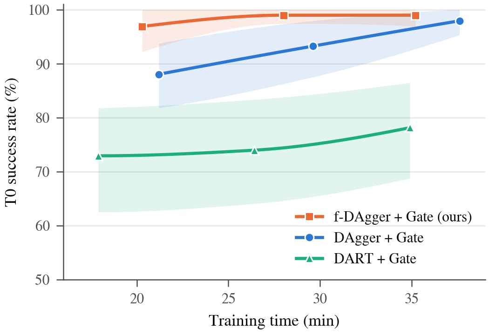

# f-DAgger: behaviour cloning for a mobile manipulator (COMP0245 final project)

A Robotnik mobile manipulator (7-DoF arm on a four-wheel base, PyBullet) must drive to a 3-D target, place its end effector **within 10 mm** of it and **hold for 3 s**. We replace the course's expert controller with a learned policy: a **141k-parameter MLP** that maps the current robot state and the target to **7 arm torques and 2 wheel speeds at 1 kHz**. There is no controller, planner or expert in the loop at run time.

**What we built**

1. **A memoryless (Markovian) expert** derived from the course template controller, so every state can be labelled on demand: a requirement for DAgger and DART ([report/01](final/robotnik_arm_task/report/01_markovian_expert/README.md)).
2. **Deployable features**: robot-frame target geometry, forward-kinematics task error and an explicit **reach gate** input (22 inputs) ([report/03](final/robotnik_arm_task/report/03_feature_engineering/README.md)).
3. **BC + damping-Jacobian loss**: a Huber action loss plus a Sobolev-style term that teaches the expert's velocity feedback ([report/05](final/robotnik_arm_task/report/05_training_details/README.md)).
4. **f-DAgger**: expert demonstrations with phase-gated Ornstein–Uhlenbeck (OU) action noise first, then DAgger rounds ([report/04](final/robotnik_arm_task/report/04_f_dagger/README.md)).
5. **A frozen 240-scene test suite** (in-range, far, near, height edges, shifted starts, 20 s hold), plus robustness, network-size and training-time studies ([report/06–10](final/robotnik_arm_task/report/README.md)).

**Results** (3 training seeds per row; unified-test success = error < 10 mm continuously for 3 s):

| Row | Method | Inputs | Validation hold (32 scenes × 3) | T0 test, 64 in-range scenes | All 240 test scenes |
|---|---|---:|---:|---:|---:|
| R1 | Baseline (BC + J) | 21 | 1/96 | 2.1% | 1.1% |
| R2 | Baseline + Gate | 22 | 10/96 | 20.8% | 8.3% |
| R3 | OU | 21 | 1/96 | 1.6% | 4.6% |
| R4 | OU + Gate (= f-DAgger round 0) | 22 | 83/96 | 96.9% | **81.2%** |
| R5 | DAgger | 21 | 85/96 | 96.4% | 80.0% |
| R6 | DAgger + Gate | 22 | 82/96 | 91.7% | 76.7% |
| R7 | f-DAgger | 21 | 85/96 | 96.4% | 67.6% |
| **R8** | **f-DAgger + Gate (ours)** | 22 | **89/96** | **97.9%** | 70.0% |
| R9 | DART + Gate (Laskey et al. 2017, α = 6) | 22 | 62/96 | 78.1% | 39.4% |
| – | Expert A (teacher) | – | – | 100% | 97.5% |

<p align="center"></p>

- **The gate and the OU noise are both needed:** either one alone leaves the arm unable to settle at the target (R1–R3: at most 21% on T0). With both, R4 reaches 96.9% after only 12.5 min of total pipeline time.
- **f-DAgger + Gate gives the best in-range point estimates** (validation 89/96, T0 97.9%). DAgger + Gate needs three rounds and 33.5 min to reach 91.7%; full DART + Gate reaches 78.1% in 34.9 min. The R4–R8 differences on in-range scenes are not statistically significant ([report/06](final/robotnik_arm_task/report/06_ablation/README.md)).
- **Limitation:** DAgger labels only states the student visits, so R8 loses far-target navigation (T1 > 6 m). Over all 240 scenes R4 (81.2%) beats R8 (70.0%).

Sources: [`report/06_ablation/tables/`](final/robotnik_arm_task/report/06_ablation/tables/) and [`report/07_training_time_comparison/tables/`](final/robotnik_arm_task/report/07_training_time_comparison/tables/).

---

## 1. Quick start (about 10 minutes, no training)

```bash
git clone https://github.com/Yilin-1001/COMP0245-Robotnik-BC.git
cd COMP0245-Robotnik-BC

# Simulator (course RoboEnv at the pinned commit) and Python 3.10 environment
git clone https://github.com/VModugno/RoboEnv.git
git -C RoboEnv checkout 7bb49439677c2ac111347b40e997025ce87bff50
git -C RoboEnv submodule update --init
uv venv --python 3.10 .venv && source .venv/bin/activate
uv pip install torch==2.11.0 --index-url https://download.pytorch.org/whl/cpu
uv pip install -e RoboEnv -r requirements-dev.txt

cd final/robotnik_arm_task
python tools/fetch_release.py        # download, SHA-256-check and unpack the weights (56 MiB)
python tools/verify_release.py       # load all 27 models in PyTorch, compare with the NumPy exports

# Expert and f-DAgger + Gate side by side in two PyBullet windows
python -m evaluation.live_compare --protocol checkpoints/2026-11-05final/demo_models.yaml \
    --row R8-f-DAgger-Gate --seed 0 --scenario train-0186
```

Sections 3–6 explain each step. Section 2 lists what every folder contains.

## 2. Repository structure

The **repository root** holds this README and the requirements files. The **task directory** `final/robotnik_arm_task/` holds the project code. **Run all project commands from the task directory** (Bash on Linux or WSL2).

```text
<repository root>/
├── README.md                     # this guide
├── requirements.txt              # pinned runtime dependencies (Python 3.10)
├── requirements-dev.txt          # + pytest
├── pytest.ini, tests/            # 290+ unit, simulator and data tests (run from the root)
├── RoboEnv/                      # course simulator: cloned by you (git-ignored)
├── docs/                         # pipeline guide, test-suite protocol, naming, dated design notes and reports
└── final/robotnik_arm_task/      # TASK DIRECTORY
    ├── robotnik_arm_task.py, robotnik_arm_control.py   # course template (unchanged)
    ├── settings.yaml             # task settings shared by every module
    ├── configs/, models/         # simulator config and robot URDF/meshes (course assets)
    ├── core/                     # environment wrapper, observation/action interfaces, features, reach gate, model names
    ├── data_collection/          # Markovian expert A, template teacher B, scenario sampling, clean / OU / DAgger / DART collectors, QA
    ├── training/                 # dataset builder, normalisation, MLP and gated MLP, Huber + Jacobian loss, training engine, policies
    ├── evaluation/               # validation, unified test suite, live comparison, robustness / far / hold probes, plots
    ├── experiments/              # training recipes (configs/), ablation and DAgger/DART runners, frozen splits, demo manifests
    ├── tools/                    # fetch_release.py, verify_release.py, package_release.py, checkpoint export, data helpers
    ├── report/                   # evidence for every report section: figures, tables, data and code (01–10), LaTeX in paper/
    ├── results/                  # experiment summaries behind the reported numbers (per-rollout files stay local)
    ├── checkpoints/2026-11-05final/  # submitted models: index files in Git, weights from the release (section 3)
    └── data/                     # demonstrations and feature datasets (not shipped, rebuilt by section 7)
```

| Folder | What you will find |
|---|---|
| `report/01_markovian_expert` | Why the expert must be memoryless; expert A vs the template controller |
| `report/02_data_collection` | Scenario sampling (scrambled Sobol), coverage, fixed seeds |
| `report/03_feature_engineering` | 21/22 inputs, FK accuracy, reach gate, shared train/inference features |
| `report/04_f_dagger` | f-DAgger algorithm (LaTeX pseudocode), OU noise parameter selection |
| `report/05_training_details` | Recipe (AdamW, warm-up + cosine, 42k updates), BC vs BC + Jacobian, training curves |
| `report/06_ablation` | R1–R8 ablation: validation, per-suite test, statistics (bootstrap, Holm) |
| `report/07_training_time_comparison` | Training time vs success for f-DAgger, DAgger and full DART |
| `report/08_dev_scene_removal` | Why the R5–R8 DAgger rounds use only the 221 fitting scenes (v3) |
| `report/09_network_size` | Hidden widths 32–256 for f-DAgger + Gate and OU + Gate |
| `report/10_robustness` | Friction, link mass, sensor noise and pushes on R4–R8 and the expert |

Each report folder's `README.md` explains its figures, tables, data and code. Dated files in `docs/` keep their historical context. For submitted models, follow this README and the release manifest.

**Not in Git:** `RoboEnv/` (clone it), model weights (GitHub Release, section 4), `data/` (about 128 GB of demonstrations and datasets, rebuilt by section 8), per-rollout result files, LaTeX build output, robot meshes that the URDFs do not load, and retired experiments (`Archive/`, kept locally; paths to it in documents are provenance only).

## 3. Installation

Use **Python 3.10** and **uv**. Native Windows is unsupported because the project uses `fcntl`; use WSL2. The graphical live comparison needs a desktop or WSLg. CPU is enough for inference and training.

From the repository root:

```bash
git clone https://github.com/VModugno/RoboEnv.git                        # skip if RoboEnv/ already exists
git -C RoboEnv checkout 7bb49439677c2ac111347b40e997025ce87bff50
git -C RoboEnv submodule update --init                                  # required: simulation_and_control is a submodule

uv venv --python 3.10 .venv
source .venv/bin/activate
uv pip install torch==2.11.0 --index-url https://download.pytorch.org/whl/cpu   # NVIDIA CUDA 12.8: use /cu128
uv pip install -e RoboEnv -r requirements-dev.txt

cd final/robotnik_arm_task
```

On minimal Ubuntu/WSL2, install `libgomp1` if Pinocchio reports a missing OpenMP runtime (`sudo apt install libgomp1`). In each new terminal, run `source .venv/bin/activate` from the repository root, then `cd final/robotnik_arm_task`.

Optional check from the repository root: `python -m pytest tests -m "not sim and not realdata"` (fast), then `python -m pytest tests -m sim` (simulator). The `realdata` tests need the original datasets.

## 4. Download the trained weights

Weights are not stored in Git. They are attached to the GitHub Release [**v1.0-submission**](https://github.com/Yilin-1001/COMP0245-Robotnik-BC/releases/tag/v1.0-submission):

| Asset | Size | Contents |
|---|---:|---|
| `robotnik-bc-checkpoints-2026-11-05final.zip` | 55 MiB | `checkpoints/2026-11-05final/`: 27 final models (R1–R9 × seeds 0–2) and 22 round-history models. Each has a `.pt` PyTorch checkpoint, a `.npz` NumPy export, the normaliser, `config.yaml`, metrics and provenance |
| `robotnik-bc-test-inventory-2026-11-05.zip` | 1 MiB | Scenario CSVs and dataset `metadata.json` files that the unified test reads to prove that no test scene was used in training (no training arrays) |
| `robotnik-bc-small-net-2026-11-05.zip` | 0.7 MiB | Optional: 9 small-width models for `report/09_network_size` |
| `SHA256SUMS.txt` | | SHA-256 of the three zips |

From the task directory:

```bash
python tools/fetch_release.py                    # checkpoints + test inventory
python tools/fetch_release.py --with-small-net   # also the width-study models
```

The script checks each zip's SHA-256 before unpacking into the task directory, then checks all 347 release files against `checkpoints/2026-11-05final/SHA256SUMS`. Did you download the zips in a browser instead? Put them in one folder and run `python tools/fetch_release.py --from-dir <folder>`. Manual equivalent: `unzip <zip> -d final/robotnik_arm_task`.

### Check the weights in PyTorch

```bash
python tools/verify_release.py          # 27 final models; --all adds the 22 round-history models
```

For every model the script loads the `.pt` with plain `torch.load(..., weights_only=True)` and rebuilds the network with `load_state_dict(strict=True)`. It then predicts 256 probe states and compares the result with the `.npz` NumPy export that the live demo uses. Expected output: `27/27 models passed`, 141,065 (21 inputs) or 141,321 (22 inputs) parameters, |PyTorch − NumPy| ≤ 5e-4 (float32 vs float64), and about 0.05 ms per CPU forward pass.

Use a checkpoint in your own PyTorch code:

```python
import torch
from training.common.models import model_from_spec          # run from final/robotnik_arm_task

ckpt = torch.load("checkpoints/2026-11-05final/models/R8-f-DAgger-Gate/seed-0/"
                  "R8-f-DAgger-Gate-r3__MLP01-256x3__s0__v3__2026-11-05.pt", weights_only=True)
net = model_from_spec(ckpt["meta"]["model"]); net.load_state_dict(ckpt["model_state"]); net.eval()
n = {k: torch.tensor(ckpt["normaliser"][k]) for k in ("x_mean", "x_scale", "y_mean", "y_scale")}
print(ckpt["meta"]["feature_names"])                          # the 22 inputs, in order
x = n["x_mean"][None]                                         # one feature vector (here: the training mean)
y = net((x - n["x_mean"]) / n["x_scale"]) * n["y_scale"] + n["y_mean"]   # 7 torques [N·m], right/left wheel [rad/s]
```

Closed-loop use computes features from the simulator observation with `training.common.policies.MLPPolicy` (`MLPPolicy.load(path, backend="torch")` for `.pt`, `backend="numpy"` for `.npz`). Torques are clipped to ±30 N·m and wheel speeds to ±6 rad/s, and the right/left wheel speeds expand to the 4 wheel commands `[R, L, L, R]`.

## 5. Models and seeds

The release contains **27 final models**: R1–R9 × training seeds 0, 1, 2, all at terminal update 42,000. The network is `MLP01`: three 256-unit hidden layers (Linear → LayerNorm → SiLU) with a 7-torque head and a 2-wheel head. Gate rows add the `reach_gate` input (22 inputs). The other rows have 21.

| Row | Report name | `--row` value | Inputs | Released round |
|---|---|---|---:|---:|
| R1 | Baseline | `R1-Baseline` | 21 | 0 |
| R2 | Baseline + Gate | `R2-Baseline-Gate` | 22 | 0 |
| R3 | OU | `R3-OU` | 21 | 0 |
| R4 | OU + Gate | `R4-OU-Gate` | 22 | 0 |
| R5 | DAgger | `R5-DAgger` | 21 | 3 |
| R6 | DAgger + Gate | `R6-DAgger-Gate` | 22 | 3 |
| R7 | f-DAgger | `R7-f-DAgger` | 21 | 3 |
| R8 | f-DAgger + Gate (ours) | `R8-f-DAgger-Gate` | 22 | 3 |
| R9 | DART + Gate | `R9-DART-Gate` | 22 | 3 (noise scale 6) |

R3/R4 use fixed phase-gated OU perturbations; R7/R8 add DAgger to those data. R9 uses learner-fitted Gaussian DART. **The historical `dart` strings in R3/R4/R7/R8 run ids mean OU, not full DART.** "Gate" means the extra input, independent of the phase gate used when injecting OU noise.

**Seeds.** `seed-0`, `seed-1` and `seed-2` are three separately trained repetitions of the same recipe (network initialisation, batch sampling and Jacobian-loss sampling). A larger seed is neither a stronger model nor a harder task. For DAgger and DART, seed 0 drives the collection chain; seeds 1/2 retrain on the selected round's aggregated data. Scenario and noise seeds are separate from model seeds.

Files live in `checkpoints/2026-11-05final/models/<row>/seed-<N>/`, e.g. `R8-f-DAgger-Gate-r3__MLP01-256x3__s0__v3__2026-11-05.{pt,npz}`: round `r3`, architecture `MLP01-256x3`, seed `s0`, training version `v3` (R1–R4 `v1`, R9 `v2`), training date. The [model index](final/robotnik_arm_task/checkpoints/2026-11-05final/model_index.csv) maps every file to its source run and SHA-256. See also the [release README](final/robotnik_arm_task/checkpoints/2026-11-05final/README.md) and [naming reference](docs/model-naming.md).

## 6. Live comparison: expert vs a submitted model

```bash
RELEASE=checkpoints/2026-11-05final
ROW=R8-f-DAgger-Gate      # any --row value from section 5
SEED=0                    # 0, 1 or 2

python -m evaluation.live_compare \
    --protocol "$RELEASE/demo_models.yaml" \
    --teacher A --objective bcj --row "$ROW" --seed "$SEED" \
    --scenario train-0186 \
    --output "results/live_compare/${ROW}-s${SEED}-train-0186.json"
```

Two PyBullet windows open: **EXPERT A** and the **chosen student**. Both start from the same scenario and state and stay synchronised every 20 physics steps. The student controls both base and arm. Overlays show the model and seed, simulation time, end-effector error (mm), torques and wheel speeds. The program checks the weight file's hash before starting. To switch models, quit and rerun with a different `ROW` or `SEED`. Explicit `--protocol` selects the submitted release. This release contains teacher A / objective `bcj` only.

| Key (focus either window) | Action |
|---|---|
| Space | Pause/resume both simulations |
| R | Reset/replay both from the same initial state |
| F | Toggle follow camera in the focused window |
| Q | Close both and save the summary JSON |

There is no time limit by default. `--seconds 40` freezes both at 40 simulated seconds. `--speed 2` doubles the playback speed while keeping 1 kHz physics. The JSON is written on exit and overwritten on rerun with the same `--output`.

**Mouse-drag disturbances.** At `--speed 1` with no `--seconds`, focus the student's window (press F to fix the camera), then hold the left mouse button on a solid part of the robot (base or arm link), drag a short distance and release. No Ctrl/Alt: those keys move the camera. Watch whether the EE error returns below 10 mm without persistent oscillation or drift. Press R before the next trial. Only the window you drag is disturbed, and you can drag the expert for comparison. This is a qualitative check: forces are not recorded or calibrated. Measured robustness numbers are in [`report/10_robustness`](final/robotnik_arm_task/report/10_robustness/README.md).

**Scenes.** `--scenario` accepts any of the 32 frozen validation scenes. Their `train-…` IDs are historical names; the scenes are held out from fitting. List them with:

```bash
python -c "from evaluation.test_sets import get_split; from pathlib import Path; [print(s.scenario_id) for s in get_split('validation', Path('experiments/splits/clean253.json'), 'A')]"
```

Custom scene (world frame, metres; bearing is yaw in radians; training ranges: target 0.5–3.0 m away, height 0.1–1.25 m, start within ±0.5 m):

```bash
python -m evaluation.live_compare --protocol "$RELEASE/demo_models.yaml" --row "$ROW" --seed "$SEED" \
    --scenario train-0186 --target 2.0 0.5 0.7 --start 0.0 0.0 --bearing 0.0 \
    --seconds 40 --output "results/live_compare/${ROW}-s${SEED}-custom.json"
```

**No display:** add `--headless --seconds 0.1` for a 100-step installation check. Each JSON `runs` entry should have `failure: null`.

## 7. Validate and test the submitted models

Resolve the model file for `ROW`/`SEED` from the release manifest:

```bash
MODEL=$(python - "$RELEASE/demo_models.yaml" "$ROW" "$SEED" <<'PY'
import sys, yaml
artifacts = yaml.safe_load(open(sys.argv[1]))["decisions"]["final"]["artifacts"]
matches = [a for a in artifacts if a["row"] == sys.argv[2] and a["seed"] == int(sys.argv[3])]
assert len(matches) == 1, "Choose a listed row and seed 0/1/2"
print(matches[0]["inference"])
PY
)
printf '%s\n' "$MODEL"
```

### Validation: 32 held-out scenes

```bash
# NumPy export (.npz), the same path as the live demo
python -m evaluation.evaluate --policy mlp --artifact "$MODEL" --split validation --workers 4
# or the same model through PyTorch (.pt)
python -m evaluation.evaluate --policy mlp --artifact "${MODEL%.npz}.pt" --backend torch --split validation --workers 4
```

The evaluator prints success and error statistics and writes CSVs under `results/ablation/A/bcj/<run_id>/`. Validation success means reaching < 10 mm after 8 s, running 3 s more, and staying < 10 mm for the whole last second (40 s cap). Per-scene detail files are never overwritten, and both commands write the same file. Before the second command, or before repeating one, delete `results/ablation/A/bcj/<run_id>/`; otherwise the run fails at the end. Check: R8 seed 0 holds 29/32 with either backend, as in `report/06_ablation/tables/validation.csv`.

### Unified test: 240 frozen scenes

`tools/fetch_release.py` already installed the scenario inventory this needs. Use the frozen-test wrapper. It re-audits the current inventories against the frozen manifest (identical scenes, zero training/test overlap), then runs `evaluation.test_suite`:

```bash
# Selected model + expert on the 64 original test scenes (T0): 128 rollouts
python report/07_training_time_comparison/code/test_suite_frozen.py --models "$MODEL" --suites T0 --workers 4

# Selected model + expert on all 240 scenes (T0–T5)
python report/07_training_time_comparison/code/test_suite_frozen.py --models "$MODEL" --workers 4

# All 27 submitted models + expert on all 240 scenes: 6,720 rollouts (hours)
mapfile -t MODELS < <(python -c "import yaml; [print(a['inference']) for a in yaml.safe_load(open('checkpoints/2026-11-05final/demo_models.yaml'))['decisions']['final']['artifacts']]")
python report/07_training_time_comparison/code/test_suite_frozen.py --models "${MODELS[@]}" --workers 4
```

Add `--dry-run` to check the setup without running rollouts. Each run writes `results/test/<datetime>__<name>/`: `summary.md`/`summary.csv` (aggregates), `rollouts.csv` (every rollout), `plots/` and `run.json` (model/config hashes). Resume or replot with `python -m evaluation.test_suite --resume <dir>` or `--plots-only <dir>`.

| Suite | Scenes | Purpose |
|---|---:|---|
| T0 | 64 | Original in-range test scenes |
| T1 | 72 | Far targets: 3–6, 6–10, 10–15 m |
| T2 | 24 | Near targets: 0.3–0.5 m |
| T3 | 32 | Height edges: 0.05–0.1, 1.25–1.30 m |
| T4 | 24 | T0 scenes translated to shifted starting positions |
| T5 | 24 | New in-range scenes, 20 s continuous hold |

Unified-test success means error strictly < 10 mm continuously for 3 s (20 s in T5), counted from t = 0. Final precision uses the maximum error in the last second. The [test protocol](docs/2026-11-01__guide__unified-test-suite.md) covers timings, precision grades and resume checks.

## 8. Reproduce the data and training pipeline

Use a fresh working copy: existing datasets and run ids cause overwrite refusals or skipped work. Keep the frozen splits unchanged. Fresh training may differ numerically across machines. Sections 6–7 need only the released weights.

```text
Frozen Sobol scenarios → expert A trajectories → QA → Clean_253 split (221 fitting / 32 validation; 64 test separate)
        + OU-perturbed expert trajectories → feature datasets → BC + Jacobian training (R1–R4)
        → DAgger rounds: student rollouts relabelled by expert A, aggregated, retrained (R5–R8)
        → full DART comparison (R9) → frozen release → live comparison / unified tests
```

### Step 1: clean demonstrations and subsets

```bash
python -m data_collection.scenarios
python -m data_collection.collect --teachers markovian stateful --workers 4
python -m data_collection.qa_clean --teachers markovian stateful --workers 4
python -m data_collection.build_clean_subsets
```

Outputs: scenario CSVs in `data/scenarios/`, trajectories and QA in `data/Markovian/` and `data/Stateful/`, and the paired `Clean_253`/`Clean_223` subsets. Teacher A (Markovian) trains the students. Teacher B is collected because the paired builder checks both teachers. If local B episodes differ and the builder refuses, run `python tools/build_a_clean253.py` to build A's subset alone against the frozen split. These steps refuse to overwrite: do not unpack the test-inventory zip into a copy you use for collection.

### Step 2: OU-perturbed demonstrations and feature datasets

```bash
# Historical module/protocol names say dart; this is the fixed OU collection.
python -m data_collection.collect_dart --protocol experiments/configs/dart/d2-s075-x2.yaml --workers 4

OU_DIR=$(python -c "from pathlib import Path; p=list(Path('data/Markovian/DART').glob('*__collection__d2-s075-x2-*')); assert len(p)==1, 'set OU_DIR manually'; print(p[0])")
for FEATURES in features-v1 features-v1-gate; do
    python -m training.datasets.build --source clean253 --features "$FEATURES" --workers 4
    python -m training.datasets.build --source "$OU_DIR" --name dart-d2s075x2 --features "$FEATURES" --workers 4
done
```

Outputs: `data/datasets/A/{clean253,dart-d2s075x2}__{features-v1,features-v1-gate}/`. The OU dataset holds 441 accepted trajectories (221 fitting scenes × 2 draws). The [reproduction reference](docs/2026-10-29__guide__reproduction-details.md#reproduction-and-data-handoff) lists the exact files.

### Step 3: train R1–R4

```bash
# One model (R4, seed 0)
python -m training.datasets.train --variant R4-dart-gate \
    --set identity.version=v1 --set identity.date=2026-10-28 --set identity.seed=0 \
    --set identity.objective=bcj --set training.lr=1.0e-3 --set training.updates=42000 \
    --set loss.action=huber --set loss.arm_weight=0.5 --set loss.wheel_weight=0.5

# All four rows × seeds 0/1/2
python -m experiments.ablation.run --manifest experiments/ablation/2026-10-28__training-ablation-v1.yaml --stage train --parallel 1
```

`--dry-run` checks data and calibration without optimising; `--resume` continues from training resume states. Outputs: `checkpoints/ablation/2026-10-28__training-ablation-v1/<run_id>/`. The historical run ids are deliberate, because the round runners below expect them.

### Step 4: DAgger rounds (R5–R8)

R5 ← R1, R6 ← R2, R7 ← R3 and R8 ← R4, each from the seed-0 base model. Every round rolls the student out on the 221 fitting scenes, labels the visited states with expert A, aggregates all rounds, retrains from scratch and validates.

```bash
for ROW in R5-baseline-dagger R6-gate-dagger R7-dart-dagger R8-dart-gate-dagger; do
    python -m experiments.dagger_rounds --row "$ROW" --rounds 3 --date 2026-11-05 --final-seeds 1 2 --workers 4 \
        --version v3 --variant-suffix=-nodev --dev-scenes 0
done
# Optional: seeds 1/2 of rounds 1-2 for R6/R8 (per-round curves in report/07)
python -m experiments.dagger_extra_seeds --date 2026-11-05 --rows R8-dart-gate-dagger R6-gate-dagger \
    --rounds 1 2 --seeds 1 2 --workers 4 --version v3 --variant-suffix=-nodev --source-date 2026-11-05 --dev-scenes 0
```

Write `--variant-suffix=-nodev` with `=`. This is ablation v3, which the submission uses. Without the three v3 options the runner reproduces v2, whose rounds also used 64 development scenes ([report/08](final/robotnik_arm_task/report/08_dev_scene_removal/README.md)). Rounds are selected by seed-0 validation hold, with ties going to the later round. Every submitted R5–R8 model uses round 3. Outputs: `checkpoints/ablation/2026-11-05__training-ablation-v3/` and `results/ablation/2026-11-05__training-ablation-v3/dagger/<row>/`.

### Step 5: full DART (R9)

```bash
python -m experiments.dart_full --date 2026-11-04 --scale 6 --iterations 3 --extra-seeds 1 2 --workers 4
```

Starts from R2 seed 0. Each iteration estimates the learner/expert action-error covariance on held-out demonstrations, collects Gaussian-perturbed expert data, aggregates it and retrains. Outputs: `checkpoints/ablation/2026-11-04__training-ablation-v2/R9-dart-full-a6-r*/` and [`results/ablation/2026-11-04__dart-full/`](final/robotnik_arm_task/results/ablation/2026-11-04__dart-full/README.md).

### Step 6: evaluate new models

Set `MODEL` to the new `.npz` and use section 7. Choose models on validation before testing. Live comparison of retrained weights needs a new demo manifest, because the submitted one pins the original hashes ([reproduction reference](docs/2026-10-29__guide__reproduction-details.md)).

## 9. Troubleshooting

| Symptom | Action |
|---|---|
| `No module named ...` | Activate `.venv`, run from `final/robotnik_arm_task`, install RoboEnv with its submodule |
| `weights not found` / no matching artifact | Run `python tools/fetch_release.py`; use a listed `--row`, seed 0/1/2 and the release `--protocol` |
| `SHA-256 ... differs` | Download again; the zip was truncated or altered |
| Artifact hash differs in live comparison | Restore the original release file; retrained weights need a new manifest |
| No display | Use WSLg or a desktop, or `--headless --seconds 0.1` |
| Output already exists | Use a fresh result folder or working copy; resume unified runs with `--resume` |
| `frozen manifest differs; refusing overwrite` | Use the frozen-test wrapper in section 7 |

Further reading: [report evidence index](final/robotnik_arm_task/report/README.md), [project pipeline](docs/2026-10-30__guide__project-pipeline.md), [documentation index](docs/README.md), [model naming](docs/model-naming.md), [detailed reproduction reference](docs/2026-10-29__guide__reproduction-details.md).

## 10. External code

| Code | Source | Status |
|---|---|---|
| `RoboEnv/`, `simulation_and_control` | COMP0245 course | Used as is |
| `robotnik_arm_task.py`, `robotnik_arm_control.py`, `configs/`, `models/` | COMP0245 final task template | Used as is |
| `data_collection/expert.py` | Based on `robotnik_arm_control.py` | Modified: made Markovian |
| `data_collection/template_teacher.py` | Calls the template's `arm_controller`/`base_controller` unchanged | Project wrapper that reproduces the template setup, verified bit-identical |
| Everything else in `core/`, `data_collection/`, `training/`, `evaluation/`, `experiments/`, `tools/`, `report/` | Written for this project | From scratch |

Python libraries (PyTorch, NumPy, SciPy, PyBullet, Pinocchio, Matplotlib) are used through their public APIs. DAgger (Ross et al. 2011) and DART (Laskey et al. 2017) are reimplemented from their papers. The bibliography is in [`docs/references/`](docs/references/2026-10-26__reference__research-bibliography.md).
