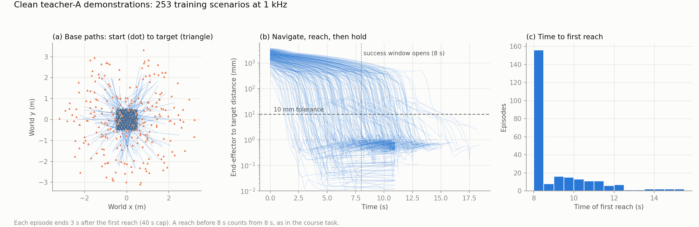
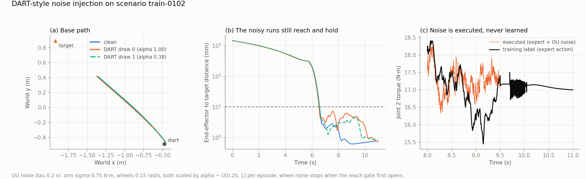
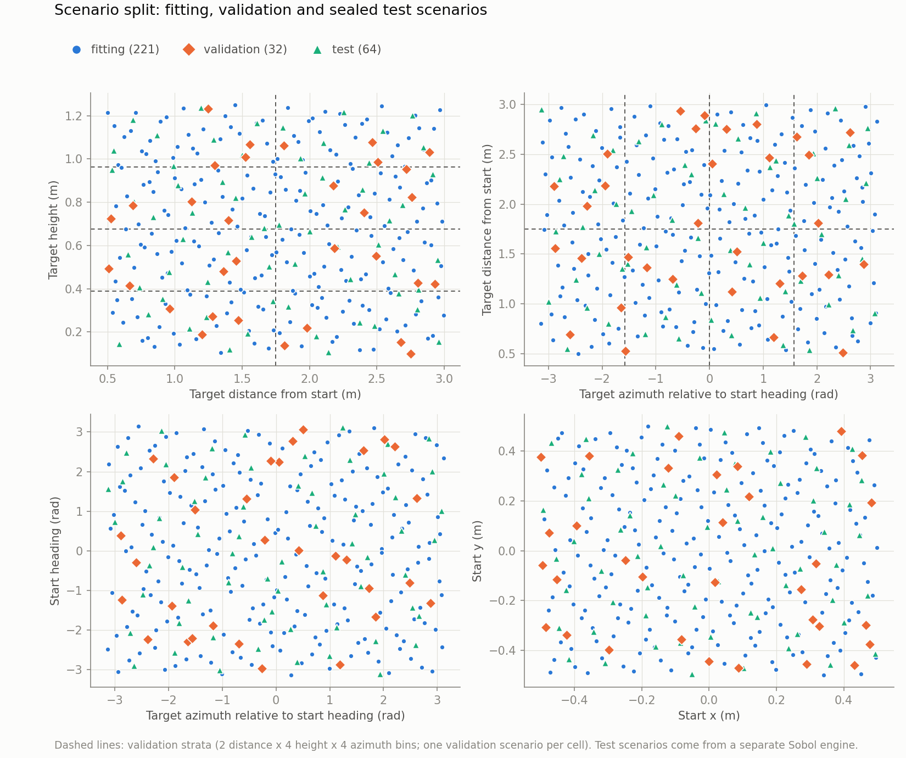
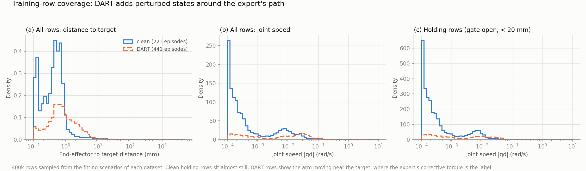
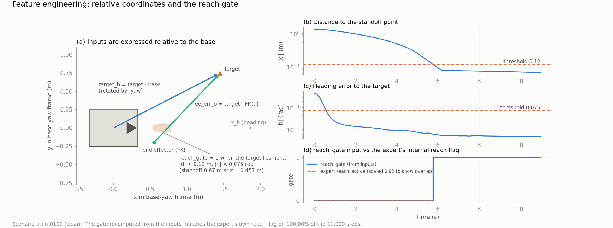

# Project Pipeline: Behaviour Cloning of Teacher A

This document follows the teacher-A pipeline from end to end: the expert, data collection, splits, features, method, training, ablation, test results and the live demo.
Date: 30 October 2026, updated 1 November 2026. Status: covers the **training-method ablation v1** (rows R1–R4) and **v2** (DAgger rows R5–R8, validation only; their test run is still to come). Model `MLP01-256x3`, BC+J objective. The final model is not chosen yet. Earlier versions are in [`Archive/`](../Archive/README.md).

Unless stated otherwise, paths are relative to `final/robotnik_arm_task/` and commands run from that directory.
Installation and a step-by-step reproduction of R4 are in the [project README](../README.md). The figures are generated by `python -m evaluation.plot_pipeline_figures`.

**Task.** A mobile manipulator (4-wheel skid-steer base and 7-DoF arm) must bring its end effector (EE) to a 3-D target. Control and physics both run at 1 kHz.
The policy maps the observation `(base_pos, base_bearing, q_mes, qd_mes, target)` to `torque_arm` (7) and `wheel_cmds` (4).
**Success (sustained hold)** means the EE comes within 10 mm of the target at or after 8 s, stays there for 3 more s, and stays within 10 mm for the whole final second. Each episode is capped at 40 s.

---

## 1. Expert A (Markovian) Design

The course template controller (`robotnik_arm_control.py`) has memory. It integrates a joint reference `q_des`, and its navigation phase is latched. It therefore cannot label an arbitrary state, which DART-style labelling and DAgger relabelling both require.
Expert A (`data_collection/expert.py`) rewrites the template so that its action depends **only on the current observation and the target**.

| Part | Design |
|---|---|
| Base goal | The standoff point on the line from the base to the target. The standoff distance depends on the target height: 0.80 / 0.65 / 0.65 / 0.35 m at z = 0.1 / 0.5 / 1.1 / 1.25 m (interpolated). |
| Base control | Signed distance error `d` and heading error `h`. The base turns in place while `h` is large. It drives at up to 0.25 m/s, with speed fading to zero as `h` approaches 0.3 rad, and with gains k_pos = 1.0 and k_ori = 3.0. It stops within 0.08 m and 0.05 rad. Skid-steer output is `[FR, FL, BL, BR] = [r, l, l, r]`. |
| Reach gate | The arm reaches only while `|d| < 0.12 m` and `|h| < 0.075 rad` (1.5 × the base tolerances). Otherwise it holds the home pose. |
| Arm reference | A Cartesian P command (gain 1.5, ≤ 0.25 m/s) towards the target, clamped to 0.85 m from the shoulder, is solved by damped least-squares IK. Damping rises from 0.01 to 0.10 near singularities, and joints at their limits are frozen. This gives `qd_des` (≤ 1 rad/s). |
| Markovian step | `q_des = q + qd_des · lead_time` with **lead_time = 0.50 s**, instead of the template's integrated reference. |
| Torque | Joint PD `τ = 100 (q_des − q) + 30 (qd_des − qd) + g(q)`, with gravity compensation from Pinocchio, clipped to ±30 N·m. |

Two corrections were needed for a state-only controller. First, PyBullet gives the inertia-less EE link a default mass of 1 kg, so it was added to the Pinocchio model (without it the arm stalls 30–70 mm short). Second, the unobserved base pitch is set to the measured flat-ground value of 0.0022 rad.

**Performance.** The expert holds the target in 320/320 clean episodes (256 training and 64 test scenarios). Its working range is target height 0.1–1.30 m and target distance up to about 9 m within the 40 s cap.
It has no integrator, so constant torque errors above about 1 N·m leave it short of the 10 mm hold. This sets the precision a student must reach.
Because the damping term is exact, `∂τ/∂qd = −30·I` wherever the torque is not clipped. Section 6 uses this as a training target.

---

## 2. Data Collection Design

**Scenarios.** Each scenario is a scrambled Sobol sample (`data_collection/scenarios.py`, settings in `settings.yaml`) in six dimensions, defined in the robot's start frame:

| Dimension | Range |
|---|---|
| Target horizontal distance from the start base | 0.5–3.0 m |
| Target azimuth relative to the start heading | −π to π |
| Target height (world z) | 0.1–1.25 m |
| Start base x, y | −0.5 to 0.5 m each |
| Start base yaw | −π to π |

Training scenarios (256, seed 1026001) and test scenarios (64, seed 1026002) come from **two separate Sobol engines**, so the test set is not a prefix of the training sequence. Physics is nominal.

**Clean demonstrations** (`data_collection/collect.py`, QA in `qa_clean.py`). Expert A drives every scenario at 1 kHz from a fixed home arm pose. Recording continues until 3 s after the first reach (40 s cap).
Each step stores the observation, the expert action (the label), the executed action and simulator truth for diagnostics only. Re-querying the expert reproduces every stored label exactly.
The working set **Clean_253** keeps the 253 training scenarios in which both course teachers succeeded. The 3 dropped scenarios are navigation timeouts of the template controller.



The base paths cover every approach direction. Targets lie 0.5–3 m away, and many are behind the robot, so the robot must turn, drive and then reach. Every episode passes through the same three regimes (navigate, reach, hold), but they start at different times.

**DART-style noise injection** (`data_collection/collect_dart.py`, protocol `experiments/configs/dart/d2-s075-x2.yaml`). The 221 fitting scenarios (Section 3) are recorded again, twice each, with noise added to the **executed** action. The label stays the expert's clean action at the state actually visited.

| Setting | Value |
|---|---|
| Noise process | Ornstein–Uhlenbeck, τ = 0.2 s, independent per action channel, seed 20261028 |
| Scale | Arm σ = 0.75 N·m and wheels σ = 0.15 rad/s, both × α ~ U[0.25, 1] per episode |
| Schedule | Wheel noise stops when the reach gate first opens. All noise stops 1.5 s after the first reach. |
| Result | 442 episodes, **441 sustained holds** |

The noise scale was chosen with a stress test of the expert (`evaluation/expert_noise_robustness.py`). Expert A keeps working under correlated arm noise of 1–2 N·m and recovers the 10 mm hold once the noise stops. Its navigation completes with wheel noise up to 1 rad/s.



---

## 3. Training Set, Validation Set and Test Set Design

| Split | Scenarios | Source | Use |
|---|---|---|---|
| Fitting (training) | 221 | Clean_253 training scenarios | Clean episodes (221, 2.66 M rows) + DART episodes (441, 5.29 M rows) |
| Validation | 32 | Clean_253 training scenarios | Closed-loop model comparison and offline loss. Never collected with noise. |
| Test | 64 | Separate Sobol engine | **Sealed.** Closed-loop evaluation of final models only. |

- The frozen split is versioned in `experiments/splits/clean253.json`.
- Validation is **stratified**: 2 distance × 4 height × 4 azimuth bins, with one validation scenario per cell. The 32 scenarios therefore span the whole scenario space, and no hand-picked easy subset is possible.
- DART data exists only for fitting scenarios (checked when the datasets are built). So no validation or test scenario, and no noisy variant of one, is ever seen in training.



The scenario split covers the task space. The next figure shows the **state** space: DART spreads the training rows around the expert's nominal path. Clean holding rows are almost motionless, while DART holding rows include the arm being pushed and corrected near the target.



Training datasets (`training/datasets/build.py`, under `data/datasets/A/`) are built once per source and feature definition: `{clean253, dart-d2s075x2} × {features-v1, features-v1-gate}`. Each comes with checksums and QA.

---

## 4. Feature Engineering

The inputs contain only information available at deployment: no simulator truth, no expert memory, no time.
Everything positional is expressed in the **base-yaw frame** `B_yaw` (origin at the base, rotated by the base yaw, world z kept). The same relative situation then produces the same input wherever the robot starts.

| # | Feature | Dim | Purpose |
|---|---|---|---|
| 1 | `q_mes` | 7 | Arm configuration |
| 2 | `qd_mes` | 7 | Arm velocity (damping) |
| 3 | `target_b = R(−yaw)(target − base_pos)` | 3 | Where the target is relative to the robot: navigation and heading |
| 4 | `ee_err_b = R(−yaw)(target − FK(q))` | 3 | Remaining EE error, from forward kinematics of the observation (fixed pitch 0.0022 rad, fixed finger angles). Measured against the simulator: median 0.5 mm, 95th percentile 1.5 mm ([FK accuracy](reports/2026-10-27__report__fk-input-accuracy.md)) |
| 5 | `target_z_world` | 1 | Absolute height (gravity load and standoff distance depend on it) |
| 6 | `reach_gate` (features-v1-gate only) | 1 | Whether the arm should be reaching |

Without the gate the input has 21 dimensions (`features-v1`); with it, 22 (`features-v1-gate`). Inputs and outputs are standardised with statistics from the fitting rows (`core/features.py`, `core/feature_sets.py`).

**The reach gate.** The expert switches the arm **discontinuously** between "hold home pose" and "reach" when the base enters the gate band.
A smooth MLP has to infer that switch from continuous inputs, and in practice it fails. In the DART prototype the home pose became an attractor: 21 of 32 validation runs never came within 150 mm of the target.
The gate is recomputed **exactly** from the deployable inputs, so it adds no privileged information:

```text
d = |target_b[x, y]| − standoff(target_z_world),   h = atan2(target_by, target_bx)
reach_gate = 1  if |d| < 0.12 m and |h| < 0.075 rad,  else 0
```



---

## 5. Methodology

**Behaviour cloning (BC)** fits the expert's action on the expert's own states. The policy's small errors then take it to states the expert never visited, and those errors compound over the horizon.
Compounding grows quadratically in the horizon for BC in general [1, 2]. For smooth policies with continuous actions it can even grow exponentially [3].
We observed exactly this. The first clean-data MLPs had small offline errors (arm RMSE 0.4–0.7 N·m) but held **0 of 32** validation targets.
Linearised at the hold pose, their closed loop was unstable. Damping was too weak (about −5 to −8 N·m·s/rad against the expert's −30), and the position stiffness had positive eigenvalues of up to about 140 N·m/rad. The data never showed how the expert corrects a deviation.

Three responses, each with its reference:

| Strategy | What it does | Why we use it |
|---|---|---|
| **DART-style noise injection** [4] | Perturbs the *executed* action while the expert demonstrates, and labels each visited state with the expert's clean action | Puts corrective labels around the expert's path offline and cheaply, with no learner in the loop. Our noise is a fixed OU scale chosen by a stress test, not DART's iterative noise optimisation, so we call it "DART-style". |
| **Damping-Jacobian loss** (Sobolev training [5], TaSIL [6]) | Also matches the derivative `∂τ/∂qd` to the expert's exact `−30·I` | Matching derivatives constrains the local feedback law and improves the closed loop beyond what matching values alone achieves. |
| **DAgger** [7] | Rolls out the *learner*, has the expert label the states it visits, aggregates them and retrains | Targets the on-policy errors that remain. On test, R4's arm error on its own states is 4–8× its error on the expert's states. Every failed state is recoverable by the expert (13/13), so the labels there are valid. |

Both DART and DAgger need an expert that can label any state. This is why Expert A was made Markovian (Section 1).
The reach gate (Section 4) addresses a different failure: an input that the expert uses discretely but the network cannot reconstruct.

**References**

1. S. Ross and J. A. Bagnell. *Efficient Reductions for Imitation Learning*. AISTATS 2010.
2. T. Osa, J. Pajarinen, G. Neumann, J. A. Bagnell, P. Abbeel and J. Peters. *An Algorithmic Perspective on Imitation Learning*. Foundations and Trends in Robotics, 2018.
3. M. Simchowitz, D. Pfrommer and A. Jadbabaie. *The Pitfalls of Imitation Learning when Actions are Continuous*. COLT 2025.
4. M. Laskey, J. Lee, R. Fox, A. Dragan and K. Goldberg. *DART: Noise Injection for Robust Imitation Learning*. CoRL 2017.
5. W. M. Czarnecki, S. Osindero, M. Jaderberg, G. Świrszcz and R. Pascanu. *Sobolev Training for Neural Networks*. NeurIPS 2017.
6. D. Pfrommer, T. T. C. K. Zhang, S. Tu and N. Matni. *TaSIL: Taylor Series Imitation Learning*. NeurIPS 2022.
7. S. Ross, G. J. Gordon and J. A. Bagnell. *A Reduction of Imitation Learning and Structured Prediction to No-Regret Online Learning*. AISTATS 2011.
8. I. Loshchilov and F. Hutter. *Decoupled Weight Decay Regularization*. ICLR 2019.
9. J. L. Ba, J. R. Kiros and G. E. Hinton. *Layer Normalization*. 2016.

The full bibliography is in [references/2026-10-26__reference__research-bibliography.md](references/2026-10-26__reference__research-bibliography.md).

---

## 6. Training Setting

**Network (`MLP01`).** Three hidden layers of 256 units, each `Linear → LayerNorm [9] → SiLU`. Two linear heads follow: 7 joint torques and 2 wheel speeds (right, left).
The wheel pair expands to `[FR, FL, BL, BR] = [r, l, l, r]`, which is exactly the expert's skid-steer structure.
The network has 141,321 parameters (22 inputs) and is exported as a 1.1 MB NumPy file. One control step (features + FK + MLP) takes **83 µs** on one CPU thread, against the 1 ms control period.

**Optimisation.**

| Setting | Value |
|---|---|
| Optimiser | AdamW [8], learning rate 1e-3, weight decay 1e-4 |
| Schedule | 500 warm-up updates (linear), then cosine decay to 0 |
| Budget | 42,000 updates, batch 1,024 rows; the **terminal checkpoint** is used (no selection on validation) |
| Sampling | Pick an episode uniformly, then a time step uniformly within it, so every episode weighs the same (R3/R4: about 2/3 of rows come from DART) |
| Normalisation | Inputs and outputs z-scored on fitting rows; scale floors 0.1 N·m (torque) and 0.05 rad/s (wheels) |
| Seeds | 0, 1, 2 (initialisation and batch order) |

The learning rate, budget and loss type were fixed by earlier pilots (an LR screen for this architecture, a constant-LR plateau pilot, and Huber vs MSE). They were frozen before the ablation.

**Loss.** On standardised outputs, with Huber loss ℓ (δ = 1):

```text
L_action = 0.5 · mean_{7 torques} ℓ(τ̂ − τ*) + 0.5 · mean_{2 wheels} ℓ(ŵ − w*)
```

**Jacobian loss (BC+J).** Expert A's damping is exact: `∂τ/∂qd = −30·I` for every joint whose torque is not clipped. The network's 7×7 Jacobian `J = ∂τ̂/∂qd` is computed with `torch.func.jacrev` on a 256-row sub-batch and differentiated through to the weights:

```text
L_J   = mean over valid entries of (J − J*)²,   J* = −30·I · σ_qd / σ_τ  (in standardised units)
L     = L_action + λ_J · L_J
```

A joint's Jacobian row is left out of `L_J` when its label torque is within 1e-4 N·m of the ±30 N·m limit. Wheels receive the action loss only.
λ_J is calibrated once per row at the seed-0 initialisation so that `λ_J · L_J = 0.1 · L_action`. This gave λ_J = 0.065 (R1), 0.070 (R2), 0.069 (R3) and 0.074 (R4).
Without this term, BC students learn about −5 to −8 N·m·s/rad of damping instead of −30. With it, every ablation model reaches −29.8 to −30.0 (hold-test median). Damping alone is therefore not enough: R1–R3 still fail.

Code: `training/datasets/train.py` (entry point), `training/common/` (model, engine, normalisation, deployed policy), `training/baseline/loss.py` and `training/jacobian/loss.py`. Configs: `experiments/configs/{common.yaml, objectives/bcj.yaml, datasets/}`.

**Model selection.** No checkpoint is ever chosen: every model is the terminal checkpoint of its 42,000-update run. Validation chooses only what each experiment declares in advance:

| Experiment | What validation chooses | Rule |
|---|---|---|
| v1 (R1–R4) | Nothing | All 3 seeds of every row are reported |
| v2 (R5–R8) | The number of DAgger rounds per row (1–3) | Highest seed-0 validation hold; a tie goes to the later round. Seeds 1–2 are then trained for that round only, and all rounds' seed-0 results are reported |
| Final model | One row and round | Not chosen yet; validation only, before the test run |

Because the round count is chosen on validation, v2 validation numbers are slightly optimistic. The test run gives the unbiased estimate.

---

## 7. Ablation Experiment Design

The ablation is a 2 × 2 × 2 factorial design: reach gate × DART × DAgger, with everything else held fixed. Version v1 holds the four rows without DAgger, and version v2 adds DAgger to each of them.

**Row names.** These are the names used in configs, checkpoints, results and the report.

| Row | Version | Training data | Inputs | Objective | Status |
|---|---|---|---|---|---|
| R1-baseline | v1 | Clean (221 episodes) | features-v1 (21) | BC+J | Done |
| R2-gate | v1 | Clean (221) | features-v1-gate (22) | BC+J | Done |
| R3-dart | v1 | Clean + DART (221 + 441) | features-v1 (21) | BC+J | Done |
| R4-dart-gate | v1 | Clean + DART (221 + 441) | features-v1-gate (22) | BC+J | Done |
| R5-baseline-dagger | v2 | R1 data + DAgger rounds | features-v1 (21) | BC+J | Validation done |
| R6-gate-dagger | v2 | R2 data + DAgger rounds | features-v1-gate (22) | BC+J | Validation done |
| R7-dart-dagger | v2 | R3 data + DAgger rounds | features-v1 (21) | BC+J | Validation done |
| R8-dart-gate-dagger | v2 | R4 data + DAgger rounds | features-v1-gate (22) | BC+J | Validation done |

A DAgger round is named `<row>-r<k>` (for example `R6-gate-dagger-r3`). The v2 controls keep R4's name with a suffix: `R4-dart-gate-s0375` / `-s150` (DART arm σ halved / doubled), `-x4` (twice the DART episodes) and `-split` (two networks switched by the gate).
Models of version `vN` are in `checkpoints/ablation/<date>__training-ablation-vN/` and their results in `results/ablation/<date>__training-ablation-vN/`. The v1 date is 2026-10-28 and the v2 date is 2026-10-30.

### 7.1 Version v1: gate × DART

The manifest `experiments/ablation/2026-10-28__training-ablation-v1.yaml` fixes every setting before any result is seen.

**Shared protocol.** `MLP01`, seeds 0–2, the Section 6 recipe and the terminal checkpoint. Each model runs on the 32 validation scenarios in two modes:
- **full student**: the student drives base and arm. This is the primary metric.
- **arm only**: the expert drives the base and the student drives the arm. This attributes failures.

A **hold test** on 8 fitting scenarios hands a held target from the expert to the student and linearises the arm's closed loop.
Results are pooled over seeds with a Wilson 95% interval. The whole ablation runs with `python -m experiments.ablation.run --manifest <manifest> --stage all`.

**Validation results** (32 scenarios per seed):

| Row | Full student: hold per seed | Pooled hold (Wilson 95%) | Arm only: hold /96 | Hold test (arm) /24 | Median final error | Max stiffness eigenvalue (N·m/rad) |
|---|---|---|---|---|---|---|
| R1-baseline | 0 / 1 / 0 | 0.01 (0.00–0.06) | 4 | 8 | 930 mm | 146 |
| R2-gate | 2 / 3 / 5 | 0.10 (0.06–0.18) | 9 | 3 | 1,051 mm | 140 |
| R3-dart | 0 / 1 / 0 | 0.01 (0.00–0.06) | 7 | **24** | 293 mm | 1.3 |
| **R4-dart-gate** | **29 / 27 / 27** | **0.86 (0.78–0.92)** | **78** | 23 | **1.3 mm** | 1.7 |

- **DART alone** (R3) stabilises the hold (24/24 in the hold test, stiffness eigenvalue from about 140 to about 1 N·m/rad), but the arm never starts reaching.
- **The gate alone** (R2) starts the reach, but the hold is unstable.
- **Both are needed** (R4): 83/96. Neither factor helps much on its own, so the interaction is the main effect.

### 7.2 Version v2: DAgger (R5–R8)

Designed from the test diagnosis (Section 8). One runner, `experiments/dagger_rounds.py`, handles every DAgger row:
- **Round 0** is the base row's v1 seed-0 model.
- **In round k**, the current student drives alone (β = 0) for full episodes on the 221 fitting scenarios plus 64 fresh development scenes (`dev-r<k>-<i>`; 70% of them have target height 0.1–0.5 m and 50% are 0.5–1.0 m away). Teacher A labels every visited state, and failed episodes are kept (`data_collection/collect_dagger.py`).
- **The next student** is trained from scratch with the base row's recipe, on the base row's data plus all DAgger rounds so far. It is validated and then drives round k + 1.
- **The round count** is chosen on seed-0 validation, as described in Section 6. Validation and test scenarios are never collected.

**Validation results** (run on a teammate's machine; 32 scenarios per seed; the test run is still to come):

| Row | Seed-0 hold, rounds 0 / 1 / 2 / 3 | Chosen round | Hold per seed | Pooled |
|---|---|---|---|---|
| R5-baseline-dagger | 0 / 27 / 29 / 30 | r3 | 30 / 29 / 30 | 89/96 |
| R6-gate-dagger | 1 / 24 / 27 / 31 | r3 | 31 / 30 / 28 | 89/96 |
| R7-dart-dagger | 0 / 23 / 26 / 31 | r3 | 31 / 27 / 30 | 88/96 |
| R8-dart-gate-dagger | 29 / 29 / 31 / 30 | r2 | 31 / 31 / 31 | 93/96 |

- With DAgger, every row reaches 88–93/96, so neither the gate nor DART is needed any more.
- The **equal-data control** (`R4-dart-gate-x4`, about as many extra DART episodes as DAgger adds) stays at R4's level (82/96). So the gain comes from where the data is collected, not from how much there is.
- **Development probes** use fresh development seeds, not test scenes (`evaluation/far_probe.py`, `evaluation/robust_probe.py`). They show that R8 loses far targets (9–12 m) as rounds are added, while R5 and R6 do not.

Details, DART-strength controls, network sizes and probe tables are in the [DAgger ablation report](reports/2026-10-31__report__dagger-ablation-and-final-model.md). The summaries and a table of the earlier names are in `results/ablation/2026-10-30__training-ablation-v2/`.

---

## 8. Test Result

R4 (3 seeds) and expert A were each run **once** on the 64 sealed test scenarios with the same evaluator (`evaluation/test_diagnosis.py`; results in `results/test/r4-seed0/` and `results/diagnostics/2026-10-29__r4-test-diagnosis/`). R1–R3 were not run on test. The v2 rows (R5–R8) have not been run on test under this protocol yet; that run comes after the final model is chosen on validation.

| Policy (64 test scenarios) | Seed 0 | Seed 1 | Seed 2 | Pooled hold (Wilson 95%) |
|---|---|---|---|---|
| Expert A | 64 | — | — | 1.00 |
| **R4 full student** | **60** | **60** | **59** | **0.93 (0.89–0.96)** |
| R4 arm + expert wheels | 61 | 60 | 60 | 0.94 (0.90–0.97) |
| R4 wheels + expert arm | 63 | 64 | 64 | 0.99 (0.97–1.00) |

The median final error is 1.0–1.7 mm for R4 and 0.67 mm for the expert. The test result (0.93) is consistent with validation (0.86).
**The arm is the bottleneck**: replacing the student's wheels changes almost nothing, while replacing its arm removes almost every failure.

| Target height | Test scenarios | Failed runs (3 seeds) |
|---|---|---|
| 0.10–0.30 m | 11 | **10 / 33** |
| 0.30–0.50 m | 11 | 2 / 33 |
| 0.50–0.80 m | 17 | 1 / 51 |
| 0.80–1.25 m | 25 | 0 / 75 |

- The 13 failures come from 7 scenarios with low or near targets. All are near misses: the minimum error was 1.4–27 mm.
- They are not out-of-coverage scenarios: their distance to the nearest fitting scenario matches that of passing ones.
- Handing each failed state to expert A recovers **13/13**.

| Arm torque RMSE (N·m), seeds 0 / 1 / 2 | Approach | Hold |
|---|---|---|
| On the expert's states | 1.26 / 1.28 / 1.28 | 0.27 / 0.31 / 0.31 |
| On the student's own states | 5.16 / 6.85 / 4.33 | 1.78 / 2.27 / 2.15 |

This 4–8× gap is the covariate shift that DAgger (R5–R8) is designed to remove.

**Out-of-range generalisation** (`evaluation/generalisation_probe.py`, 12 new scenarios per condition, R4 runs pooled over 3 seeds):

| Condition | Expert | R4 |
|---|---|---|
| Inside all training ranges (control) | 12/12 | 33/36 |
| Target 3–4 m away | 12/12 | 35/36 |
| Target 4–6 m away | 12/12 | 33/36 |
| Start 1–3 m from the origin | 12/12 | 36/36 |
| Target only 0.3–0.5 m away | 12/12 | 21/36 |
| Target 1.25–1.4 m high | 8/12 | 13/36 |
| Target 0.03–0.1 m high | 4/12 | 6/36 |

Relative inputs carry over to far targets and shifted starts. Very near targets are a learning gap: the expert holds 12/12 there. Heights outside 0.1–1.3 m are hard for the expert too.

**Disclosure.** The test scenarios were inspected (as diagnostics, not written to `results/results.csv`) before the DAgger rows were designed. The report states this. DAgger rounds and the final model are selected on validation only (Section 6), and the far and robustness probes use development seeds, never test scenes.

---

## 9. Comparison Demo

`evaluation/live_compare.py` opens **two synchronised PyBullet windows** on the same scene: expert A on one side and a trained student on the other. Both keep the 1 kHz control and physics and are synchronised every 20 steps.
Each window shows the controller name, simulation time, true EE error, torque magnitude and wheel commands. The red sphere is the target, and a red line joins it to the EE.

**Run it** (after the installation in the [README](../README.md)):

```bash
cd final/robotnik_arm_task
source ../../.venv/bin/activate

python -m evaluation.live_compare --headless --seconds 0.1     # 1. smoke test without windows
python -m evaluation.live_compare                              # 2. expert A vs R4 seed 0 on train-0186 (target 2.7 m away, behind the robot)
python -m evaluation.live_compare --row R3-dart                # 3. same scene with an ablation row (DART without the gate)
python -m evaluation.live_compare --seed 2 --scenario train-0245          # 4. another seed and validation scenario
python -m evaluation.live_compare --target 0.2 1.1 0.5         # 5. custom world-frame target (m)
python -m evaluation.live_compare --start -0.3 0.4 --bearing 3.0 --target 1.8 -1.2 0.9   # 6. custom start, yaw and target
python -m evaluation.live_compare --speed 0.5                  # slow motion (physics stays at 1 kHz)
```

**Controls:** `SPACE` pauses or resumes both windows, `R` resets both to the identical start, `F` toggles camera following in the focused window and `Q` closes both. After 40 simulated seconds the scene freezes until `R` or `Q`.

**Suggested demo sequence:**
1. Run 2 to show the full task: turn, drive, reach and hold, with both errors ending below 10 mm.
2. Switch to R3 (run 3) and R1 to show why the gate and DART are both needed.
3. Show a custom scene (run 5 or 6).

A scene outside the training ranges prints a warning: start-to-target distance 0.5–3.0 m, target height 0.1–1.25 m, start x and y within ±0.5 m. The models come from the hash-pinned manifest `experiments/demo_models/2026-10-28__training-ablation-v1.yaml`, so only R1–R4 can be shown. A v2 manifest will be added once the v2 checkpoints are on the reference machine. Each run's summary is saved to `results/live_compare/comparison.json`, and demo runs never enter the evaluation index.
