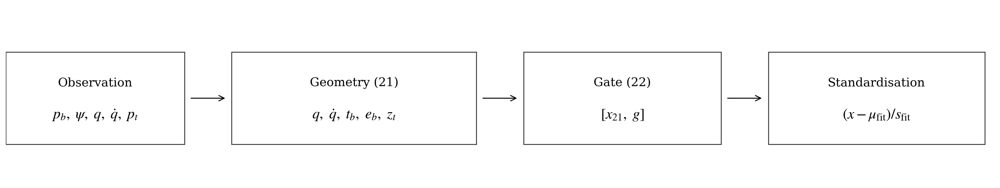
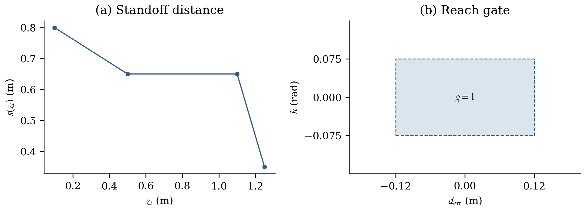
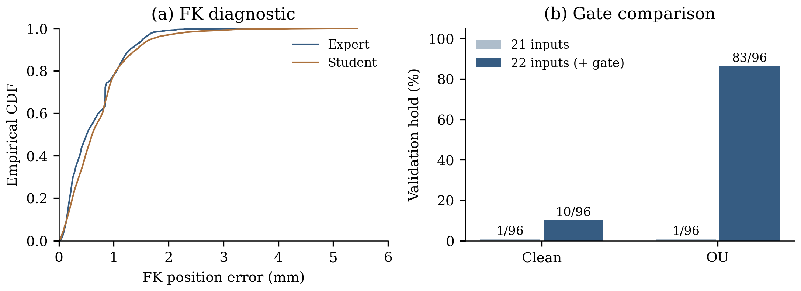

# 03. Feature engineering

This folder supports the report's feature-engineering section. It includes the project's feature-construction code, explains the representation and its implementation, and collects the FK accuracy, feature QA and gate-comparison evidence. Figures follow the report's academic style and are provided as vector PDFs for LaTeX.

**Question.** How do we express a mobile-manipulation observation so that a memoryless policy sees the task geometry, the remaining reaching error and the expert's current control mode, using information available at deployment?

## What the feature engineering changes

The raw observation is `(base_pos, base_bearing, q_mes, qd_mes, target_ee_pos)`: base position (3), base yaw (1), joint angles (7), joint velocities (7) and world target (3). It already has **21 scalars**. The engineered representation also has 21 scalars, or **22 with the reach gate**. The contribution is the representation and its geometric structure, rather than reducing the raw input dimension.

The main work has four parts:

1. Express target geometry in the **current base-yaw frame**, removing irrelevant planar position and heading from the policy input.
2. Compute the **end-effector-to-target error with deployable forward kinematics**, making the arm's Cartesian task error explicit.
3. Append a **binary reach gate**, reconstructed from the current observation, so the policy can distinguish the expert's home-holding and reaching modes.
4. Keep **feature order, fitting-only standardisation and the training/inference builders consistent**, so a saved model receives the same representation at deployment.



*Observation-to-feature pipeline for teacher A. The gate is optional: `features-v1` uses the 21 geometric/state features; `features-v1-gate` appends one gate value before standardisation. The normalisation statistics are estimated from fitting rows only.*

## Feature definition and column order

| Zero-based columns | Feature block | Dimensions | Meaning |
|---|---|---:|---|
| 0–6 | `q_mes` | 7 | Measured arm configuration, in rad |
| 7–13 | `qd_mes` | 7 | Measured joint velocities, in rad/s |
| 14–16 | `target_b` | 3 | Target displacement from the current base, rotated into its yaw frame, in m |
| 17–19 | `ee_err_b` | 3 | Target minus the FK-estimated EE position, in the same yaw frame, in m |
| 20 | `target_z_world` | 1 | World target height, in m |
| 21, gate variant only | `reach_gate` | 1 | Current reach-active rule, 0 or 1 before standardisation |

The exact names are taken from `FEATURE_NAMES_A` and the feature registry, and exported in [`tables/feature_schema.csv`](tables/feature_schema.csv). `features-v1-gate` preserves the first 21 columns exactly and adds the gate last.

**Joint state stays explicit.** Joint angles are needed for configuration-dependent arm control. Joint velocities expose the damping state: away from torque clipping, the expert's joint damping contributes `−30 · qd`. The current implementation keeps measured joint angles directly; it does not replace them with sine/cosine pairs. The damping-Jacobian training term is described separately in [`05_training_details/`](../05_training_details/README.md).

**Height is kept in the world frame.** The expert's standoff rule depends on world target height. Keeping `target_z_world` preserves that task context while horizontal geometry is expressed relative to the base. With a fixed base height, this scalar can be redundant with `target_bz`; it is an explicit task variable, not a claim of additional independent information.

## Core work 1: robot-relative geometry

Let `p_b` be the observed current base position, `ψ` its yaw, `p_t` the target and `Rz(−ψ)` a rotation about the world vertical axis:

```text
target_b = Rz(−ψ) · (p_t − p_b)
ee_err_b = Rz(−ψ) · (p_t − FK(p_b, ψ, q))
```

The frame follows the **current** base at every step, rather than the initial pose used to display collection scenarios. Its x-axis points forwards, its y-axis left, and its vertical direction remains aligned with world z.

The implementation in [`core/features.py`](code/source_snapshot/core/features.py) rotates displacements with:

```python
c, s = np.cos(base_yaw), np.sin(base_yaw)
out[:, 0] = c * vec_w[:, 0] + s * vec_w[:, 1]
out[:, 1] = -s * vec_w[:, 0] + c * vec_w[:, 1]
```

Subtracting the base position removes world translation from the relative target. Rotating by negative yaw makes the same relative task produce the same coordinates after a common planar rotation of robot and target. Yaw enters through sine and cosine rather than as a raw policy-input angle with a jump at ±π. The vertical world context is retained because gravity and the ground distinguish the vertical direction.

This builds an intended planar invariance into preprocessing. It reduces the need for the MLP to learn equivalent situations at many world positions and headings, but it does not establish robustness to arbitrary tilt or terrain. A synthetic check on 256 observations, after a common planar translation and rotation, gives a maximum feature difference of **1.33 × 10⁻¹⁵**; see [`tables/representation_checks.csv`](tables/representation_checks.csv). This is a geometric consistency check, not a closed-loop generalisation experiment.

## Core work 2: task error from deployable FK

The network receives both the target relative to the base (`target_b`, useful for navigation) and the error relative to the hand (`ee_err_b`, useful for reaching and holding). Explicit FK supplies the nonlinear mapping from joint configuration to hand position; the MLP then learns the action from a representation that already includes the task error.

`DeployableFK.ee_pos()` uses Pinocchio and the project's URDF to compute the world position of the `robot_j2s7s300_end_effector` frame. Inputs and fixed assumptions are:

| Quantity | Used by deployed FK |
|---|---|
| Base position and yaw | Current observation |
| Seven arm angles | Current `q_mes` |
| Base roll / pitch | Fixed at 0 / 0.0022 rad |
| Six finger angles | Fixed at 0.1 rad |
| EE reference | Origin of the named EE link frame, not its centre of mass |

The feature assembly is implemented directly as:

```python
target_b = to_base_yaw(target - base_pos, base_yaw)
ee_err_b = to_base_yaw(target - fk.ee_pos(base_pos, base_yaw, q_mes), base_yaw)
return np.concatenate((q_mes, qd_mes, target_b, ee_err_b, target[:, 2:3]), axis=1)
```

**Deployable inputs.** A's features do not read the simulator's true EE position, base roll/pitch, velocities absent from the observation, or the expert's integrated joint reference, phase or `done` latch. Simulator truth is used to evaluate FK accuracy, not to construct a policy input. No time input is used for teacher A. The estimated EE error is therefore available at inference under the same sensor/model assumptions used during collection.

**Measured accuracy.** The archived diagnostic compares deployed FK with PyBullet's world position of the same link frame, every 10 ms, on four fitting scenarios with expert A and four with an archived student:

| Diagnostic role | Trajectories | Sampled observations | Median error | 95th percentile | Sampled maximum |
|---|---:|---:|---:|---:|---:|
| Expert | 4 | 4,604 | 0.507 mm | 1.539 mm | 3.918 mm |
| Archived student | 4 | 16,000 | 0.607 mm | 1.694 mm | 5.435 mm |

These values are recomputed from all copied diagnostic samples in [`tables/fk_accuracy.csv`](tables/fk_accuracy.csv). No sampled error exceeds 10 mm, but the samples are 10 ms apart and cover only four nominal scenarios per role. They do not bound errors at every 1 ms state or under arbitrary disturbances. The fixed roll/pitch approximation explains the millimetre-scale discrepancy; full-attitude FK agrees with the link position to below 0.000129 mm in the historical diagnostic. The expert's added 1 kg body corrects gravity modelling, not FK link geometry.

The student in this diagnostic is the **archived 27 October DAgger round-1, 21-input student**, not ablation row R1-baseline and not the final model. None of its four trajectories reached the target, despite the small FK error. The result verifies the feature estimate's scale; it does not show that accurate FK alone solves control. The full interpretation is in the [original FK report](../../../../docs/reports/2026-10-27__report__fk-input-accuracy.md).

## Core work 3: an observable reach gate

Teacher A changes its arm reference when navigation is sufficiently close and aligned. Outside this band it holds the home pose; inside it performs reaching control. A continuous-input MLP otherwise has to infer this mode switch from geometry while fitting two different control behaviours near a boundary.

`features-v1-gate` exposes that switch as an additional feature. It is a deterministic function of the existing 21 columns, rather than extra sensing or teacher memory:

```text
r     = hypot(target_bx, target_by)
s     = piecewise_linear_standoff(target_z_world)
d_err = r − s
h     = atan2(target_by, target_bx), or 0 when r ≤ 0.001 m
g     = 1 if |d_err| < 0.12 m and |h| < 0.075 rad; otherwise 0
x22   = concatenate(x21, g)
```

Standoff interpolation uses `(height, distance)` points **(0.1, 0.80), (0.5, 0.65), (1.1, 0.65), (1.25, 0.35)**, in metres. The gate tolerances are the expert's reach scale 1.5 times its base stopping tolerances: `1.5 × 0.08 m` and `1.5 × 0.05 rad`. The inequalities are strict; the boundary itself is excluded. `reach_gate()` computes in float64 before the dataset cache is cast to float32.



*The standoff function and the active reach region. The shaded interior has g = 1; the dashed boundary is excluded. The region is evaluated through the copied `reach_gate()` implementation. These are illustrations of the implemented rule, not newly measured success rates.*

The complete implementation is in [`core/feature_sets.py`](code/source_snapshot/core/feature_sets.py), including the registry, validation of feature-definition names and `extend()`. The original tests compare the gate with `MarkovianExpert.base_command()` on 400 observations near the switching boundary.

**No extra state information is introduced.** Because g is computed from x21, it changes the representation supplied to a finite network, not the underlying information available to an ideal policy. It is recomputed every step, so it can open or close; it is not the template controller's latched `done` flag. Appending a gate input also does not by itself impose a two-branch network architecture.

**Evidence for its usefulness.** The fixed v1 ablation compares models with and without the gate under the shared MLP01/BC+J training recipe:

| Fitting data | 21-input row | Sustained validation holds | 22-input row | Sustained validation holds |
|---|---|---:|---|---:|
| Clean | R1 Baseline | 1/96 (1.0%) | R2 Baseline + Gate | 10/96 (10.4%) |
| Clean + OU | R3 OU | 1/96 (1.0%) | R4 OU + Gate | 83/96 (86.5%) |

The denominators pool **three training seeds on the same 32 validation scenes**, not 96 distinct scenes. Source counts are retained in [`tables/gate_validation.csv`](tables/gate_validation.csv). The gate's benefit is much larger with OU-augmented states; the gate alone is insufficient. The project does not contain a matched ablation removing each geometric block separately, so it does not quantify an isolated success-rate gain for base-frame coordinates or FK error. Later DAgger and test results remain in [`06_ablation/`](../06_ablation/README.md).



*Left: empirical distributions of deployed FK error from the historical diagnostic. Right: validation sustained-hold counts for the fixed v1 rows, with identical task scenes across three seeds. The panels concern different experiments and are not evidence that FK error determines the gate comparison.*

## Core work 4: fitting-only scaling and one feature contract

For each input column, the normaliser applies `x_standard = (x − mean_fit) / max(std_fit, 1e−6)`. Means and population standard deviations (`ddof = 0`) are accumulated in float64 over **fitting rows only**. Every fitting row counts once for these statistics. Training's episode-uniform batch sampling is a separate weighting rule.

The gate starts as 0 or 1 and is standardised with the other input columns. Labels are standardised too, with minimum standard deviations **0.1 N·m for arm torques** and **0.05 rad/s for wheel speeds**. Scales are saved with the model and reused at inference; validation/test statistics do not update them. `fit_normaliser()` operates on the cache it receives: the caller must first select fitting scenarios, as the training launcher does. A published Clean_253 dataset includes both fitting and validation scenarios, so passing that entire dataset to the normaliser would violate this rule.

The same preprocessing contract runs through the implementation:

| Stage | Implementation | Contract |
|---|---|---|
| Offline feature construction | `FeatureBuilder`, `training/common/dataset.py` | Calls the registered `features_a()` and `extend()`; feature row t uses pre-action observation t |
| Durable feature datasets | `training/datasets/build.py` | Stores names/order, definition, source hashes and builder identity; checks prefix equality and teacher gate agreement |
| Standardisation | `training/common/normalisation.py` | Fitting-cache moments, recorded floors, serialisable statistics |
| Online inference | `MLPPolicy.features()` and `predict()`, `training/common/policies.py` | Calls the same feature functions and applies saved input/output scales |
| Compatibility | Registry and model metadata | A model's feature-definition name, input dimension and ordered names must agree at load time |

**Historical full-dataset checks**, recomputed as summaries from the copied QA records:

| Gate dataset | Episodes | Rows | Gate mismatches vs recorded teacher flag | First 21 columns equal to v1 |
|---|---:|---:|---:|---|
| Clean_253 | 253 | 3,045,616 | 0 | Yes |
| OU, fitting scenarios only | 441 | 5,289,586 | 0 | Yes |

These counts describe saved build QA, not a new scan of the multi-million-row arrays in this report task. The new report check separately confirms exact offline/online equality on 16 synthetic observations and preservation of the original 21 columns on 256 observations. Details are in [`tables/dataset_qa.csv`](tables/dataset_qa.csv), [`tables/representation_checks.csv`](tables/representation_checks.csv) and [`data/verification.json`](data/verification.json).

**Related label representation.** The dataset keeps seven torque labels and two independent wheel speeds, reducing the 11 recorded motor commands to 9 outputs. It verifies `FR = BR` and `FL = BL`; inference reconstructs `[FR, FL, BL, BR] = [right, left, left, right]`. This avoids learning redundant wheel outputs and is distinct from the 21/22-dimensional input design.

## Scope of teacher B's features

The same source file retains the older **26-input teacher-B definition**: A's 21 columns plus the fixed navigation goal relative to the base (2), sine/cosine of the goal heading error (2), and elapsed time divided by the saved time scale (1). The goal is computed from the target using the template's geometric rule. These task-context values do not expose B's integrated `q_des`, phase or `done` memory, so they do not make B fully observable. They are not used by the report's teacher-A R1–R8 methods. `features-v1-gate` is registered for A only.

## Code, reproduction and LaTeX

[`code/source_snapshot/`](code/source_snapshot/) contains byte-identical copies of the feature implementation and its integration code, with the URDF required to run FK. [`data/source_inventory.json`](data/source_inventory.json) records every original repository path and SHA-256. These are the project's existing implementations; this report does not change the production feature functions.

| Copied code | Main content |
|---|---|
| [`core/features.py`](code/source_snapshot/core/features.py) | FK, base-yaw transform, A/B feature assembly and B's geometric task context |
| [`core/feature_sets.py`](code/source_snapshot/core/feature_sets.py) | Feature names and dimensions, the reach gate and the 21→22 extension |
| [`core/interfaces.py`](code/source_snapshot/core/interfaces.py) | Available observation fields and action layout |
| [`training/common/dataset.py`](code/source_snapshot/training/common/dataset.py) | FeatureBuilder, observation/action alignment, builder identity and cache construction |
| [`training/common/normalisation.py`](code/source_snapshot/training/common/normalisation.py) | Population statistics, scale floors and saved transforms |
| [`training/common/policies.py`](code/source_snapshot/training/common/policies.py) | Shared online feature construction, compatibility checks and inverse action scaling |
| [`training/datasets/build.py`](code/source_snapshot/training/datasets/build.py) | Durable feature datasets and per-row gate/prefix QA |
| [`training/datasets/train.py`](code/source_snapshot/training/datasets/train.py) | Selection of fitting rows before normaliser estimation |

The source snapshot supports the report's FK and feature probes; it is not a copy of the full simulator or training environment. Use the original project entry points for training. The production feature files are [`core/features.py`](../../core/features.py) and [`core/feature_sets.py`](../../core/feature_sets.py).

From `final/robotnik_arm_task/`, in the project environment:

```bash
python report/03_feature_engineering/code/build_report.py
```

The script imports the frozen code snapshot, verifies source/evidence hashes, rebuilds five CSV tables and three PNG/vector-PDF figures, and writes the numerical consistency results. It uses NumPy, Pinocchio and Matplotlib; no new rollout, training run or test-set trajectory is used. The historical FK JSON is losslessly gzip-compressed, with both original and compressed hashes recorded.

The relevant existing checks were run from the repository root:

```bash
python -m pytest tests/datasets/test_feature_sets.py \
  tests/training/test_normalisation.py tests/training/test_dataset.py \
  tests/training/test_policy.py -q
```

**Result: 33 tests passed.** These cover the gate against the teacher, feature definitions, cache alignment, fitting-only scaling, inference consistency and refusal of incompatible feature metadata. The report's synthetic checks and the copied historical diagnostics provide additional, separate evidence.

[`latex/feature_figures.tex`](latex/feature_figures.tex) contains figure environments with English captions and reference labels. The figures use embedded serif/math fonts. A minimal LaTeX document is in [`latex/example.tex`](latex/example.tex), with the compiled [`example.pdf`](latex/example.pdf). Configure `graphicx` and the figure path as shown there; the figure environments span both columns of a two-column paper.

```text
03_feature_engineering/
  README.md
  code/build_report.py         rebuild tables, figures and numerical checks
  code/source_snapshot/       original feature and integration code, plus FK URDF
  data/                      source inventory, archived FK diagnostics, dataset QA and v1 results
  tables/                    schema, representation checks, dataset QA, FK accuracy and gate comparison
  figures/                   pipeline, gate rule and evidence; PNG + vector PDF
  latex/                     figure snippets and a compiled example
```

## Report-ready summary

We represented each observation using joint positions and velocities, the target relative to the current base-yaw frame, a deployable FK estimate of the end-effector-to-target error, and world target height. This 21-dimensional representation encodes planar translation/rotation invariance and exposes the Cartesian task error without simulator-truth inputs. The 22-input variant appends the expert's reach-active rule, recomputed from current geometry, to make the navigation-to-reaching mode switch explicit. The gate adds no independent observation information; it supplies a useful representation of an existing decision boundary. Fitting-only standardisation and shared offline/online feature functions preserve the input contract. Historical FK diagnostics show millimetre-scale error under nominal conditions, while the fixed v1 validation comparison shows the strongest gate benefit with OU-augmented training states. The evidence does not establish separate causal gains for every feature block or robustness beyond the FK's fixed-attitude assumptions.
