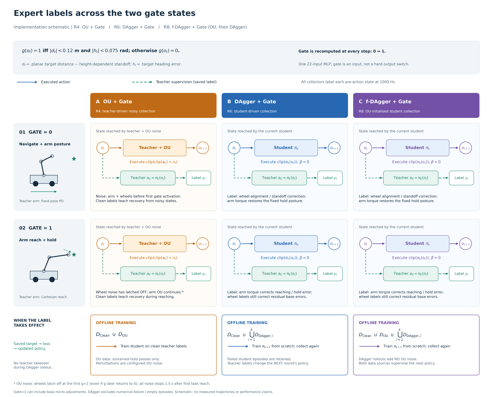
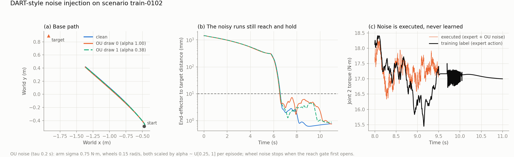
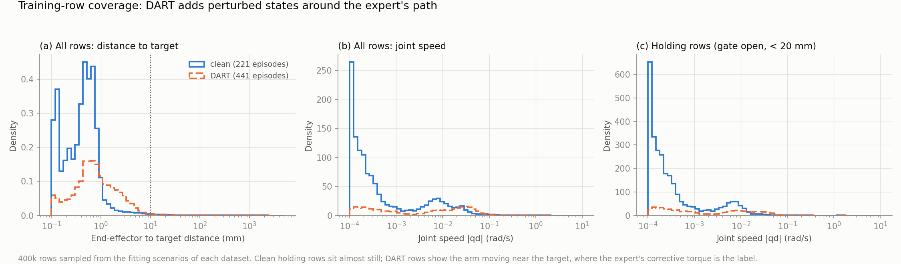
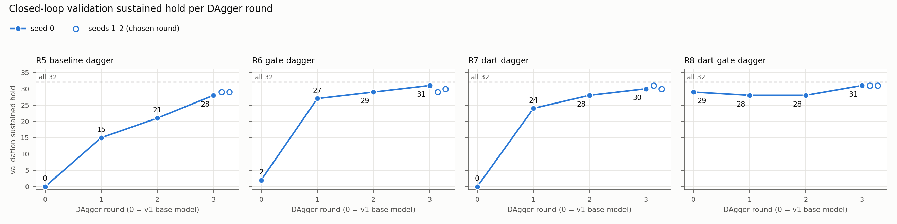

# 04. f-DAgger Algorithm

This folder holds the evidence for the report's method section: the f-DAgger algorithm, its two components (phase-gated OU noise injection and DAgger), the evidence for each design choice and the ablation that isolates each component. It contains the algorithm in LaTeX, the figures, the tables, the code that produced them and the data behind every number.

**Question.** What exactly is f-DAgger, why is each part designed the way it is, and what does each part contribute?

The training-time comparison against DAgger + Gate and full DART (DART + Gate) is in [`../07_training_time_comparison/`](../07_training_time_comparison/README.md). It is linked here, not repeated.

## The name

**f-DAgger = fast DAgger**: OU-noise injection, then DAgger. The OU-noise stage needs no trained student, so it can run alongside the clean collection and costs one 3.3 min collection. With the Gate it gives a round-0 student (OU + Gate) that already holds 96.9% of the T0 test scenes. DAgger + Gate needs three train→collect rounds to reach that level (37.6 vs 12.5 min of pipeline time; [`../07_training_time_comparison/`](../07_training_time_comparison/README.md)). The DAgger rounds that follow therefore start from a student that is already close to the expert.

Names follow [`../06_ablation/`](../06_ablation/README.md). **Gate** is the 22nd network input `reach_gate`; "+ Gate" marks the rows that have it. It is not the noise gate (m_t in the algorithm), which every OU row uses. The report's main pipeline is f-DAgger + Gate.

| Report name | Inputs | Run ids |
|---|---|---|
| f-DAgger | 21 | round 0 (= OU, R3): `R3-dart`; rounds 1–3 (R7): `R7-dart-dagger-r1..r3` |
| **f-DAgger + Gate** | 22 | round 0 (= OU + Gate, R4): `R4-dart-gate`; rounds 1–3 (R8): `R8-dart-gate-dagger-r1..r3` |

## The problem it addresses

Behaviour cloning fits the expert's action on the expert's own states. Small errors then take the student to states the expert never visited, and the errors compound [1, 2]. We observed this directly. Clean-data students had small offline errors, but their closed loop was unstable at the hold pose: the largest position-stiffness eigenvalue was about 140 N·m/rad, against about 0 for the expert. They held 1/96 (R1) and 10/96 (R2) validation targets. The clean data never show how the expert corrects a deviation.

Both components of f-DAgger add **corrective labels**: states off the expert's path, each labelled with the expert's action at that state. Both require an expert that can label any state, which is why the expert was made Markovian ([`../01_markovian_expert/`](../01_markovian_expert/README.md)).

## Algorithm



`algorithm/f_dagger.tex` is the compact version for the report, and `algorithm/f_dagger.pdf` is its compiled form. `algorithm/f_dagger_detailed.tex` states every interface (feature map, label projection, clipping, stopping rule) in full. Both are standalone documents; copy the `algorithm` environment into the IEEE template.

```text
Input:  Markovian expert πE, clean fitting data D_clean, DAgger rounds K
Stage 1 (OU noise injection; no student needed)
  for each fitting scenario s, draws m = 1..M:
      α ~ U(0.25, 1);  z ← 0
      for each 1 ms control step t:
          aE ← πE(o_t)                                    clean expert action
          z  ← ρ z + sqrt(1 − ρ²) (α σ ⊙ ξ),  ξ ~ N(0, I)  OU state, ρ = exp(−Δt/τ)
          n  ← phase-gate(z)                              wheels off after the first gate opening,
                                                          everything off 1.5 s after the first reach
          save (o_t, aE);  execute clip(clip(aE) + n)     the label is never noisy
      keep the episode only if it passes the sustained-hold check
  D ← D_clean ⊎ D_OU;   π0 ← train from scratch on D
Stage 2 (DAgger)
  for k = 1..K:
      roll out π_{k−1} alone (β = 0, no added noise) on the fitting scenarios + 64 fresh low/near-biased scenes
      label every visited observation with πE;  keep failed episodes, drop numerical failures
      D ← D ⊎ D_new;   π_k ← train from scratch on D;   validate π_k
  return the π_k (k ≥ 1) with the highest seed-0 validation hold; ties go to the later round
```

Every statement in both `.tex` files was checked against the code below.

| Step | Code |
|---|---|
| OU noise, phase gating, clean labels | `data_collection/collect_dart.py` (`NoisyEnv`), protocol `experiments/configs/dart/d2-s075-x2.yaml` |
| Keep only sustained-hold OU episodes; DAgger keeps failures, drops numerical failures | `training/datasets/build.py` (`dart_sources`, `dagger_sources`) |
| Student rollout with expert labels (β = 0) and the development scenes | `data_collection/collect_dagger.py` (`StudentEnv`, `dev_rows`) |
| Rounds: collect → build → train from scratch → validate, plus round selection | `experiments/dagger_rounds.py` |
| Extra seeds for rounds 1–2 on the same datasets | `experiments/dagger_extra_seeds.py` |
| Reach gate (the 22nd input, also used by the noise schedule) | `core/feature_sets.py`, `data_collection/expert.py` (`base_command`) |
| Training recipe (BC + Jacobian loss, Huber, 42k updates) | `training/datasets/train.py`, `training/jacobian/loss.py` |

## Stage 1: phase-gated OU noise injection

The focused [OU parameter-selection report](ou_parameter_selection.md) collects the scale-selection experiments, correlation-time comparisons, parameter-by-parameter evidence, protocol differences and a paragraph for the written report. Its [data index](data/ou_noise/README.md) links the complete pilot archive, stress-test results, configurations and copy-integrity records.

| Setting | Value | Why |
|---|---|---|
| Where the noise goes | Added to the **executed** command, while the stored label is the clean expert action at the state actually visited | The student learns the expert's *correction*, never the noise |
| Process | Ornstein–Uhlenbeck, τ = 0.2 s, independent per channel, zero initial value, exact discrete update at 1 kHz | Correlated noise moves the arm; white noise at 1 kHz is filtered out by the dynamics. For the same per-step size, OU gives a 5–9× larger impulse over 100–500 ms than the learner-fitted white noise of full DART ([`../07_training_time_comparison/data/noise/applied_noise.csv`](../07_training_time_comparison/README.md)). The expert stress test also found white noise far milder than OU at equal σ |
| Scale | Arm σ = 0.75 N·m, wheels σ = 0.15 rad/s (stationary std), × α ~ U[0.25, 1] drawn once per episode | Chosen with the pilot below. The per-episode α spreads the deviations from small to the full scale |
| Wheel gating | Wheel noise is latched off at the first step the reach gate opens | The expert cannot hold the 10 mm target while the base is pushed around. Its ungated wheel-OU hold limit is 0.1 rad/s, against 1 rad/s when wheel noise stops at the gate ([`../01_markovian_expert/tables/disturbance_thresholds.csv`](../01_markovian_expert/README.md)) |
| End of noise | All noise stops 1.5 s after the first task reach; the episode ends 3 s after it | Every episode ends with a clean hold, so the sustained-hold filter checks that the expert recovered |
| Scenarios | The 221 fitting scenarios only, 2 draws each (442 episodes); never validation or test (checked in code) | No held-out scene, or a noisy version of one, enters training |
| Episode filter | Only sustained-hold episodes are kept: 441 of 442 | No label from an episode the expert itself failed |

**How the scale was chosen** (pilot of 2026-10-26, `tables/ou_pilot.csv`; scenes disjoint from the training, validation and test sets). Two candidates were tuned on 16 scenes, and the lower one was frozen *before* the 32-scene confirmation:

| Cohort | Arm σ / wheel σ | Expert A: sustained hold | Template B: sustained hold |
|---|---|---|---|
| Tuning (16 scenes) | 0 / 0 | 16/16 | 15/16 |
| Tuning | **0.75 / 0.15** | 15/16 | 15/16 |
| Tuning | 1.5 / 0.3 | 14/16 | 14/16 |
| Confirmation (32 scenes × 2 draws) | 0.75 / 0.15 | 62/64 | 59/64 |
| Confirmation, α-sampled as in collection | α × (0.75, 0.15) | 31/32 | 31/32 |

**The collection used for training** (`tables/ou_collection.csv`): 442 episodes, 441 sustained holds, 5.29 M training rows. Noise is active on 87.5% of steps, and the executed command is clipped on 2.3% of them. α ranges from 0.25 to 1.00 (median 0.62). Median final error is 0.77 mm.



**What the noise does to the student** (v1 ablation, 3 seeds × 32 validation scenes). OU noise fixes the hold: in the hold test the arm stays on target 24/24 times for OU (R3), against 8/24 for Baseline (R1). The largest stiffness eigenvalue falls from about 140 to about 1.3 N·m/rad. Alone, however, it makes the home pose an attractor, and the arm never starts reaching (OU, R3: 1/96). The Gate input fixes the start. Together they give **OU + Gate (R4): 83/96**.



**Noise strength and data volume** (`tables/noise_strength_controls.csv`; validation, 3 seeds × 32):

| Variant | Arm σ / wheel σ | OU episodes | Validation hold | Run on |
|---|---|---|---|---|
| R2-gate (Baseline + Gate, no OU) | – | 0 | 10/96 | this machine |
| R4-dart-gate-s0375 | 0.375 / 0.075 | 442 | 69/96 | teammate's machine |
| **R4-dart-gate** (OU + Gate) | **0.75 / 0.15** | **442** | **83/96** | this machine |
| R4-dart-gate-s150 | 1.5 / 0.3 | 442 | 84/96 | teammate's machine |
| R4-dart-gate-x4 | 0.75 / 0.15 | 884 | 82/96 | teammate's machine |

Halving σ is clearly worse. Doubling σ or doubling the OU data gives nothing further. More OU data cannot replace DAgger: DAgger + Gate reaches 89–90/96 with a similar number of episodes (R6 r3, 855).

## Stage 2: DAgger rounds

| Setting | Value | Why |
|---|---|---|
| Who drives | The student alone (β = 0); no added noise | The states that matter are the ones the student itself reaches |
| Scenes per round | The 221 fitting scenarios, plus 64 newly sampled training scenarios per round (`dev-r<k>-<i>`, called development scenes in the code), biased towards low and near targets as detailed below | The R4 test diagnosis found its failures at low and near targets |
| Labels | The expert's action at every visited 1 ms step, whatever the student does; failed episodes are kept | Failed episodes contain the states DAgger is for. The expert recovers all of them: 13/13 failed R4 episodes were held after the expert took over |
| Aggregation | The next student is trained **from scratch** on clean + OU + every DAgger round so far, with the same recipe | No warm-start effects; each round differs only in its data |
| Round selection | Highest seed-0 validation hold among rounds 1..K (tie → later round); seeds 1–2 are then trained for that round | Declared before the run; the test set is never used |

**What the 64 new development scenes mean.** A scene specifies the robot's initial base position and heading, and the target position for the same reaching-and-holding task. Each round samples 64 new configurations within the training ranges. Their student rollouts and expert labels enter training; these scenes are separate from the frozen validation and test sets. Here, "development" names an additional source of training scenes, not a held-out evaluation split.

**Why add new scenes each round?** DAgger can collect corrective labels on the existing 221 fitting scenes alone; adding new configurations is a choice in this experiment, not a requirement of the algorithm. It serves two purposes. First, new combinations of start pose and target position broaden the configurations on which the current student receives corrective supervision, with the aim of improving generalisation beyond the fixed fitting scenes. Second, the low/near bias allocates more collection to the conditions where R4 struggled, so the expert labels the student's approach, stall and drift states under additional configurations. The [R4 diagnosis](../../../../docs/reports/2026-10-29__report__r4-test-diagnosis.md) found all 13 failed runs in seven low or near scenes and recommended oversampling these conditions. It also found that these failures were not simply outside the fitting-scene coverage: the purpose is denser corrective supervision in difficult parts of the training range. As recorded under provenance below, this design was informed by the earlier test diagnosis; the newly generated scene configurations themselves are not taken from validation or test.

Keeping all 221 fitting scenes preserves coverage of the original training conditions, while sampling 64 additional scenes each round supplies new combinations in the difficult regions. These are intended benefits of the sampling design; the reported ablation does not isolate the contribution of fresh scenes from the rest of DAgger.

**Why exactly 64?** This is the configured per-round collection budget (`--dev-scenes 64`), adding about 29% more trajectories than the 221 fitting-scene rollouts alone, for 285 trajectories per round. The experiment records do not establish 64 as an optimal or necessary number, and the reported results do not compare 0, 32, 64 or 128 added scenes. It should therefore be reported as an experimental setting, rather than a theoretically required sample count or a separately validated optimum.

The sampling rule in [`dev_rows`](../../data_collection/collect_dagger.py) is:

| Scene parameter | Sampling rule |
|---|---|
| Initial base position | x and y independently uniform in −0.5–0.5 m |
| Initial heading and target relative azimuth | Independently uniform in −π–π radians |
| Target height z | With probability 0.7, uniform in 0.1–0.5 m; otherwise uniform in the full 0.1–1.25 m range |
| Horizontal start-to-target distance d | With probability 0.5, uniform in 0.5–1.0 m; otherwise uniform in the full 0.5–3.0 m range |

These are mixture-selection probabilities, not exact quotas of the 64 scenes. The full ranges also include the low and near bands, so the final fractions within those bands need not equal 70% and 50%. This sampling increases coverage of low and near targets, where the student had struggled.

Each round therefore collects **285 new trajectories: 221 fresh student rollouts on the existing fitting scenes, plus 64 rollouts on newly sampled scenes**. Over three rounds, each method adds 192 scene configurations and 855 trajectories. The 221 fitting configurations are reused; their trajectories change with the student. The new scenes have IDs `dev-r1-0000` through `dev-r1-0063` in round 1, and corresponding `dev-r2-*` and `dev-r3-*` IDs in later rounds. Sampling is reproducible: `default_rng([20261030, round_index, scene_index])` gives R5–R8 the same 64 configurations at a given round, although their students produce different trajectories and labels.

The fixed trajectory count does not imply a fixed number of labelled samples. Each executed 1 ms step contributes one expert-action label; trajectories stop 3 s after the first reach or at the 40 s cap, so their lengths and the total label count vary by method and round. Extra training seeds reuse the existing aggregated datasets without collecting new scenes or labels ([`dagger_extra_seeds.py`](../../experiments/dagger_extra_seeds.py)).

**f-DAgger + Gate's DAgger data are already near-expert** (`tables/dagger_collections.csv`, round 1). The collector is the round-0 student, so it determines what DAgger sees:

| Row | Round-1 collector | Collector holds while collecting (fitting / development) | Student–expert arm RMSE (median) | Rows |
|---|---|---|---|---|
| **R8 f-DAgger + Gate** | R4-dart-gate (OU + Gate) | **201/221 / 50/64** | **0.17 N·m** | 4.1 M |
| R6 DAgger + Gate | R2-gate (Baseline + Gate) | 21/221 / 4/64 | 27.7 N·m | 10.1 M |
| R7 f-DAgger | R3-dart (OU) | 5/221 / 0/64 | 18.3 N·m | 11.3 M |
| R5 DAgger | R1-baseline (Baseline) | 2/221 / 0/64 | 27.5 N·m | 10.8 M |

For R5–R7, round 1 mostly records an untrained student failing far from the expert's path. For f-DAgger + Gate it records small on-policy deviations around a working controller.



## Ablation: gate × OU noise × DAgger

The full ablation (per band, gate effect, failure modes, terminal precision, cost) is in [`../06_ablation/`](../06_ablation/README.md).

**Validation** (`tables/factorial_validation.csv`; 32 scenes × 3 seeds; DAgger rows at round 3, the round chosen for every row):

| Row | Run id | Gate | OU noise | DAgger | Hold per seed | Pooled (Wilson 95%) |
|---|---|---|---|---|---|---|
| R1 Baseline | `R1-baseline` | | | | 0 / 1 / 0 | 1/96 (0.00–0.06) |
| R2 Baseline + Gate | `R2-gate` | ✓ | | | 2 / 3 / 5 | 10/96 (0.06–0.18) |
| R3 OU | `R3-dart` | | ✓ | | 0 / 1 / 0 | 1/96 (0.00–0.06) |
| **R4 OU + Gate** (f-DAgger + Gate r0) | `R4-dart-gate` | ✓ | ✓ | | 29 / 27 / 27 | **83/96** (0.78–0.92) |
| R5 DAgger | `R5-baseline-dagger` | | | ✓ | 28 / 29 / 29 | 86/96 (0.82–0.94) |
| R6 DAgger + Gate | `R6-gate-dagger` | ✓ | | ✓ | 31 / 29 / 30 | 90/96 (0.87–0.97) |
| R7 f-DAgger | `R7-dart-dagger` | | ✓ | ✓ | 30 / 31 / 30 | 91/96 (0.88–0.98) |
| **R8 f-DAgger + Gate** (r3) | `R8-dart-gate-dagger` | ✓ | ✓ | ✓ | 31 / 31 / 31 | **93/96** (0.91–0.99) |

Per round (`tables/dagger_rounds.csv`, seed 0): f-DAgger + Gate (R8) holds 29 / 28 / 28 / 31 of 32 for rounds 0–3. DAgger + Gate (R6) holds 2 / 27 / 29 / 31. With all three seeds, R8 holds 87, 85 and 93 of 96 for rounds 1–3, and R6 holds 71, 85 and 90.

**Unified test** (`tables/factorial_test.csv`; 240 scenes × 3 seeds; success = continuous < 10 mm for 3 s, or 20 s on T5; suites T0 in range, T1 far 3–15 m, T2 near, T3 height edges, T4 translated start, T5 long hold):

| Row | T0 | T1 | T2 | T3 | T4 | T5 | All 240 |
|---|---|---|---|---|---|---|---|
| Teacher A | 100 | 100 | 100 | 81.2 | 100 | 100 | 97.5 |
| R1 Baseline | 2.1 | 0.0 | 2.8 | 0.0 | 2.8 | 0.0 | 1.1 |
| R2 Baseline + Gate | 20.8 | 0.0 | 1.4 | 3.1 | 22.2 | 0.0 | 8.3 |
| R3 OU | 1.6 | 3.7 | 6.9 | 14.6 | 4.2 | 0.0 | 4.6 |
| **R4 OU + Gate** (f-DAgger + Gate r0) | 96.9 | 90.7 | 47.2 | 54.2 | 94.4 | 68.1 | **81.2** |
| R5 DAgger (r3) | 96.4 | 97.7 | 37.5 | 12.5 | 94.4 | 51.4 | 75.0 |
| R6 DAgger + Gate (r3) | 97.9 | **100** | 50.0 | 21.9 | 95.8 | 72.2 | 80.8 |
| R7 f-DAgger (r3) | 97.4 | 88.9 | 50.0 | 25.0 | 93.1 | 54.2 | 75.7 |
| **R8 f-DAgger + Gate** (r3) | **99.0** | 44.4 | **81.9** | **66.7** | **97.2** | **87.5** | 75.3 |

What the ablation shows:

1. **Without DAgger, OU noise and the gate work only together.** Either alone gives at most 10/96; both give 83/96 and 96.9% on T0.
2. **f-DAgger + Gate is the best row in range.** R8 r3 has the highest validation hold (93/96, 31 on every seed) and the best test results on T0, T2, T3, T4 and T5. The largest gains over DAgger + Gate (R6) are at the range edges: near targets 81.9 vs 50.0% and height edges 66.7 vs 21.9%.
3. **f-DAgger + Gate loses far targets (T1).** R8 r3 holds 44.4% on T1, against 90.7% for its own round 0 and 100% for R6. Its failures are navigation failures. R6's T1 advantage is confounded: its round-1 collector (R2) drove up to 798 m away, so R6's data contain 3.1 M rows beyond 3 m, and every other dataset stops at 3.1 m. This analysis is in [`../07_training_time_comparison/`](../07_training_time_comparison/README.md) (`data/analysis/`).
4. **Over all 240 scenes, round 0 (OU + Gate) is f-DAgger + Gate's best point** (81.2%, against 69.7 / 76.9 / 75.3% for rounds 1–3), because the T1 loss outweighs the in-range gains. Validation (in range only) picks round 3. Per-round test results for rounds 1–2 are in [`../07_training_time_comparison/tables/success_by_round.csv`](../07_training_time_comparison/README.md).

## Relation to prior work

- **DART** [3] injects noise into the expert's executed actions and labels the visited states with the clean expert action. Our Stage 1 follows that principle with a *fixed*, temporally correlated, phase-gated OU process chosen by a pilot. It does not use DART's iterative fitting of the noise to the learner's error, so it is "DART-style". Full DART with α = 6 was run as a baseline ([`../07_training_time_comparison/`](../07_training_time_comparison/README.md)).
- **DAgger** [4] is used as published, with β = 0 and aggregation of all rounds.
- **Combination.** A targeted literature search (`literature/overlap_review.md`, 2026-11-04) found prior work combining perturbed expert demonstrations with DAgger. Examples are temporally correlated steering noise with DAgger (Abeysirigoonawardena et al., ICRA 2019), adversarial disturbances with DAgger (SAFE-GIL, ICRA 2025) and OU noise on *observations* in DAgger distillation (HuB, CoRL 2025). It found no paper with this exact recipe: phase-gated OU noise on the expert's commands, clean labels, keeping the noisy dataset, then β = 0 DAgger without added noise. The absence of a match is not proof of novelty. The defensible claim is an evaluation of this task-specific combination, not "the first combination of OU noise and DAgger".

References: [1] Ross & Bagnell, AISTATS 2010. [2] Osa et al., Found. Trends Robotics 2018. [3] Laskey et al., *DART: Noise Injection for Robust Imitation Learning*, CoRL 2017. [4] Ross, Gordon & Bagnell, AISTATS 2011.

## Layout

```
04_f_dagger/
  README.md
  algorithm/   f_dagger.tex, f_dagger.pdf (compact), f_dagger_detailed.tex (every interface spelled out)
  figures/     gate_dart_dagger_comparison.{png,pdf,svg}   schematic: labels in the OU + Gate, DAgger + Gate and f-DAgger + Gate collectors
               ou_noise_episode.png                        one scenario with and without OU noise
               state_coverage.png                          training-row coverage, clean vs OU
               dagger_rounds.{png,pdf}                     validation per DAgger round, R5-R8 (copy of ../06_ablation/figures/, code/plot_ablation.py there)
  tables/      ou_pilot.csv, ou_collection.csv, dagger_collections.csv, factorial_validation.csv,
               dagger_rounds.csv, factorial_test.csv, noise_strength_controls.csv   (all from code/make_tables.py)
  data/        ou_noise/protocols/       the four OU protocol files (d2-s075-x2 is the one used)
               ou_noise/pilot/           complete 2026-10-26 pilot: results, manifests, JSONL, traces, logs, report and scripts
               ou_noise/expert_stress/   2,112-episode expert sweep, threshold table and original report
               ou_noise/strength_controls/  original student-control report and dataset variant configs
               ou_noise/README.md        archive index; source_inventory.csv and verification_summary.json record integrity
               collections/              OU collection episodes.csv + manifest; dagger/<round>-<digest>_{episodes.csv,manifest.json}
                                         for all 12 DAgger collections of 2026-11-01
               validation/               v1 R1-R4 summary and runs; v2 per-row summaries (2026-11-01, extra seeds 2026-11-03)
               test/                     unified test R1-R8 of 2026-11-01: summary.csv and summary.md
  code/        make_tables.py            data/ -> tables/
               draw_schematic.py         figures/gate_dart_dagger_comparison.* (copy; see caveats)
               redraw_ou_figures.py      figures/ou_noise_episode.png, state_coverage.png (pipeline plots with report names)
  literature/  overlap_review.md         targeted prior-work search for OU noise + DAgger
  ou_parameter_selection.md              OU scale/parameter selection, evidence and protocol differences
  tables/ou_parameter_evidence.csv       settings and the type of evidence supporting each
  tables/ou_stress_by_condition.csv      archived OU stress results grouped by teacher/channel/tau/gating/sigma
  code/ou_noise_snapshot/                current collection, expert, stress-test and filtering implementation snapshots
```

## Reproduce

All commands run from `final/robotnik_arm_task/`. Every number in this folder is already in `data/` and `tables/`.

```bash
python report/04_f_dagger/code/make_tables.py        # tables/ from data/ (no simulation)
python report/04_f_dagger/code/draw_schematic.py     # figures/gate_dart_dagger_comparison.*
python report/04_f_dagger/code/redraw_ou_figures.py  # figures/ou_noise_episode.png, state_coverage.png (needs git-ignored data/)
```

The pipeline (simulation and training; outputs are git-ignored; full instructions in the project README and `docs/2026-10-29__guide__reproduction-details.md`):

```bash
# Stage 1: OU-noise collection, features, round-0 training (R4)
python -m data_collection.collect_dart --protocol experiments/configs/dart/d2-s075-x2.yaml --workers 20
DART_DIR=data/Markovian/DART/2026-10-28__collection__d2-s075-x2-58af5db87875   # the directory printed by collect_dart
python -m training.datasets.build --source "$DART_DIR" --name dart-d2s075x2 --features features-v1-gate --workers 20
python -m training.datasets.train --variant R4-dart-gate \
    --set identity.version=v1 --set identity.date=2026-10-28 --set identity.seed=0 \
    --set identity.objective=bcj --set training.lr=1.0e-3 --set training.updates=42000 \
    --set loss.action=huber --set loss.arm_weight=0.5 --set loss.wheel_weight=0.5
# Stage 2: DAgger rounds 1-3 from R4 seed 0, then seeds 1-2 of the chosen round
python -m experiments.dagger_rounds --row R8-dart-gate-dagger --rounds 3 --date 2026-11-01 --final-seeds 1 2 --workers 20
python -m experiments.dagger_extra_seeds --date 2026-11-03 --rows R8-dart-gate-dagger --rounds 1 2 --seeds 1 2 --workers 20
# The other ablation rows: experiments.ablation.run (R1-R4) and dagger_rounds --row R5/R6/R7 (R5-R7)
python -m evaluation.test_suite --models <step_42000.npz files> --out results/test/<run> --workers 20
```

Source runs: `results/ablation/2026-10-28__training-ablation-v1/` (R1–R4), `results/ablation/2026-11-01__training-ablation-v2/` (R5–R8), `results/ablation/2026-11-03__training-ablation-v2/` (extra seeds), `results/test/2026-11-01_215340__R1-R8/` (test, scene manifest sha256 `0a916445…`).

## Provenance and caveats

- **Teammate's controls.** The noise-strength and data-volume controls (`-s0375`, `-s150`, `-x4`) were run on a teammate's machine on 2026-10-30 and are validation only. Their numbers are transcribed from `docs/reports/2026-10-31__report__dagger-ablation-and-final-model.md`; per-seed counts and checkpoints are not on this machine. No teammate test-set result is used anywhere.
- **The pilot used a different teacher setting.** The 2026-10-26 OU pilot ran expert A at the code default lead_time = 0.15 s, with a wheel clip of about 5.273 rad/s. The training collection uses lead_time = 0.50 s and a 6 rad/s clip. The chosen scale was re-confirmed by the collection itself (441/442 held at 0.50 s). The pilot lives outside the repository (`ML_Final/ou_validation_20261026/`); its results, manifests, report and script are copied into `data/ou_noise/pilot/`.
- **Arithmetic slip upstream.** `results/ablation/2026-11-01__training-ablation-v2/README.md` gives R5 round 3 as "28 / 29 / 29 = 87/96". The seeds sum to 86/96, which is what `tables/` uses. The upstream file was not changed.
- **Validation is slightly optimistic for R5–R8**, because the round count was chosen on it. The test run is the unbiased estimate. The selection rule considers rounds 1..K only, so round 0 (OU + Gate, R4) is never selected, even though it is f-DAgger + Gate's best point over all 240 test scenes.
- **Test.** One run, after all models were frozen. T0 had been viewed once during development (the R4 test diagnosis of 2026-10-29); T1–T5 had not. T1 is confounded by data coverage (point 3 above).
- **Schematic and LaTeX.** `figures/gate_dart_dagger_comparison.*`, `code/draw_schematic.py`, `algorithm/*.tex` and `literature/overlap_review.md` were copied from `ML_Final/outputs/2026-11-04/`. `draw_schematic.py` now writes to `figures/` and uses the report names (OU + Gate, DAgger + Gate, f-DAgger + Gate; the original said "DART-style"). The schematic shows the implementation, not a measured trajectory.
- **Literature search.** The search behind `literature/overlap_review.md` is targeted, not systematic, and was not re-run for this folder.
