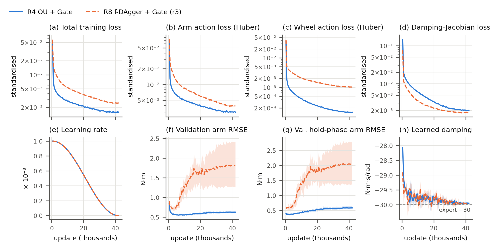
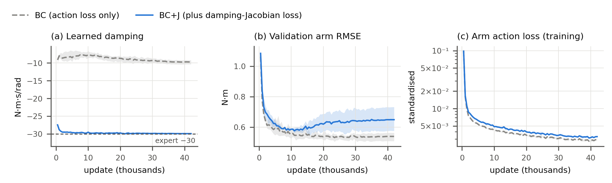
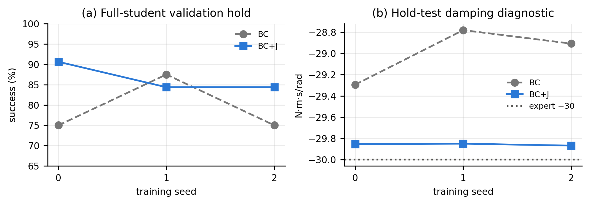

# 05. Training details

This folder holds the evidence for the report's training section: the network, the loss function (including the damping-Jacobian term), the optimiser and learning-rate schedule, the update budget, how the data are sampled, and the training curves. It contains the figures, the tables, the code that produced them and the logs behind every number.

**Question.** How exactly is every model in the report trained, why these settings, and what do the training curves show?

Every model in the R1–R8 ablation ([`../06_ablation/`](../06_ablation/README.md); all rounds and seeds: 40 runs) uses **one identical recipe**. `tables/recipe_check.csv` reads the resolved `config.yaml` of every run and finds exactly one distinct recipe. The full-DART baseline (R9, [`../07_training_time_comparison/`](../07_training_time_comparison/README.md)) uses the same recipe (checked the same way on its 14 runs). Only the training data and the input set (21 or 22 features) differ between runs.

## The recipe

| Part | Setting | Code |
|---|---|---|
| Network (`MLP01`) | 3 hidden layers of 256 units, each `Linear → LayerNorm (ε = 1e-5) → SiLU`; two linear heads: 7 joint torques and 2 wheel speeds (right, left), expanded to `[FR, FL, BL, BR] = [r, l, l, r]` | `training/common/models.py` |
| Size | 141,321 parameters with 22 inputs; exported as a 1.1 MB NumPy file; 83 µs per control step (features + FK + MLP, one CPU thread) | |
| Inputs / outputs | z-scored with population mean and std of the fitting rows (every row counted once); std floors 0.1 N·m (torques) and 0.05 rad/s (wheels) | `training/common/normalisation.py` |
| Action loss | Huber (δ = 1, standardised units), mean over the 7 torques and mean over the 2 wheels, weighted **0.5 / 0.5** | `training/baseline/loss.py` |
| Jacobian loss | Squared error between the network's 7×7 `∂τ̂/∂q̇` and the expert's `−30·I` (standardised), on a 256-row sub-batch | `training/jacobian/loss.py`, `evaluation/offline.py` |
| Optimiser | AdamW, weight decay 1e-4 on all parameters, default betas; no gradient clipping | `training/common/engine.py` |
| Learning rate | Peak 1e-3; linear warm-up over 500 updates, then cosine decay to 0 at the last update | `engine.lr_factor` |
| Budget | 42,000 updates, batch 1,024 rows, float32, on the GPU | `experiments/configs/common.yaml` |
| Sampling | Each row of a batch: pick an episode uniformly, then a time step uniformly within it, so every episode weighs the same whatever its length | `training/common/dataset.py` (`sample_indices`) |
| Seeds | 0, 1, 2; independent streams for initialisation, batches and Jacobian sub-batches, all derived from the seed | `engine.stream_seed` |
| Model used | The **terminal** checkpoint (update 42,000); no checkpoint or early-stopping selection | `training/datasets/train.py` |
| Logging | Every 500 updates: mean training losses over those 500 updates, plus offline validation metrics; checkpoints every 2,000 | `engine.fit` |

### Loss function

With standardised predictions `ŷ` and expert labels `y*`, and Huber loss ℓ (δ = 1):

```text
L_action = 0.5 · mean_{j=1..7} ℓ(τ̂_j − τ*_j)  +  0.5 · mean_{w ∈ {r, l}} ℓ(ŵ − w*)
L_J      = mean over valid entries of (J − J*)²,   J = ∂τ̂/∂q̇ (7×7, standardised),   J* = −30 · I · σ_q̇ / σ_τ
L        = L_action + λ_J · L_J
```

- **Why a Jacobian term.** The expert's joint damping is exact: wherever its torque is not clipped, `∂τ/∂q̇ = −30·I`. Matching derivatives as well as values (Sobolev training [1]; TaSIL [2]) constrains the local feedback law that holds the arm on target, which matching values alone leaves under-determined.
- **Valid entries.** A joint's Jacobian row is left out when its label torque is within 1e-4 N·m of the ±30 N·m limit (no damping there). Wheels get the action loss only.
- **How J is computed.** `torch.func.vmap(jacrev(...))` over the 256-row sub-batch, differentiated through to the weights.
- **λ_J calibration.** λ_J is set once per training variant so that `λ_J · L_J = 0.1 · L_action` at the seed-0 initialisation, on a fixed 1,024-row fitting batch. All seeds of a variant share it (`tables/lambda_j.csv`): 0.065–0.074 for R1–R4, 0.13 for R8, 0.37–0.43 for R7 and 0.00025–0.00032 for R5–R6. The spread comes from units, not from a different weighting. `J*` is standardised by σ_q̇, which is large in the R5–R6 DAgger data: their round-1 collectors were untrained students moving the arm fast. So the initial `L_J` is large and λ_J small. The learned physical damping is the same in every run (below).
- **Why Huber.** The choice was empirical: in a matched pilot (see "Where the settings come from"), Huber beat MSE on every offline error measure except saturated rows. A plausible reason is the heavy tail of the torque labels (500 Hz hold chatter of ±30 N·m in about 10% of hold windows), which a squared loss weights heavily.

## Training curves



`figures/training_curves.pdf` is the IEEE double-column version. Lines are the mean of 3 seeds; bands span the seed minimum to maximum. The two runs are OU + Gate (R4, clean + OU-noise data; round 0 of f-DAgger + Gate) and f-DAgger + Gate round 3 (R8-r3, clean + OU + 3 DAgger rounds).

What the curves show (`tables/terminal_metrics.csv` has every run):

1. **The training loss falls smoothly to the end, on every component.** Most of the drop happens in the first 2,000 updates. The rest follows the cosine decay of the learning rate. For these two runs the Jacobian loss falls from about 0.1 to 0.002. All 40 runs completed the 42k updates; the engine stops on any non-finite loss, and none did.
2. **R8-r3 ends at a higher training loss than R4** (total 2.4–2.5×10⁻³ vs 1.5–1.6×10⁻³; wheel loss about 7× higher). Its data contain the states the student visited, which are more varied and harder to fit than the expert's own path.
3. **The learned damping reaches −30 within about 5,000 updates and stays there**, in all 40 runs: the terminal median diagonal is −29.9 to −30.1 N·m·s/rad.
4. **The offline validation error rises while the training loss keeps falling.** It is measured on the *expert's* states in the 32 validation episodes. The best arm RMSE comes early (R4 at 6,000–11,500 updates, 0.54–0.55 N·m; R8-r3 at 2,500–3,500 updates, 0.64–0.76 N·m) and then rises (terminal R4 0.61–0.66, R8-r3 1.27–2.41 N·m). This is not overfitting to the fitting episodes: R8-r3 has the worst terminal offline error of the two, but the best closed-loop result (validation 93/96 against R4's 83/96; test T0 99.0% against 96.9%). Its capacity goes to the states the student actually reaches, not to reproducing the expert's nominal path. So offline error on expert states is a diagnostic, not a selection metric. The terminal checkpoint is used and closed-loop success is the measure.

The curves of every row (training losses on top, offline validation on the bottom; DAgger rows overlay rounds 0–3) are in `figures/per_row/`.

## What the Jacobian loss does

There are two complementary checks: the older clean-data M6 experiment isolates the learned damping offline; the R4 experiment below checks the objective on the report's MLP01 network with OU correction data in closed loop. Implementation checks are documented separately below. The original implementation, tests and experiment definitions are included in [`code/source_snapshot/`](code/source_snapshot/README.md).

### Clean-data M6: offline damping comparison



A matched pair from the archived clean-data experiments (`tables/jacobian_effect.csv`). The network is M6 (256-128-64), trained on clean data with lr 1e-3, 42k cosine updates and Huber loss, 3 seeds. The two arms differ only in the objective:

| Objective | Learned damping (terminal median) | Validation arm RMSE (terminal) | Hold torque bias, max |·| | Training time |
|---|---|---|---|---|
| BC (action loss only) | −9.2 to −10.4 N·m·s/rad | 0.51–0.56 N·m | 2.4–4.4 N·m | 1.0 min |
| BC+J (λ_J = 0.070) | **−29.9 N·m·s/rad** | 0.58–0.73 N·m | 2.4–7.3 N·m | 3.4 min |

Without the Jacobian term, this clean-data M6 network learns a third of the expert's damping, even though its offline error is slightly lower. The term costs about 3.4× the training time per run (the per-row Jacobian) and a little offline accuracy on expert states. Matching damping alone does not guarantee closed-loop success: R1–R3 have the right damping (−29.9) and still fail closed-loop (1–10/96). Corrective data are also needed in these experiments ([`../04_f_dagger/`](../04_f_dagger/README.md)).

### R4 OU + Gate: closed-loop objective validation



The objective ablation of **2026-11-04** trains `R4-dart-gate-bc` with the action loss only and compares it with the existing `R4-dart-gate` BC+J runs from **2026-10-28**. Both use MLP01 (256×3, 22 inputs), the same Clean_253 + OU (`d2-s075-x2`) data, Huber action loss, lr 1e-3, 42,000 updates, terminal checkpoint, and seeds 0, 1, 2. The BC+J weight is λ_J = 0.07439793449003185. The per-seed resolved configurations confirm identical selected architecture, training settings, action loss, data settings, fitting and validation IDs, dataset hashes, normaliser hash, and evaluation settings; see [`tables/jacobian_config_audit.csv`](tables/jacobian_config_audit.csv). Initialisation uses the seed's independent `init` stream (`training/common/engine.py`), shared by the two objectives.

The primary measure is sustained hold by the **full student** (student arm and wheels) on the same 32 validation scenarios per seed. These are validation results, not the unified test suites. [`tables/jacobian_closed_loop.csv`](tables/jacobian_closed_loop.csv) pools the three seeds; [`tables/jacobian_closed_loop_per_seed.csv`](tables/jacobian_closed_loop_per_seed.csv) retains each run.

| Objective | Full-student hold, seeds 0 / 1 / 2 (each /32) | Pooled validation hold | Arm-only validation hold | Arm hold diagnostic (8 fitting scenarios × 3 seeds) | Hold-diagnostic damping, median across seeds |
|---|---|---|---|---|---|
| BC | 24 / 28 / 24 | 76/96 = 79.2% (Wilson 95%: 70.0–86.1%) | 77/96 = 80.2% | 21/24 | −28.91 N·m·s/rad |
| BC+J | 29 / 27 / 27 | 83/96 = 86.5% (Wilson 95%: 78.2–91.9%) | 78/96 = 81.3% | 23/24 | −29.86 N·m·s/rad |

Adding the Jacobian term is associated with **7 more successful validation rollouts out of 96 (+7.3 percentage points)**. The paired seed changes are +5, −1, +3 successes; the benefit is not uniform across seeds. Arm-only validation differs by just one success. OU correction data already let plain BC learn damping close to −30 (about −28.8 to −29.3 in the hold diagnostic), unlike the clean-only M6 result above. BC+J brings that diagnostic closer to the teacher (about −29.85 to −29.87). The evidence therefore supports an additional feedback constraint with a modest observed full-student benefit in R4, rather than claiming that the loss is always essential or guarantees success.

**Scope of the evidence.** The damping column is the `hold_test_median_damping_diag` diagnostic from eight **fitting** scenarios, followed by a median over the three seeds; it is not the offline `val_damping_median_diag` on validation states used in the training curves. The hold diagnostic is also not a held-out test set. Pooled Wilson intervals describe the counts; the same scenarios recur across seeds and the intervals are not a paired significance test. Only three seeds were run. BC+J reuses the October runs rather than a simultaneous retraining: their recorded code digests differ and are retained in the config audit. The current source snapshot supports inspection and reproduction of the implementation, not reconstruction of both historical code revisions.

The copied per-scene validation files reproduce all full-student and arm-only counts. `code/build_jacobian_validation.py` checks these against the run summaries and verifies the configuration pairing before generating the tables and figure. The BC+J source `runs.csv` contains R1–R4; the script explicitly selects R4.

### Implementation correctness checks

The included [`test_jacobian.py`](code/source_snapshot/tests/training/test_jacobian.py) checks nine properties:

| Check | What it establishes |
|---|---|
| Finite differences | `vmap(jacrev(...))` agrees with central differences on an MLP, h = 1e-6, float64, rtol = 1e-6 and atol = 1e-8 |
| Known linear damping | The Jacobian loss is zero at −30·I and has the expected positive value for an incorrect diagonal or cross-joint terms |
| Parameter gradients | The derivative loss backpropagates to the model weights |
| Optimisation direction | One gradient step moves a −20 diagonal towards −30 |
| Standardised units | The derivative target includes σ_q̇ / σ_τ correctly |
| Torque-limit mask | Near-limit joint rows are excluded; no valid entries falls back to the action loss without NaNs |
| Zero λ_J | The result equals the baseline action loss exactly and no derivatives are computed |
| Sampling RNG | Jacobian sub-batches consume their own generator and leave the global RNG unchanged |
| Calibration | λ_J·L_J = 0.1·L_action at calibration, initial weights are preserved, and a zero denominator is rejected |

These verify the numerical implementation, not closed-loop stability. The loss is in [`training/jacobian/loss.py`](code/source_snapshot/training/jacobian/loss.py); derivative targets, autodiff and physical-unit damping diagnostics are in [`evaluation/offline.py`](code/source_snapshot/evaluation/offline.py). The snapshot also includes action loss, normalisation, the MLP, initialisation/engine code, test fixtures, the experiment runner, both manifests and both R4 dataset definitions. File hashes and original paths are recorded in [`data/jacobian_validation_sources.json`](data/jacobian_validation_sources.json).

Verification on **2026-11-04**: all **9 tests passed**, all **33 source/data copies** matched both their recorded SHA-256 hashes and repository originals, and the R4 table/figure builder passed all configuration-pairing and per-scene count checks. This verification did not retrain models or rerun simulator rollouts; the closed-loop results are the recorded experiments above.

## Where the settings come from

The learning rate, budget and loss type were fixed by pilots on the earlier clean-data pipeline, then frozen and reused unchanged for R1–R8. Those pilots are cited here, not copied (their run logs are in `Archive/`). Each decision was frozen as a hash-chained protocol file in `Archive/final/robotnik_arm_task/experiments/protocols/`:

| Setting | Decision | Evidence (protocol) |
|---|---|---|
| Budget: 42,000 updates | Constant-LR pilot, 50k updates (M2 128×128, BC, lr 1e-3 and 3e-4). Validation arm and wheel RMSE both stay within 10% of their best after 28k updates; budget = 1.5 × 28k | `p-0dedccad51dc` |
| Action loss: Huber | Matched M2 Huber/MSE pair (42k cosine, lr 3e-4, seed 0). Huber is better on arm RMSE (0.58 vs 0.70 N·m), wheel RMSE (0.059 vs 0.10 rad/s), hold-phase arm RMSE (0.37 vs 0.63 N·m) and max hold bias (3.03 vs 6.33 N·m). MSE is marginally better only on saturated rows (1.89 vs 1.97) | `p-2a37f68e30af` |
| Learning rate: 1e-3 for 256×3 | Offline screen of 6 architectures × {1e-3, 3e-4, 1e-4}; the 256×3 network (then called m5, now MLP01) was best at 1e-3 | `p-9e89dc42395f` |
| λ_J ratio 0.1, cosine schedule, warm-up 500, AdamW, batch 1,024, weight decay 1e-4 | Defaults of the training plan, set before the pilots and not tuned | `experiments/configs/common.yaml`, `objectives/bcj.yaml` |
| Arm/wheel weights 0.5 / 0.5 | Equal action-group weights, as in the clean final protocol and the OU-noise (DART-style) prototype; fixed in the v1 ablation manifest | `experiments/ablation/2026-10-28__training-ablation-v1.yaml` |

The per-architecture learning-rate screen of 2026-11-02 (other network sizes at 3e-4 to 1e-2) belongs to the network-size ablation and is not covered here. It confirmed 1e-3 for most sizes; MLP01 itself was not re-screened.

## Layout

```
05_training_details/
  README.md
  figures/   training_curves.{pdf,png}     OU + Gate (R4) vs f-DAgger + Gate r3 (R8-r3): losses, lr, offline validation (report figure)
             jacobian_effect.{pdf,png}     M6 BC vs BC+J: damping, validation arm RMSE, training arm loss (report figure)
             jacobian_closed_loop.{pdf,png} R4 BC vs BC+J: per-seed validation hold and hold-diagnostic damping
             per_row/<row>.png             the full 10-panel curves of each of R1-R8 (copied from results/ablation/*/figures/training/)
  tables/    recipe_check.csv, lambda_j.csv, terminal_metrics.csv, jacobian_effect.csv   (code/make_tables.py)
             jacobian_closed_loop.csv, jacobian_closed_loop_per_seed.csv, jacobian_config_audit.csv
  data/      runs/<experiment>/<run>/{metrics.csv,config.yaml}   all 40 R1-R8 runs (v1 2026-10-28, v2 2026-11-01, extra seeds 2026-11-03)
             jacobian_effect/<run>/{metrics.csv,config.yaml}     the 6 archived M6 runs (BC and BC+J, seeds 0-2)
             objective_ablation/{bc,bcj}/  run summaries, resolved configs and per-scene validation CSVs
             jacobian_validation_sources.json   original paths and SHA-256 of all new evidence/source copies
  code/      make_tables.py                data/ -> tables/
             plot_training.py              data/ -> figures/training_curves.*, figures/jacobian_effect.*
             build_jacobian_validation.py   objective_ablation/ -> R4 validation tables and figure
             verify_jacobian_sources.py     verify evidence/code copies against hashes and repository sources
             source_snapshot/              loss, derivative diagnostics, tests/fixtures and experiment code/configs
```

`metrics.csv` columns: `update`, `elapsed_s`, `lr`, the training losses (`train_loss`, `train_arm_loss`, `train_wheel_loss`, and `jacobian_loss` in the JSON `extra` column), and the offline validation metrics on the 32 validation episodes (`val_arm_rmse_nm`, `val_wheel_rmse_rad_s`, `val_hold_arm_rmse_nm` on hold-phase rows, `val_hold_bias_max_abs_nm` = largest mean torque error over an episode's final second, and `val_damping_median_diag` = median diagonal of the learned `∂τ̂/∂q̇` on up to 4,096 hold-phase rows).

## Reproduce

All commands run from `final/robotnik_arm_task/`. Every number in this folder is already in `data/` and `tables/`.

```bash
python report/05_training_details/code/make_tables.py      # tables/ from data/
python report/05_training_details/code/plot_training.py    # figures/ from data/ (needs matplotlib)
python report/05_training_details/code/build_jacobian_validation.py  # R4 objective comparison, no training
python report/05_training_details/code/verify_jacobian_sources.py    # hashes + live-source equality
python -m pytest ../../tests/training/test_jacobian.py -q            # nine numerical correctness checks
```

The test command runs the repository implementation after checking its equality to the copied source files; the snapshot retains the original imports and is not a standalone Python package. Install the repository's normal dependencies (including PyTorch, NumPy, pytest, PyYAML and matplotlib) in the Python environment used for these commands.

To rerun the new BC experiment, including validation and hold diagnostics, from the full repository with its datasets and simulator installed:

```bash
python -m experiments.ablation.run \
    --manifest report/05_training_details/code/source_snapshot/experiments/ablation/2026-11-04__objective-ablation-v1.yaml
```

This invokes the repository runner and the included `R4-dart-gate-bc` variant; it may train models if their exports are absent. The comparison reuses the R4 BC+J runs defined by the included `2026-10-28__training-ablation-v1.yaml`. Training checkpoints and datasets are not bundled into this report folder.

One training run (here R4 seed 0; the other rows change `--variant`, the seed and the version/date):

```bash
python -m training.datasets.train --variant R4-dart-gate \
    --set identity.version=v1 --set identity.date=2026-10-28 --set identity.seed=0 \
    --set identity.objective=bcj --set training.lr=1.0e-3 --set training.updates=42000 \
    --set loss.action=huber --set loss.arm_weight=0.5 --set loss.wheel_weight=0.5
```

`--dry-run` checks the data and prints the run identity, including λ_J; `--resume` continues from `latest.pt`. The DAgger rounds call this same command through `experiments/dagger_rounds.py`.

## Provenance and caveats

- **Pilots ran on an older setup.** The budget, loss and learning-rate pilots used clean data only, plain BC and the retired m1–m6 networks. The budget pilot ran M2 at lr 3e-4. Their decisions were frozen and carried over to R1–R8 without re-tuning, so the 42k budget and Huber loss were not re-checked on OU or DAgger data. The curves above show the training loss still falling slowly at 42k, so the budget is not obviously too short. The offline validation minimum comes much earlier, but offline error is not the selection metric.
- **Training time depends on the run.** Per run, the 42k updates took 6.1–6.2 min in v1 (2026-10-28) and 3.5–3.8 min in v2 (2026-11-01/03; one run took 7.1 min), on the same laptop GPU (RTX 5070 Ti). `elapsed_s` includes the offline validation every 500 updates. The training-time comparison uses about 4 min per run.
- **λ_J differs between variants by three orders of magnitude** for the units reason given above. The ratio rule (0.1 at initialisation) was fixed before the ablation and not tuned per row.
- **The M6 comparison is offline only.** It shows what the Jacobian term does to the learned feedback law. Closed-loop evidence that damping alone is not enough comes from R1–R3, which all use BC+J.
- **The R4 objective comparison is validation only.** It is a different experiment from the M6 offline comparison. Do not transfer its +7.3 percentage-point observation to R8 or held-out test suites; no BC / BC+J test-suite ablation is included here.
- **Data copies.** `data/runs/` holds the `metrics.csv` and `config.yaml` of each run, copied from `checkpoints/ablation/`. `data/jacobian_effect/` is copied from `Archive/final/robotnik_arm_task/checkpoints/clean/A/`. Checkpoints and datasets themselves are git-ignored and not copied.

References: [1] Czarnecki et al., *Sobolev Training for Neural Networks*, NeurIPS 2017. [2] Pfrommer et al., *TaSIL: Taylor Series Imitation Learning*, NeurIPS 2022. Optimiser: Loshchilov & Hutter, *Decoupled Weight Decay Regularization* (AdamW), ICLR 2019. LayerNorm: Ba et al., 2016.
