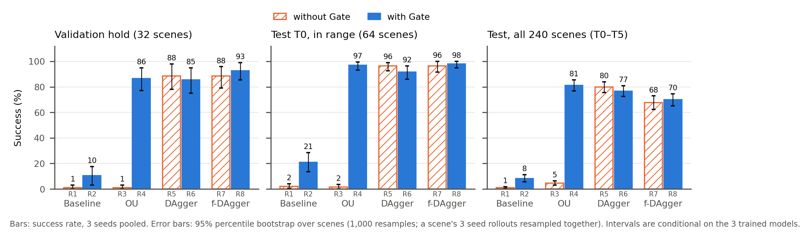
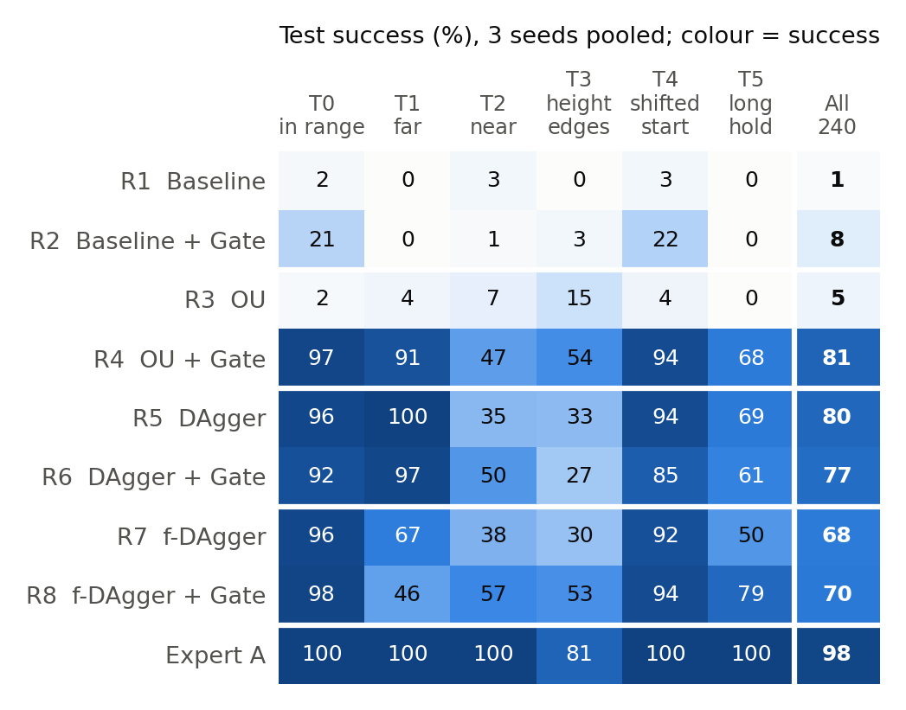
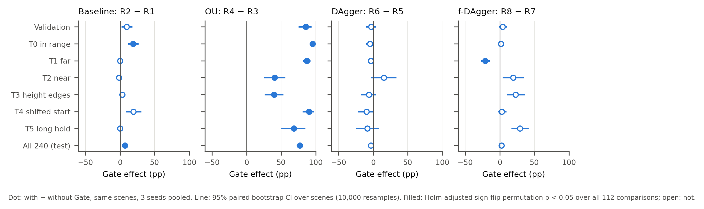
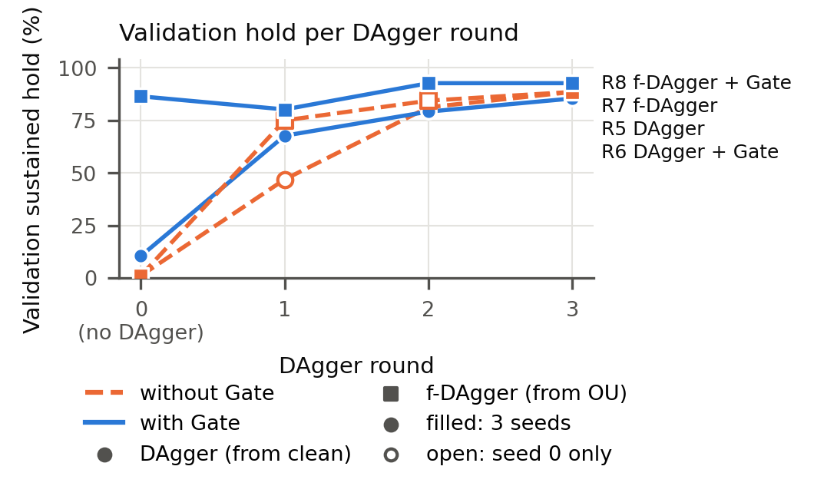
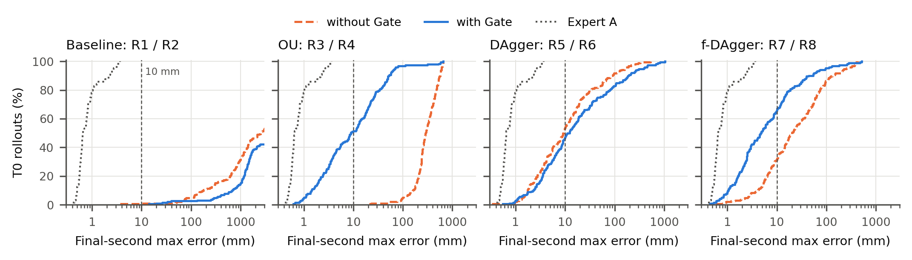

# 06. Ablation Experiment

This folder holds the evidence for the report's ablation section: the eight training-method rows R1–R8, their validation results, the unified test, the per-round DAgger results, and the cost and efficiency of each row. It contains the figures, the tables, the code that produced them and the data behind every number.

**Question.** What does each part of the training pipeline contribute: OU-noise data, DAgger, their combination (f-DAgger), and the reach-gate input?

**Versions.** R1–R4 are ablation v1 (2026-10-28). R5–R8 are ablation v3 (2026-11-05). In v3, every DAgger round rolls the student out on the 221 fitting scenarios only. v3 replaces v2, whose rounds also collected 64 low/near-biased development scenes; [`../08_dev_scene_removal/`](../08_dev_scene_removal/README.md) explains why and compares the two. v3 run ids carry `-nodev`, e.g. `R8-dart-gate-dagger-nodev-r3`.

## Naming

The row numbers and run ids are unchanged. Only the names used in the report are new: each of four data-collection methods is trained without and with the Gate. In the run ids, "dart" means the phase-gated OU-noise data, which this report calls **OU**.

| Row | Report name | Run id | Gate | OU noise | DAgger | Inputs | Training data |
|---|---|---|:---:|:---:|:---:|---|---|
| R1 | **Baseline** | `R1-baseline` | | | | 21 | 221 clean expert episodes |
| R2 | **Baseline + Gate** | `R2-gate` | ✓ | | | 22 | 221 clean expert episodes |
| R3 | **OU** | `R3-dart` | | ✓ | | 21 | 221 clean + 441 OU-noise episodes |
| R4 | **OU + Gate** | `R4-dart-gate` | ✓ | ✓ | | 22 | 221 clean + 441 OU-noise episodes |
| R5 | **DAgger** | `R5-baseline-dagger` | | | ✓ | 21 | R1 data + DAgger rounds 1–3 |
| R6 | **DAgger + Gate** | `R6-gate-dagger` | ✓ | | ✓ | 22 | R2 data + DAgger rounds 1–3 |
| R7 | **f-DAgger** | `R7-dart-dagger` | | ✓ | ✓ | 21 | R3 data + DAgger rounds 1–3 |
| R8 | **f-DAgger + Gate** | `R8-dart-gate-dagger` | ✓ | ✓ | ✓ | 22 | R4 data + DAgger rounds 1–3 |

`tables/naming.csv` has this mapping in machine-readable form. Every table and figure here carries both the row number and the report name.

- **Gate.** A 22nd input, `reach_gate`. It is 1 when the expert's own rule says the arm should reach: the base is within 0.12 m of the standoff distance and within 0.075 rad of the target heading. It is computed exactly from the other 21 inputs, so it adds no information. What it adds is the expert's switch from "hold the home pose" to "reach", as a single feature the network can use directly.
- **OU.** The 221 fitting scenarios are collected twice more, with Ornstein–Uhlenbeck noise added to the *executed* command: τ = 0.2 s; arm σ 0.75 N·m and wheels σ 0.15 rad/s, each × α ~ U[0.25, 1] per episode. The label is always the clean expert action at the visited state. 441 of the 442 episodes reached a sustained hold and are used. Design and parameter evidence: [`../04_f_dagger/`](../04_f_dagger/README.md).
- **DAgger.** The student drives alone (β = 0) on the 221 fitting scenarios each round. Expert A labels every visited state. The next student is trained from scratch on all data so far. There are three rounds; round 3 had the best seed-0 validation result in every row, so it is the model tested.
- **f-DAgger** = OU noise, then DAgger: the DAgger rounds start from the OU row's data and model (R7 from R3, R8 from R4).
- **Shared by all eight rows.** Expert A labels; the MLP01 network (256×3, LayerNorm, SiLU); BC + damping-Jacobian loss, Huber, AdamW, lr 1e-3, 42k updates; the terminal checkpoint; seeds 0, 1, 2. Details: [`../05_training_details/`](../05_training_details/README.md).

## How uncertainty is reported

Every number in this folder is one of the four kinds below. Each table and figure says which one it uses.

| Quantity | What is reported | Method | Unit of resampling | Where |
|---|---|---|---|---|
| Success rate of one row | rate, k/n, **95% CI** | Percentile bootstrap over **scenes**: 1,000 resamples, seed 1101031 (the test suite's own method). The 3 seed rollouts of a scene are resampled together, so they are not treated as independent. | scene (32 validation, 240 test) | `validation.csv` (`scene_boot95_*`), `test_by_band.csv` / `test_by_suite.csv` (`scene_boot95_*`), all error bars |
| Validation, reference only | Wilson 95% score interval | Binomial on 96 trials pooled over seeds. It assumes 96 independent trials and ignores that the same 32 scenes are run 3 times, so it is slightly narrower. Kept for comparison with older documents. | rollout | `validation.csv` (`wilson95_*_iid`) |
| Difference between two rows | difference in pp, **95% paired CI**, **p value**, **Holm-adjusted p** | Both rows run on the same scenes, so the comparison is paired. The per-scene difference in success (mean over 3 seeds) is bootstrapped over scenes (10,000 resamples). p: two-sided sign-flip permutation test of the mean per-scene difference (20,000 draws, p = (1 + #extreme) / (1 + 20,000)). Holm's step-down correction is applied over all 112 differences in `comparisons.csv`. | scene | `comparisons.csv` (all 12 one-factor contrasts of the 2×2×2 design plus 2 cross-method contrasts, on validation and each test suite), `gate_effect.csv`, `figures/gate_effect.*` |
| Seed-to-seed spread | per-seed counts; sign agreement over the 9 seed pairings | Descriptive only. With 3 seeds per row, no interval over training runs is attempted. "9/9" means that every pairing of a seed of one row with a seed of the other gives a difference of the same sign as the pooled one. | training seed | `hold_per_seed`, `per_seed`, `seed_pairings_same_sign` |

What the intervals do and do not cover:

- They cover **scene sampling**: how much the rate would change on another draw of scenes from the same distributions. They are **conditional on the 3 trained models** of each row and do not cover the variation from training more seeds.
- **Significance claims use the Holm-adjusted p < 0.05**, over every comparison in `comparisons.csv`. A raw p or a CI that excludes 0 without Holm significance is reported as "indicative", not as an effect. With 20,000 permutations the smallest possible raw p is 5×10⁻⁵ and the smallest Holm p 0.0056, so these values mean "at the resolution limit".
- Validation chose the DAgger round count, so validation differences between R5–R8 are slightly optimistic. The test intervals are the unbiased ones.
- The percentile bootstrap can undercover when there are few scenes: T2, T4 and T5 have 24 scenes each and T3 has 32 (16 per band). Treat their intervals as approximate.
- DAgger-round counts (`validation_by_round.csv`), the hold test, terminal grades, failure modes and cost are **descriptive counts with no interval**.

## Main result



`figures/ablation_overview.pdf` is the IEEE double-column version. Hatched orange bars are without the Gate, solid blue bars with it. **Error bars: 95% percentile bootstrap CI over scenes** (validation 32 scenes, T0 64, all 240), with each scene's 3 seed rollouts resampled together.

**Validation** (`tables/validation.csv`; 32 validation scenes × 3 seeds; sustained hold = continuous < 10 mm until the end):

| Row | Report name | Hold per seed | Pooled | 95% CI (scene bootstrap) | Wilson 95% (iid, reference) | Median final error |
|---|---|---|---|---|---|---|
| R1 | Baseline | 0 / 1 / 0 | 1/96 | 0.00–0.03 | 0.00–0.06 | 930 mm |
| R2 | Baseline + Gate | 2 / 3 / 5 | 10/96 | 0.03–0.18 | 0.06–0.18 | 1051 mm |
| R3 | OU | 0 / 1 / 0 | 1/96 | 0.00–0.03 | 0.00–0.06 | 293 mm |
| R4 | OU + Gate | 29 / 27 / 27 | 83/96 | 0.77–0.95 | 0.78–0.92 | 1.3 mm |
| R5 | DAgger | 28 / 29 / 28 | 85/96 | 0.78–0.98 | 0.81–0.93 | 2.8 mm |
| R6 | DAgger + Gate | 28 / 26 / 28 | 82/96 | 0.75–0.95 | 0.77–0.91 | 2.1 mm |
| R7 | f-DAgger | 28 / 29 / 28 | 85/96 | 0.79–0.96 | 0.81–0.93 | 2.3 mm |
| R8 | **f-DAgger + Gate** | 29 / 29 / 31 | **89/96** | 0.85–0.99 | 0.86–0.96 | **1.4 mm** |

R4–R8 overlap in their intervals; no paired difference between them on validation is Holm-significant (below).

**Unified test** (`tables/test_by_suite.csv`; 240 scenes × 3 seeds; success = continuous < 10 mm for 3 s, or 20 s on T5; the last column is the 95% scene-bootstrap CI; per-suite CIs are in `tables/test_by_band.csv`). R1–R4 and the expert come from the 2026-11-01 test run and R5–R8 from the 2026-11-05 run. Both runs use the same frozen scenes and simulator code, and the expert's 240 rollouts are identical in both (`code/test_data.py` checks this on every load).

| Row | Report name | T0 in range | T1 far 3–15 m | T2 near | T3 height edges | T4 shifted start | T5 long hold | All 240 [95% CI, scene bootstrap] |
|---|---|---|---|---|---|---|---|---|
| – | Expert A (teacher) | 100 | 100 | 100 | 81.2 | 100 | 100 | 97.5 [95.4, 99.2] |
| R1 | Baseline | 2.1 | 0.0 | 2.8 | 0.0 | 2.8 | 0.0 | 1.1 [0.4, 1.9] |
| R2 | Baseline + Gate | 20.8 | 0.0 | 1.4 | 3.1 | 22.2 | 0.0 | 8.3 [5.7, 11.3] |
| R3 | OU | 1.6 | 3.7 | 6.9 | 14.6 | 4.2 | 0.0 | 4.6 [3.1, 6.4] |
| R4 | **OU + Gate** | 96.9 | 90.7 | 47.2 | **54.2** | **94.4** | 68.1 | **81.2** [76.8, 85.6] |
| R5 | DAgger | 96.4 | **100** | 34.7 | 33.3 | **94.4** | 69.4 | 80.0 [75.6, 83.9] |
| R6 | DAgger + Gate | 91.7 | 96.8 | 50.0 | 27.1 | 84.7 | 61.1 | 76.7 [72.4, 81.0] |
| R7 | f-DAgger | 96.4 | 66.7 | 37.5 | 30.2 | 91.7 | 50.0 | 67.6 [62.4, 72.9] |
| R8 | f-DAgger + Gate | **97.9** | 45.8 | **56.9** | 53.1 | **94.4** | **79.2** | 70.0 [65.1, 74.6] |

Bold marks the highest point estimate in each column; it does not mean the row is significantly better than the others (see below).

Bands (`tables/test_by_band.csv`):

| Row | T1 3–6 m | T1 6–10 m | T1 10–15 m | T3 low (z 0.05–0.10 m) | T3 high (z 1.25–1.30 m) |
|---|---|---|---|---|---|
| Expert A | 100 | 100 | 100 | 62.5 | 100 |
| R4 OU + Gate | 97.2 | 97.2 | 77.8 | 16.7 | **91.7** |
| R5 DAgger | 100 | 100 | 100 | **39.6** | 27.1 |
| R6 DAgger + Gate | 94.4 | 98.6 | 97.2 | 18.8 | 35.4 |
| R7 f-DAgger | 100 | 90.3 | 9.7 | 31.2 | 29.2 |
| R8 f-DAgger + Gate | 95.8 | 36.1 | 5.6 | 31.2 | 75.0 |



The heatmap shows point estimates only. Per band, with the 95% scene-bootstrap CI, per-seed counts, median completion time and median terminal error: `tables/test_by_band.csv`.

## What the ablation shows

Each claim gives the paired difference Δ (with minus without, percentage points) with its **95% paired scene-bootstrap CI** and the **Holm-adjusted p** (`tables/comparisons.csv`).

1. **Without DAgger, OU and the Gate work only together.**
   - OU alone vs Baseline (R3 − R1), validation: Δ = 0.0 [−3.1, 3.1], p_Holm = 1.
   - Gate alone (R2 − R1), validation: Δ = +9.4 [+2.1, +17.7], raw p = 0.046, p_Holm = 1 (indicative only). On T0 the Gate alone is significant but small: Δ = +18.8 [+11.5, +26.6], p_Holm = 0.0056.
   - Adding the Gate to OU (R4 − R3), validation: Δ = **+85.4** [+75.0, +93.8]. Adding OU to the Gate (R4 − R2): Δ = **+76.0** [+65.6, +86.5]. Both have p_Holm = 0.0056 and 9/9 seed pairings agree.
   - The two components fix different failures (`tables/hold_test.csv`, below): OU fixes the hold, the Gate fixes the start of the reach.
2. **OU + Gate needs no DAgger round, and three DAgger rounds do not beat it.** Neither DAgger + Gate (R6) nor f-DAgger + Gate (R8) is significantly better than OU + Gate on any metric.
   - DAgger + Gate − OU + Gate (R6 − R4): validation Δ = −1.0 [−10.4, +8.3]; T0 Δ = −5.2 [−11.5, 0.0]; all 240 Δ = −4.6 [−8.6, −0.7] (raw p = 0.029); p_Holm = 1 for all three. OU + Gate is better on T3 (Δ = −27.1 [−41.7, −13.5], raw p = 0.0014, p_Holm = 0.078, indicative). OU + Gate needs no train→collect cycle (3.3 vs 24.3 min added; `tables/cost.csv`).
   - f-DAgger + Gate − OU + Gate (R8 − R4), i.e. three DAgger rounds added after OU + Gate: validation Δ = +6.2 [−1.0, +15.6]; T0 Δ = +1.0 [−2.6, +4.7]; p_Holm = 1. Over all 240 scenes the rounds make it **worse**: Δ = **−11.2** [−16.1, −6.5], p_Holm = 0.0056, 9/9 seed pairings agree. The loss is on far targets (T1 Δ = −44.9 [−52.8, −36.6], p_Holm = 0.0056). The other suites change by −1.0 to +11.1, none significant.
   - So the best row over all 240 scenes is OU + Gate (81.2%). DAgger (R5, 80.0%) and DAgger + Gate (R6, 76.7%) are not significantly different from it; f-DAgger (R7) and f-DAgger + Gate (R8) are.
3. **Starting DAgger from OU data (f-DAgger) instead of clean data: better high targets, worse far targets.**
   - With the Gate (R8 − R6): T3 Δ = **+26.0** [+15.6, +36.5], p_Holm = 0.018, almost all from the high band (75.0 vs 35.4%); T1 Δ = **−50.9** [−60.6, −41.2], p_Holm = 0.0056. In range nothing is significant: validation Δ = +7.3 [0.0, +14.6], T0 Δ = +6.2 [+0.5, +12.5] (raw p = 0.062), T2 Δ = +6.9 [−8.3, +22.2], T5 Δ = +18.1 [+5.6, +30.6] (raw p = 0.018); all p_Holm ≥ 0.9.
   - Without the Gate (R7 − R5): T1 Δ = −33.3 [−43.5, −23.6] and all 240 Δ = −12.4 [−17.2, −7.8], both p_Holm = 0.0056; validation and T0 Δ = 0.0.
4. **Once DAgger is used, the Gate has no significant benefit** (`tables/gate_effect.csv`, `figures/gate_effect.*`).
   - With DAgger (R6 − R5): no metric reaches Holm significance; all 240 Δ = −3.3 [−6.8, +0.1].
   - With f-DAgger (R8 − R7): T3 Δ = +22.9 [+10.4, +36.5] (raw p = 0.0032, p_Holm = 0.18), T5 Δ = +29.2 [+16.7, +41.7] (raw p = 0.001, p_Holm = 0.06) and T2 Δ = +19.4 [+4.2, +34.7] (raw p = 0.038) are indicative only. T1 Δ = −20.8 [−27.3, −14.4] is significant (p_Holm = 0.0056), against the Gate. Over all 240 scenes Δ = +2.4 [−1.8, +6.5].
5. **Far targets (T1) follow the far-target coverage of the DAgger data, not the method** (see the caveats). The DAgger rows that start from a student that cannot reach (R5 from Baseline, R6 from Baseline + Gate) drive far away while collecting round 1. Their round-1 data contain 3.37 M (R5) and 2.26 M (R6) rows with the target more than 3 m away, up to 736 m and 859 m, and they reach 100% and 96.8% on T1. Every other training dataset stops at 3.1 m. Without such data, OU + Gate still reaches 90.7% (77.8% at 10–15 m). The DAgger rows that start from OU data (R7, R8) fall to 66.7% and 45.8%. All 117 T1 failures of f-DAgger + Gate never came within 10 mm (`tables/failure_modes.csv`): they are navigation failures.
6. **Where the remaining failures are** (`tables/failure_modes.csv`; counts, no interval). Outside T1, every row with a working controller fails mainly on T2 and T3, often as near misses: the median closest approach of the failures is 10–20 mm. On T5 (20 s hold) almost every failure first reached the target and then lost the hold. f-DAgger + Gate has the fewest T5 failures (15/72, against 22–36 for R4–R7). T3 low targets are hard for everyone: the expert itself holds only 10 of the 16 low scenes.



`figures/gate_effect.pdf`: the Gate effect (with − without) per method and metric. Lines are 95% paired scene-bootstrap CIs; filled dots are Holm-significant (p < 0.05 over all 112 comparisons), open dots are not.

### Why the two components of OU + Gate are both needed

`tables/hold_test.csv` (R1–R4 only; 8 scenes × 3 seeds; descriptive counts and medians, no interval). The student is started at the expert's own hold state and must stay within 10 mm for 10 s. The stiffness is the largest eigenvalue of the linearised position feedback.

| Row | Report name | Arm stays on target | Max stiffness eigenvalue (median) | Max real eigenvalue of the closed loop (median) |
|---|---|---|---|---|
| R1 | Baseline | 8/24 | 143 N·m/rad | 0.73 |
| R2 | Baseline + Gate | 3/24 | 113 N·m/rad | 0.92 |
| R3 | OU | **24/24** | **1.4 N·m/rad** | 0.02 |
| R4 | OU + Gate | 23/24 | 1.7 N·m/rad | 0.03 |

The expert's closed-loop maximum real eigenvalue is 0.004 on the same states. OU data make the hold stable, with or without the Gate. Without the Gate, the OU student holds the home pose so firmly that it never starts the reach (R3 validation 1/96, median final error 293 mm). The Gate gives the network the expert's switch, and the reach starts.

### DAgger rounds



`tables/validation_by_round.csv` (counts, no interval). Round 0 is the starting model (R1–R4, 3 seeds). For rounds 1–2, all 3 seeds exist only for the Gate rows (extra seeds trained on the same v3 datasets); DAgger and f-DAgger without the Gate have seed 0 only there (open markers).

| Row | Report name | Round 0 | Round 1 | Round 2 | Round 3 |
|---|---|---|---|---|---|
| R5 | DAgger | 1/96 | 15/32 | 26/32 | 85/96 |
| R6 | DAgger + Gate | 10/96 | 65/96 | 76/96 | 82/96 |
| R7 | f-DAgger | 1/96 | 24/32 | 27/32 | 85/96 |
| R8 | f-DAgger + Gate | 83/96 | 77/96 | 89/96 | 89/96 |

Only f-DAgger + Gate starts high: its first round records small on-policy deviations around a working controller. The others spend their first round recording an untrained student failing ([`../04_f_dagger/tables/dagger_collections.csv`](../04_f_dagger/README.md)). Its round 1 is lower than its round 0 on validation (77 vs 83 of 96).

### Terminal precision



The final-second maximum error on the 64 T0 scenes, per method (empirical distribution of all 192 rollouts per row; no interval). `tables/terminal_grades.csv` has grades over all 240 scenes: A < 5, B 5–10, C 10–20, D 20–50, E ≥ 50 mm. The Gate shifts the f-DAgger curve furthest to the left: 66% of f-DAgger + Gate T0 rollouts end below 10 mm, against 31% for f-DAgger. With DAgger alone the Gate shifts the curve slightly to the right (47% vs 54%).

**In-range precision, paired by scene** (`tables/precision.csv`; **secondary analysis, added after the v3 results were seen**, so it is not covered by the Holm family above). The metric is the suite's predefined final-second maximum error; the ratio compares per-scene geometric means of the 3 seeds, with a 95% scene bootstrap (10,000). On T0, f-DAgger + Gate's terminal error is **0.64×** that of OU + Gate [0.49, 0.85] and **0.38×** that of DAgger + Gate [0.28, 0.53]; over T0 + T4 + T5 (112 in-range scenes) the ratios are 0.60× [0.49, 0.75] and 0.42× [0.32, 0.55]. Median T0 final-second error: f-DAgger + Gate 4.8 mm (51% of rollouts below 5 mm), OU + Gate 8.9 mm (39%), DAgger + Gate 11.7 mm (29%); expert 0.65 mm. Per round, f-DAgger + Gate's T0 median is 8.9 / 9.3 / 6.8 / 4.8 mm for rounds 0–3 (`../07_training_time_comparison/data/rollouts_used.csv`): rounds 2–3, not round 1, bring the gain.

## Cost and efficiency

`tables/cost.csv`. Added wall time and expert labels are counted beyond the shared clean collection and round-0 training. DAgger times are the seed-0 chain from the 2026-11-05 v3 run log (collect + build + train + validate per round).

| Row | Report name | Training episodes | Training rows | Added expert labels | Added wall time | Sequential train→collect cycles |
|---|---|---|---|---|---|---|
| R1 / R2 | Baseline (+ Gate) | 221 | 2.66 M | 0 | 0 | 0 |
| R3 / R4 | OU (+ Gate) | 662 | 7.95 M | 5.29 M | 3.3 min | 0 |
| R5 | DAgger | 884 | 18.39 M | 15.73 M | 25.5 min | 3 |
| R6 | DAgger + Gate | 884 | 16.89 M | 14.23 M | 24.3 min | 3 |
| R7 | f-DAgger | 1,325 | 22.74 M | 20.09 M | 28.7 min | 3 |
| R8 | f-DAgger + Gate | 1,325 | 16.33 M | 13.67 M | 23.5 min | 3 |

f-DAgger + Gate has the *fewest* DAgger rows of the four DAgger rows. A DAgger episode ends 3 s after the first task reach or at the 40 s cap, and its collector students already reach from round 1 on (median round-1 episode 11,000 rows, against 40,000 for the other three rows). The OU collection needs no trained student, so it can run alongside the clean collection.

`tables/efficiency.csv`. All rows use the same network: 141,065 parameters with 21 inputs, 141,321 with 22 (551–552 KiB as float32). The Gate costs 256 parameters. In the test rollouts the median per-step inference latency (p50) was 168–231 µs, well inside the 1 ms control period. These rollouts ran 20 in parallel; on one idle CPU thread the measured cost is 83 µs per step (features + FK + MLP; [`../05_training_details/`](../05_training_details/README.md)).

## Layout

```
06_ablation/
  README.md
  figures/   ablation_overview.{pdf,png}     validation, test T0, test all 240; 4 methods x without/with Gate (report figure)
             test_suites.{pdf,png}           success per suite T0-T5 and all 240, R1-R8 and expert A
             dagger_rounds.{pdf,png}         validation per DAgger round, R5-R8
             terminal_error_ecdf.{pdf,png}   T0 final-second max error, one panel per method
             gate_effect.{pdf,png}           Gate effect per method and metric, 95% paired CIs, Holm significance
  tables/    naming.csv, validation.csv, validation_by_round.csv, test_by_suite.csv, test_by_band.csv,
             comparisons.csv (112 paired differences: CI, permutation p, Holm p, seed agreement), gate_effect.csv,
             failure_modes.csv, terminal_grades.csv, hold_test.csv, cost.csv, efficiency.csv,
             precision.csv (secondary, in-range terminal error ratios)
             (all from code/make_tables.py)
  data/      validation/   v1 R1-R4 summary, runs and manifest (2026-10-28); v3 R5-R8 per-round summaries
                           (2026-11-05, including the extra seeds of R6/R8 rounds 1-2);
                           per_scene/<run>.csv: per-scene validation records of all 40 models (used for the
                           scene-level intervals and the paired tests)
             hold_test/    the 12 R1-R4 hold-test records (8 scenes each)
             test/         2026-11-01_R1-R8/: unified test of 2026-11-01 (R1-R4 and the expert are used from it);
                           2026-11-05_R5-R8_v3/: unified test of the v3 R5-R8 models. Each: rollouts.csv, summary.{csv,md},
                           scene_manifest.json (identical), run.json, report.json
             datasets/     episodes.csv of every training dataset (clean, OU, 12 v3 DAgger rounds) and the clean253 split
             collections/  OU collection manifest and the 12 v3 DAgger collection manifests
             logs/         v1 training log (simulator noise removed), v3 DAgger run log, v3 extra-seed run log,
                           OU collection write log (attempts.jsonl)
  code/      make_tables.py    data/ -> tables/
             plot_ablation.py  tables/ + data/ -> figures/
             test_data.py      merges the two test runs (R1-R4 + expert, R5-R8) and checks they are comparable
```

## Reproduce

All commands run from `final/robotnik_arm_task/`. Every number in this folder is already in `data/` and `tables/`.

```bash
python report/06_ablation/code/make_tables.py      # tables/ from data/ (no simulation)
python report/06_ablation/code/plot_ablation.py    # figures/ from tables/ and data/ (needs matplotlib)
```

`make_tables.py` checks its per-suite counts against each test run's own `summary.csv`, its per-scene validation counts against the run summaries and its hold-test counts against the v1 summary, and stops on any mismatch. The bootstrap and permutation draws use fixed seeds, so the intervals and p values are reproduced exactly.

The pipeline (simulation and training; outputs are git-ignored; full instructions in the project README):

```bash
# R1-R4: clean and OU data, 3 seeds each, validation and hold test
python -m experiments.ablation.run --manifest experiments/ablation/2026-10-28__training-ablation-v1.yaml
# R5-R8 (v3): 3 DAgger rounds from the seed-0 R1-R4 model on the fitting scenarios only, then seeds 1-2 of the chosen round
python -m experiments.dagger_rounds --row R5-baseline-dagger --rounds 3 --date 2026-11-05 --final-seeds 1 2 --workers 20 \
    --version v3 --variant-suffix=-nodev --dev-scenes 0
#   (the same for R6-gate-dagger, R7-dart-dagger, R8-dart-gate-dagger; run order R8, R6, R7, R5)
python -m experiments.dagger_extra_seeds --date 2026-11-05 --rows R8-dart-gate-dagger R6-gate-dagger --rounds 1 2 --seeds 1 2 \
    --workers 20 --version v3 --variant-suffix=-nodev --source-date 2026-11-05 --dev-scenes 0
# Unified test of the tested models plus expert A (frozen 240-scene manifest)
python report/07_training_time_comparison/code/test_suite_frozen.py --models <step_42000.npz files> --out results/test/<run> --workers 20
```

Source runs: `results/ablation/2026-10-28__training-ablation-v1/` (R1–R4), `results/ablation/2026-11-05__training-ablation-v3/` (R5–R8 and their extra seeds), `results/test/2026-11-01_215340__R1-R8/` (R1–R4 test; run identity `09ca62fb…`), `results/test/2026-11-05_130144__nodev-dagger-R5-R8/` (R5–R8 test; run identity `e84979ff…`). Both test runs use scene manifest sha256 `0a916445…`.

## Provenance and caveats

- **Names.** These names are used in every report folder: "+ Gate" marks the 22-input models, so R4 → R8 is "f-DAgger + Gate", R2 → R6 is "DAgger + Gate" and full DART is "DART + Gate" ([`../07_training_time_comparison/`](../07_training_time_comparison/README.md)). "f-DAgger" alone is R7, or the algorithm in [`../04_f_dagger/`](../04_f_dagger/README.md). The run ids, the `results/` folders and older documents still use "dart" for OU.
- **v3 replaces v2.** The v2 DAgger rounds (2026-11-01) added 64 development scenes per round, biased towards low and near targets after a diagnosis that had looked at T0. Removing them changed R5–R8 on the test (e.g. f-DAgger + Gate on T2: 81.9 → 56.9%). The full comparison and its limits (one collection chain per version) are in [`../08_dev_scene_removal/`](../08_dev_scene_removal/README.md).
- **T1 is confounded by data coverage.** Only the DAgger rows whose round-1 collector could not reach (R5, R6) have training rows with the target beyond 3.1 m (`../07_training_time_comparison/data/analysis/data_coverage.csv` for R6, R8 and DART; the R5/R7 values above were computed the same way). The T1 differences should not be read as an effect of the Gate, OU noise or DAgger alone.
- **Validation is slightly optimistic for R5–R8**, because the round count was chosen on it. The test run is the unbiased estimate. The selection rule considers rounds 1–3 only, so a round-0 model is never chosen. Over all 240 test scenes, f-DAgger + Gate's round 0 (OU + Gate, 81.2%) is better than its round 3 (70.0%).
- **Rounds 1–2 without the Gate have seed 0 only.** The extra seeds were trained for R6 and R8 only.
- **Test.** R1–R4 were tested once (2026-11-01) and R5–R8 once (2026-11-05), each after its models were frozen. T0 had been viewed during development: early clean-data models were scored on it, and the R4 test diagnosis of 2026-10-29 looked at its failures. T1–T5 had not been viewed before the 2026-11-01 run; the v3 models were trained after that run had been read, but without using any test scene.
- **Statistics.** The intervals resample scenes, not training runs, so they do not cover seed-to-seed variation. The comparisons were not pre-registered; Holm's correction over all 112 of them is deliberately conservative. A difference that is significant only before correction is called indicative. Details are in "How uncertainty is reported" above.
- **Hold test is R1–R4 only.** It was part of the v1 ablation; the DAgger rows were not hold-tested.
- **Timing.** v1 training ran three runs at a time (6.3 min each); v3 ran one at a time (about 4 min). The cost table uses the seed-0 chain of the 2026-11-05 run. R8's round-1 collection reused 4 episodes from a smoke test of the same collection, so its collection time covers 217 of the 221 episodes. The OU collection time (3.3 min) is the first-to-last write in its attempts log.
- **Data copies.** Everything in `data/` is copied unchanged from `results/` and `data/datasets/`, except the v1 training log, from which the PyBullet loader messages were removed (37 lines remain). The logs are saved as `.txt` because `*.log` is git-ignored. Checkpoints and the datasets themselves are git-ignored and not copied.
