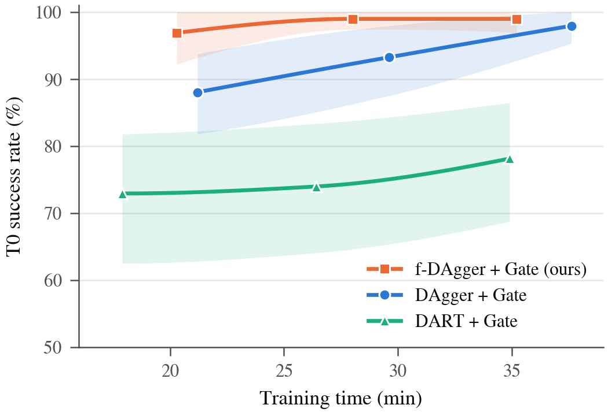

# 07. Training time comparison

This folder holds the evidence for the report's training-time comparison: the figure, the tables, the code that produced them, and the data behind every number.

**Question.** How much training time does each method need to reach a given test success?

## Methods

Names follow [`../06_ablation/`](../06_ablation/README.md): "+ Gate" marks the models with the 22nd input `reach_gate`. Every model in this comparison has it.

| Report name | What it is | Run ids |
|---|---|---|
| **f-DAgger + Gate (ours)** | DART-style noise (fixed, phase-gated OU noise on the expert's actions), then DAgger rounds | round 0 (= OU + Gate, R4): `R4-dart-gate`; rounds 1–3 (R8): `R8-dart-gate-dagger-r1..r3` |
| **DAgger + Gate** | Behaviour cloning on clean data, then DAgger rounds | round 0 (= Baseline + Gate, R2): `R2-gate`; rounds 1–3 (R6): `R6-gate-dagger-r1..r3` |
| **DART + Gate** | Full DART (Laskey et al., 2017): learner-fitted Gaussian noise, re-estimated every iteration, α = 6 | round 0 (= Baseline + Gate, R2): `R2-gate`; iterations 1–3 (R9): `R9-dart-full-a6-r1..r3` |

Every model in this comparison shares:

- the inputs (`features-v1-gate`, 22 features including the reach gate);
- the architecture (MLP01, 256×3);
- the recipe (BC + Jacobian loss, Huber, 42k updates, lr 1e-3, arm/wheel weights 0.5/0.5);
- the clean expert data (221 fitting scenarios);
- three training seeds.

The methods differ only in where the extra training data comes from.

## Main result



`figures/efficiency_T0.pdf` is the IEEE single-column version.

- **Training time** is the wall-clock time of the whole pipeline: data collection, training and validation, including the shared clean collection and round-0 training (9.2 min).
- **Markers** are rounds 1–3 of each method (left to right). **Curves** are monotone (PCHIP) interpolation between measured rounds.
- **Bands** are 95% confidence intervals from a bootstrap over the 64 T0 test scenes, with the three seeds pooled. They do not show spread across seeds.

| Method | Round | Training time (min) | Sequential train→collect cycles | T0 success (%) [95% CI] | All 240 test scenes (%) |
|---|---|---|---|---|---|
| f-DAgger + Gate | 0 | **12.5** | 0 | **96.9** [93.2, 99.5] | **81.2** |
| f-DAgger + Gate | 1 | 20.3 | 1 | 96.9 [92.2, 100] | 69.7 |
| f-DAgger + Gate | 2 | 28.0 | 2 | 99.0 [97.4, 100] | 76.9 |
| f-DAgger + Gate | 3 | 35.2 | 3 | 99.0 [96.9, 100] | 75.3 |
| DAgger + Gate | 1 | 21.2 | 1 | 88.0 [81.8, 93.8] | 48.6 |
| DAgger + Gate | 2 | 29.6 | 2 | 93.2 [87.5, 97.9] | 74.7 |
| DAgger + Gate | 3 | 37.6 | 3 | 97.9 [95.3, 100] | 80.8 |
| DART + Gate | 1 | 17.9 | 1 | 72.9 [62.5, 81.8] | 36.0 |
| DART + Gate | 2 | 26.4 | 2 | 74.0 [64.1, 83.3] | 37.1 |
| DART + Gate | 3 | 34.9 | 3 | 78.1 [68.8, 86.5] | 39.4 |

**Round 0.** DAgger + Gate and DART + Gate start from the same model, Baseline + Gate (R2, clean data only): 9.2 min, T0 20.8%, all scenes 8.3%. f-DAgger + Gate's round 0 is OU + Gate (R4).

**Full tables.** Every test group (T0–T5, distance and height bands, per-seed counts, terminal errors) is in `tables/success_by_round.csv`. Per-step costs are in `tables/cost_by_round.csv`.

What the comparison shows:

1. **f-DAgger + Gate needs no train→collect cycle to reach high T0 success.** Its OU-noise data need no trained student and take 3.3 min to collect.
2. **DAgger + Gate needs about 3× the time to catch up.** It reaches f-DAgger + Gate's round-0 T0 level only after three rounds (37.6 vs 12.5 min).
3. **DART + Gate is the slowest to improve.** Each iteration costs about as much as a DAgger round (about 8.5 min), and it stays below both other methods at every time point.
4. **The other methods' cycles are sequential.** Every DAgger round and every DART iteration must train a student before it can collect; f-DAgger + Gate's OU collection can run alongside the clean collection.

## Supporting analyses (`data/noise/`, `data/analysis/`)

| File | Claim it supports |
|---|---|
| `noise/applied_noise.csv` | DART at α = 6 injects a larger per-step torque than our OU noise (0.88 vs 0.50 N·m RMS). Its impulse over 100–500 ms, which is what moves the arm, is 5–9× smaller (0.009–0.020 vs 0.046–0.178 N·m·s): white noise at 1 kHz is filtered out by the dynamics. |
| `noise/learner_error_structure.csv` | The learner's error (what DART's first iteration estimates) is temporally correlated: arm autocorrelation is 0.26 at 200 ms. It is phase dependent: 0.04 N·m while driving vs 0.91 N·m while reaching and holding. DART's i.i.d. Gaussian represents neither; OU noise with phase gating represents both. Cross-joint correlation (off-diagonal / diagonal energy 1.6–1.9) is what our independent-channel noise omits. |
| `noise/dart_fitted_covariances.csv` | The 9×9 noise covariances DART fitted at each iteration (α = 1 and α = 6). |
| `analysis/data_coverage.csv` | Every f-DAgger + Gate and DART + Gate dataset stops at a 3.1 m base-to-target distance. DAgger + Gate's round-1 data (collected by the poor Baseline + Gate student) contain 3.1 M rows beyond 3 m, up to 798 m. This is why DAgger + Gate generalises to far targets (T1) and f-DAgger + Gate rounds do not. |
| `analysis/t1_failure_geometry.csv` | f-DAgger + Gate and DART + Gate failures on T1 are navigation failures: the end effector stops short or off the start→target line. DAgger + Gate round-1 failures reach the target and fail at the arm. |
| `analysis/far_probe_net.csv` | One-step probe: wheel commands of f-DAgger + Gate models drift from the expert beyond 3 m. Inputs at 10 m are about 15 std outside f-DAgger + Gate's normalisation but 0.4 std inside DAgger + Gate's. |

## Layout

```
07_training_time_comparison/
  README.md
  figures/   efficiency_T0.{pdf,png} (main figure), cost_vs_success.png (three test groups vs time, rounds 0-3)
  tables/    success_by_round.csv, cost_by_round.csv, efficiency_table.{csv,tex}
  data/      rollouts_used.csv       every test rollout used (33 models x 240 scenes)
             test_runs.csv           test runs, models and their sha256, scene-manifest hash
             dart_step_timing.csv    per-step wall time of every DART iteration
             validation/             32-scene validation summaries of every model
             noise/, analysis/       supporting analyses (table above)
  code/      make_comparison.py      merges test runs -> tables/success_by_round.csv, cost_by_round.csv, cost_vs_success.png
             efficiency_plot.py      -> figures/efficiency_T0.*, tables/efficiency_table.*
             test_suite_frozen.py    runs evaluation.test_suite with the frozen unified-test manifest (see below)
             analysis/               noise_impulse.py, learner_error_structure.py, far_coverage.py, far_probe_net.py
```

The pipeline code that trained and collected the models stays at its module paths, because the dataset manifests and checkpoint configs record those paths:

| Code | Role |
|---|---|
| `data_collection/collect_dart.py` | The OU-noise collection (OU and f-DAgger rows), protocol `experiments/configs/dart/d2-s075-x2.yaml` |
| `data_collection/collect_dagger.py` | DAgger collection (learner rolls out, expert labels) |
| `experiments/dagger_rounds.py` | DAgger and f-DAgger rounds (R5–R8), seed 0, plus round-3 seeds; run of 2026-11-01 |
| `experiments/dagger_extra_seeds.py` | Seeds 1–2 of rounds 1–2 on the same datasets; run of 2026-11-03 |
| `data_collection/collect_dart_full.py` | Full-DART collection (learner-fitted i.i.d. Gaussian noise) |
| `experiments/dart_full.py`, `experiments/dart_full_alpha.py` | Full-DART iterations: estimate noise → collect → retrain; run of 2026-11-04 |
| `evaluation/test_suite.py` | Unified 240-scene test (T0–T5) |

## Reproduce

All commands run from `final/robotnik_arm_task/`.

These steps need inputs that are git-ignored (`results/test/`, `data/`, `checkpoints/`, run logs). Those files exist on the reference machine and can be regenerated with the pipeline commands in the results READMEs listed below. Every number in this folder is already in `data/` and `tables/`.

```bash
R=report/07_training_time_comparison
python $R/code/make_comparison.py --tests results/test/2026-11-01_215340__R1-R8 \
    results/test/2026-11-03_231207__dart-low-round-dagger results/test/2026-11-04_134912__dart-full-a6 \
    results/test/2026-11-04_151122__dart-full-a6-r2r3 --out $R/tables --fig-dir $R/figures --data-dir $R/data
python $R/code/efficiency_plot.py --tables $R/tables --fig-dir $R/figures
python $R/code/analysis/noise_impulse.py
python $R/code/analysis/learner_error_structure.py
python $R/code/analysis/far_coverage.py
python $R/code/analysis/far_probe_net.py
```

Training and test runs:

- `results/ablation/2026-11-01__training-ablation-v2/README.md`: DAgger and f-DAgger rounds (R5–R8).
- `results/ablation/2026-11-03__training-ablation-v2/README.md`: extra seeds for rounds 1–2.
- `results/ablation/2026-11-04__dart-full/README.md`: full DART.

## Provenance and caveats

- **Timing.** All times were measured on one machine (RTX 5070 Ti laptop, 24 CPU threads) with 20 collection and evaluation workers. They come from run logs, collection timestamps and `data/dart_step_timing.csv`. The shared 9.2 min is the clean collection (5.3 min) plus one 42k-update training (about 3.9 min). Each training run takes the same 42k updates (about 4 min) whatever the data size, so the methods differ in collection time and in the number of sequential cycles.
- **Test runs.** The four test runs use the same frozen scene manifest (sha256 `0a916445…`). The expert's 240 rollouts are identical in all four runs.
  - The two full-DART runs went through `code/test_suite_frozen.py`. Adding the full-DART datasets changes the manifest's source audit, though not its scenes, so `evaluation/test_suite.py` refuses to reuse the frozen file. The wrapper re-runs the audit, requires identical scenes and zero overlap with the training data, then uses the frozen manifest.
  - T0 had been viewed once during development (the R4 test diagnosis of 2026-10-29). T1–T5 had not.
- **Seeds.** Seed 0 of each round is the model that collected the next round's data. For DAgger + Gate and f-DAgger + Gate, seeds 1–2 of rounds 1–2 were trained on 2026-11-03 on the same datasets with an identical config apart from seed and date. Round 3 and round 0 come from the original runs.
- **DART settings.** α = 6 follows the paper's grasping experiment; it is our only setting with all three iterations and test results. The α = 1 run (the paper's MuJoCo setting) reached 7 / 6 / 12 of 32 on validation over three iterations (seed 0). It was stopped by user decision and not tested; see `data/validation/dart_R9_2026-11-04.csv`.
- **Curves.** Points between measured rounds are interpolated, not measured.
