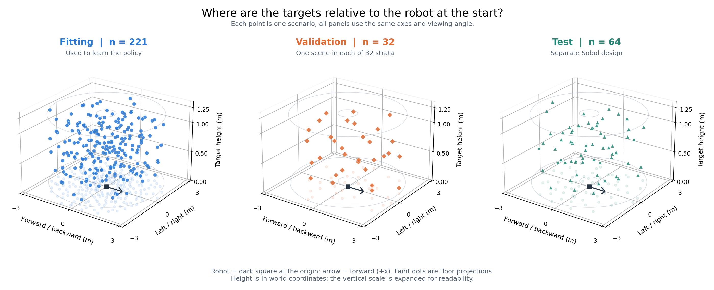
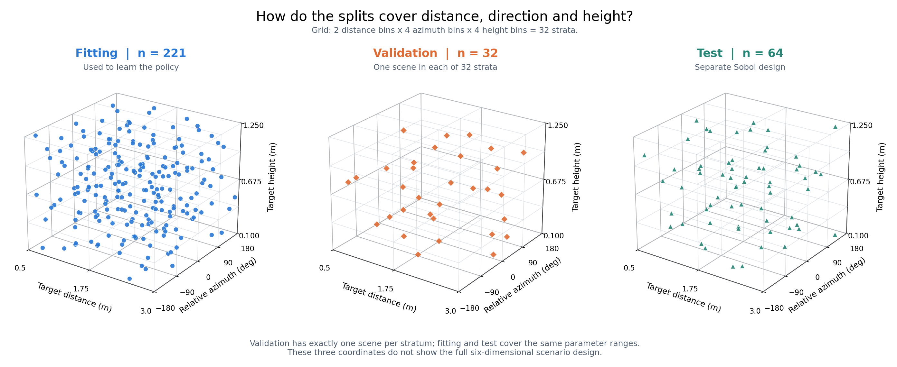
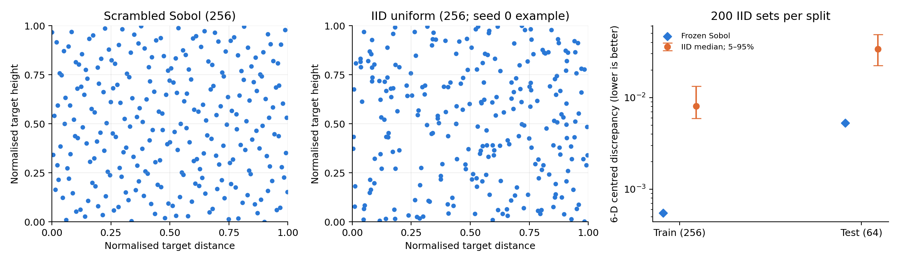

# Data collection: coverage, reproducibility and Sobol sampling

This folder supports the report's data-collection section: how demonstrations were recorded, how the dataset covers different task conditions, why seeds are fixed, and why the scenarios use scrambled Sobol sampling. It follows the other report folders with copied evidence, derived tables, figures and a script that rebuilds them without running the simulator.

**Question.** How can a finite demonstration budget give useful coverage of the task while keeping collection reproducible and method comparisons fair?

## How the dataset was collected

The task is mobile manipulation: a four-wheel base and a seven-joint arm must bring the end effector within **10 mm** of a 3-D target and hold it there. The dataset starts with a frozen list of scenarios, rather than targets selected interactively while collecting.

1. **Generate and freeze scenarios.** Sample six parameters jointly: target distance, relative azimuth, height, starting base x, y and yaw. Save the resulting physical parameters, normalised coordinates, scenario IDs and environment seeds to CSV, with SHA-256 checksums.
2. **Reset the environment.** Set the sampled base pose and target, the fixed home arm/finger pose, and nominal physics. The clean collection adds no action noise, sensor noise, pushes or delays.
3. **Roll out the expert at 1 kHz.** Record the observation before each action, the expert label, the executed action and the next observation. There are **T actions and T+1 observations**, preserving the supervised pair `(observation_t, expert_action_t)`.
4. **Record the hold.** The task's first reach requires error below 10 mm, active reaching and time greater than 8 s. Continue for 3 s after that event, with a 40 s episode cap. The sustained-hold check also requires a complete recording window and every error sample in the final second below 10 mm. A navigation `done` flag alone is not success.
5. **Audit and select.** Check finite values, shapes, timestamps, action alignment, execution limits, outcome flags, label replay and scenario identity. Preserve failed recordings and their exclusion reasons. Do not replace difficult scenes with newly sampled easy ones.

Two teachers were collected on the **same 256 training and 64 test scenarios**: Markovian expert A and course-template controller B. All student methods in this report use **A's labels**; B supplies the original paired comparison. A uses `lead_time = 0.50 s`. Its action depends only on the current observation, so it can also label states visited by a noisy expert or a student. The rationale is in [`markovian_expert/`](../markovian_expert/README.md).

| Teacher | Training episodes | Training sustained holds | Test episodes | Test sustained holds |
|---|---:|---:|---:|---:|
| A: Markovian | 256 | 256 | 64 | 64 |
| B: course template | 256 | 253 | 64 | 64 |

Source: [`tables/collection.csv`](tables/collection.csv), rebuilt from the copied episode inventories. A's training episodes contain **3,078,616 control steps**; these are temporally correlated samples from 256 trajectories, not three million independent task conditions.

**The working set is Clean_253.** The paired set retains the 253 training scenarios where both teachers passed. The three excluded scenarios are `train-0064`, `train-0131` and `train-0183`: B timed out during navigation, while A succeeded. This exclusion keeps the original teacher comparison paired; it is not an A failure or a new Sobol draw. Their raw recordings remain in the source dataset. The later split assigns **221 scenarios to fitting and 32 to validation**, with the separate 64 test scenarios reserved for evaluation.

## Making the dataset sufficiently general

Here, generality means coverage of the **declared task distribution** and the states a learned controller may visit. It does not mean success for every robot configuration or physical environment.

### Cover the task geometry jointly

| Sampled parameter | Range | What it varies |
|---|---|---|
| Horizontal target distance from starting base | 0.5–3.0 m | Short and long navigation before reaching |
| Target azimuth relative to starting heading | −π to π rad | Front, side and rear approaches |
| Target height in the world | 0.1–1.25 m | Different reach geometries and arm loads |
| Starting base x | −0.5 to 0.5 m | Translation of the whole task |
| Starting base y | −0.5 to 0.5 m | Translation in the other floor direction |
| Starting base yaw | −π to π rad | Different world headings for the same relative task |

For sampled distance `d`, relative azimuth `a`, base position `(x0, y0)` and yaw `ψ0`:

```text
target_x = x0 + d · cos(ψ0 + a)
target_y = y0 + d · sin(ψ0 + a)
target_z = sampled height
```

This samples the target relative to the robot's starting pose. Varying the start and target together avoids tying each relative task to one world position or heading. At training time, the base-yaw-frame features also express positions relative to the robot (`core/features.py`), supporting that intended invariance.

Distance is **uniform in radius**, not uniform in floor area: equal-width distance intervals have equal probability, so targets are denser per square metre near the robot. This is the chosen task weighting, not a uniform spatial distribution.



*Each point is one target, shown relative to the robot's starting position and heading: x is forward/backward, y is left/right, and z is target world height. The dark square marks the robot and the arrow its forward direction; faint floor projections help judge horizontal position. Fitting (221), validation (32) and test (64) have separate panels with identical limits and viewpoints. The vertical scale is expanded for readability. The pale rings mark the sampled distance and height bounds.*

The horizontal coordinates are `x = d · cos(relative_azimuth)` and `y = d · sin(relative_azimuth)`. Aligning every scenario to the initial robot pose makes front, rear and side targets directly comparable despite different world starting positions and headings. This physical view shows an annular target volume because distance is limited to 0.5–3.0 m.



*A complementary view keeps the original sampling coordinates: distance, relative azimuth (degrees) and height. The lattice shows the actual 2 × 4 × 4 validation strata; validation has exactly one point in each of the 32 cells. Azimuth −180° and +180° are the same direction at the angular boundary. Both figures show three of the six sampled parameters, rather than complete six-dimensional or trajectory-state coverage.*

### Verify coverage and preserve the split

The original 256-scene training design has exactly **32 points in each of eight equal bins of every sampled variable**, with 64 scenes in each front/left/right/rear sector. The 64-scene test design has 16 per four-bin marginal and per direction sector. These are measurements of the frozen manifests, not guarantees for every possible subset.

The actual fitting/validation split is checked separately. Validation selects one scene from each of **2 distance × 4 height × 4 azimuth bins**, giving 32 scenes. All remaining Clean_253 scenes form the 221-scene fitting set. [`tables/split_cells.csv`](tables/split_cells.csv) recomputes these counts; [`tables/marginals.csv`](tables/marginals.csv) includes the original and filtered sets. Removing three episodes or holding out validation changes the original Sobol balance.

Split by **scenario/episode**, not by randomly distributing adjacent time steps across fitting and validation: neighbouring steps share nearly the same state and trajectory. Every noisy or student-driven variant of a scenario must stay with its source scenario. Validation and test scenes are excluded from augmentation collection, and normalisation uses fitting data only. Independent Sobol engines, disjoint IDs and seeds, explicit parameter-overlap checks and a frozen split work together; changing a seed alone does not establish independence or prevent leakage.

### Cover deviations from the expert's trajectory

Clean trajectories contain navigation, approach and holding, but a learned policy makes errors and reaches states absent from a clean demonstration. Initial-scene coverage alone cannot fix that distribution shift.

| Data source | Executed controller | Supervised label | Coverage purpose |
|---|---|---|---|
| Clean | Expert A | A's clean action at the recorded state | Nominal navigation, reach and hold trajectories |
| Phase-gated OU collection | A plus temporally correlated action noise | A's **clean** action at the actual visited state | Nearby deviations and corrective actions |
| DAgger | Current student, labelled by A | A's action at each student-visited state | Errors and recovery states specific to the learned policy |

The phase-gated OU protocol records **two noise draws for each of the 221 fitting scenarios**: 442 attempts, of which 441 passed the sustained hold and entered the selected OU dataset. DAgger additionally collects on fitting scenes and fresh development scenes; its failed student episodes are retained for corrective labels. These sources broaden visited states rather than changing the six-dimensional clean scenario definition. Detailed schedules and collection evidence are in [`f_dagger/`](../f_dagger/README.md).

**Limits.** The clean design fixes the initial arm pose, robot model, masses, friction and ground conditions. It does not demonstrate robustness to arbitrary arm starts, model mismatch, delays, obstacles or real-world sensing. Sobol samples do not deliberately include exact range endpoints. In the original audit's **16** extreme combinations (near/far × low/high × four directions), four test combinations are empty. A separate boundary or out-of-range suite is needed for such claims; good marginals do not establish full joint coverage. The test suite is discussed in [`ablation/`](../ablation/README.md).

**Evaluation history.** The original 64-scene test set was inspected diagnostically before the DAgger design, as disclosed in the [pipeline report](../../../../docs/2026-10-30__guide__project-pipeline.md). It should not be described as untouched throughout development. The split rules above describe data-use boundaries; a seed does not remove this historical exposure.

## Why use seeds?

A seed fixes a pseudorandom stream so that a particular sampling or noise realisation can be regenerated. It makes errors traceable and allows methods to be compared on matched conditions. The integer's magnitude has no special quality meaning; the recorded algorithm, inputs and stream assignment matter.

| Seed / identity | Actual project value | Role |
|---|---|---|
| Sobol scrambling seed, training | `1026001` | Fixes the 256-point scrambled six-dimensional design |
| Sobol scrambling seed, test | `1026002` | Fixes a separately scrambled 64-point design, not the training prefix |
| Environment seed | train: `1000000 + index`; test: `1100000 + index` | Resets the environment RNG for that scenario; geometry itself is stored explicitly in the CSV |
| Split-selection seed | `20261026` | Chooses the validation member within each predeclared stratum; final IDs are frozen in JSON |
| OU action-noise seed | `default_rng([20261028, scenario_index, draw])` | Reproduces each scene's two noise draws without reusing the same noise trajectory everywhere |
| Training seed | `0`, `1`, `2` | Measures variation across model initialisation and training sampling; separate streams are derived for initialisation, batches and Jacobian sub-batches |

The nominal clean environment has zero added sensor/action noise, so its environment seed does **not** itself create scene diversity or randomise physics. The six sampled parameters provide scene diversity. The OU seed controls a different source of variation. Training seeds repeat learning on the fixed data; they are not extra independently collected clean datasets.

Fixed collection seeds make replay and paired comparisons possible. Multiple training seeds help reveal whether a method's result depends on a lucky initialisation. The same seed still does not promise identical results after changing library versions, solver settings, source code or hardware. Therefore the evidence includes **explicit scenario manifests and their hashes**, teacher parameters, protocol files, and source/version records. The original QA reports found exact label re-query and bitwise re-execution for six episodes per teacher in the recorded environment; this is historical verification, not a new simulation run performed here.

## Why scrambled Sobol sampling?

Each scenario is a point `u ∈ [0, 1)^6`, transformed to physical units by `x_j = lower_j + u_j · (upper_j − lower_j)`. Sobol is a low-discrepancy design: it distributes a finite set through the parameter cube with less uneven occupancy than typical independent uniform draws. This is useful when every additional scenario requires a full simulation rollout. SciPy's [`Sobol` documentation](https://docs.scipy.org/doc/scipy/reference/generated/scipy.stats.qmc.Sobol.html) describes the low-discrepancy construction and its scrambling.

The project generates the original designs with:

```python
qmc.Sobol(d=6, scramble=True, seed=1026001).random_base2(m=8)  # 256 training scenes
qmc.Sobol(d=6, scramble=True, seed=1026002).random_base2(m=6)  # 64 test scenes
```

`random_base2` preserves Sobol's balance at `2^m` points. Scrambling randomises the construction while retaining its structured coverage. Skipping, thinning or using an arbitrary sample count loses the original balance guarantee. These properties are documented by [SciPy](https://docs.scipy.org/doc/scipy/reference/generated/scipy.stats.qmc.Sobol.html). The calls above retain the repository's recorded `seed=` API; the frozen collection used SciPy 1.15.3.

The practical design rationale is that an exhaustive grid grows quickly: even four values for each of six parameters require **4^6 = 4,096 scenarios**. Independent uniform draws permit random clusters and gaps at a 256-scene budget. Sobol supplies a structured alternative at that budget; it does not establish that 256 is a sufficient sample size for every learning objective.



*Left/middle: one two-dimensional projection of the frozen training design and an illustrative IID set. Right: six-dimensional centred discrepancy, with the IID median and 5–95% range over 200 reference sets per split. Lower is better. The error bars describe reference-set variation, not uncertainty in policy success.*

| Original design | Scenarios | Sobol centred discrepancy | IID median (200 sets) | IID / Sobol |
|---|---:|---:|---:|---:|
| Training | 256 | 0.000552 | 0.008038 | 14.57× |
| Test | 64 | 0.005306 | 0.033829 | 6.38× |

These numbers are recomputed from the copied frozen manifests and match the historical coverage audit; see [`tables/sobol_vs_iid.csv`](tables/sobol_vs_iid.csv). They quantify parameter coverage relative to this IID reference. They do **not** measure a success-rate gain from Sobol: the project has no matched policy-training experiment comparing Sobol-collected and IID-collected datasets. The 253-scene filtered set and 221-scene fitting subset are not complete power-of-two Sobol designs; their coverage is reported separately in [`tables/coverage.csv`](tables/coverage.csv).

## Report-ready summary

We collected expert demonstrations from frozen scrambled Sobol designs spanning target distance, relative direction, height and the robot's initial planar pose. The original design contains 256 training and 64 separately scrambled test scenarios. Each rollout records aligned observation–expert-action pairs at 1 kHz, followed by a post-reach hold window and quality checks. The paired Clean_253 set is divided by scenario into 221 fitting and 32 stratified validation scenes. Fixed seeds and checksummed manifests make scene generation, split selection and noise realisations reproducible, while multiple training seeds expose learning variability. Sobol reduces measured six-dimensional discrepancy relative to independent uniform sampling at the same scene budget. OU perturbations and DAgger complement this geometric coverage with corrective labels away from clean expert trajectories. These choices support generalisation within the declared operating range; robustness beyond that range requires separate evaluation.

## Layout and reproduction

```text
data_collection/
  README.md
  code/build_report.py          rebuild and verify the derived evidence
  data/scenarios/              original frozen scene CSVs, manifest and coverage audit
  data/clean/                  both teachers' episode inventories and historical QA reports
  data/clean253_split.json     fixed fitting/validation IDs
  data/ou_protocol.yaml        phase-gated noise collection settings
  data/source_inventory.json  source paths and hashes of the 11 copied evidence files
  tables/                     collection, coverage, marginal, stratum and discrepancy counts
  figures/                    physical 3-D coverage, 3-D strata and Sobol comparison, PNG + PDF
```

From `final/robotnik_arm_task/`, in the project environment:

```bash
python report/data_collection/code/build_report.py
```

The script uses NumPy, SciPy and Matplotlib. It verifies copied evidence hashes, checks fitting/validation separation and stratum occupancy, checks train/test parameter and seed separation, verifies the robot-relative coordinate transform against the stored world coordinates, recomputes the IID discrepancy reference, and regenerates all five tables and three figure pairs. It does not recollect data, train a policy or overwrite the original manifests. Raw `.npz` trajectories remain in the original dataset rather than being duplicated here.

**Source implementation:** [`scenarios.py`](../../data_collection/scenarios.py), [`collect.py`](../../data_collection/collect.py), [`qa_clean.py`](../../data_collection/qa_clean.py), [`scenario_coverage.py`](../../data_collection/scenario_coverage.py), [`build_clean_subsets.py`](../../data_collection/build_clean_subsets.py), [`collect_dart.py`](../../data_collection/collect_dart.py), [`collect_dagger.py`](../../data_collection/collect_dagger.py), [`core/env.py`](../../core/env.py), [`training/common/engine.py`](../../training/common/engine.py).

**Historical evidence:** [clean collection report](../../../../docs/reports/2026-10-26__report__clean-expert-data-collection.md), [paired subset report](../../../../docs/reports/2026-10-26__report__paired-clean-dataset-subsets.md), and the copied [`coverage audit`](data/scenarios/coverage/coverage_report.md). Historical QA results are included as evidence; rebuilding this folder verifies summaries and copied inputs, not the full original simulator QA.
