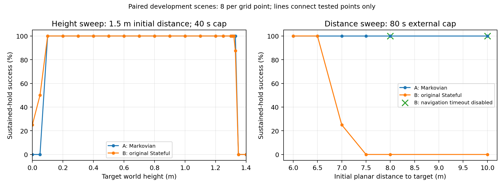
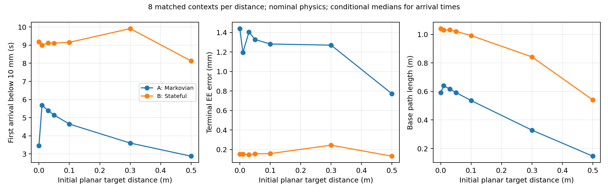

# Markovian expert A vs the course template controller B

This folder holds the evidence for the report's expert section: why the project needs a memoryless (Markovian) expert, how it differs from the controller the course provides, and what that change costs. It contains the figures, the tables, the code that produced them and the data behind every number.

**Question.** Why can't we clone the course's controller directly? What did we change to make it Markovian, and what does the change cost?

## The two controllers

| Name in the report | Code | What it is |
|---|---|---|
| **Template controller (B)** | `robotnik_arm_control.py` and `robotnik_arm_task.py` (course code, unmodified); wrapped as a teacher in `data_collection/template_teacher.py` | The controller provided by the course. It has memory: an integrated joint reference `q_des`, a navigation phase (`align → drive → orient`), a latched `done` flag and a 25 s navigation timeout on absolute time. |
| **Markovian expert (A)** | `data_collection/expert.py`, `MarkovianExpert`, run with `lead_time = 0.50 s` (`settings.yaml`, `clean_collection.markovian_lead_time`; teacher version `markovian-lt0.50-v1`) | Our rewrite of B. Every action is a function of the current observation `(base_pos, base_bearing, q_mes, qd_mes, target)` and nothing else. |

Every dataset (Clean, DART-style noise, DAgger, full DART) is labelled by A. B is used only as a comparison.

## Why we need a Markovian expert

A Markovian expert is a function `a = π_A(o)` of the observation alone. A stateful expert is `a = π_B(o, m)`, where its memory `m = (q_des, phase, done, t)` depends on the whole past trajectory. Our method needs the first form, for four reasons.

### 1. DAgger and DART need labels at states the expert did not produce

DAgger (`data_collection/collect_dagger.py`) rolls out the *student* and asks the expert for the correct action at every state the student visits. DART-style collection (`data_collection/collect_dart.py`) executes a *noisy* action and labels the state that results. Both query the expert at states it did not reach on its own path.

- **A** answers any such query directly: `a = π_A(o)`. Re-querying A on recorded observations reproduced every stored clean label with a maximum difference of **0** (QA of the clean collection, `docs/reports/2026-10-26__report__clean-expert-data-collection.md`). In the hidden-state probe below, A re-queried at the same observation also differs by 0.
- **B** has no answer at a state alone. Its answer also depends on the memory it would have built along some trajectory, and a student-visited state comes with no expert trajectory. Running B alongside the student's rollout only makes the label depend on the student's history.

**Hidden-state probe** (`tables/hidden_state_probe.csv`). B is evaluated at one fixed observation, target, time (t = 10 s), base quaternion and motor angles, and only its memory is changed:

| Memory change (observation identical) | Effect on B's action |
|---|---|
| `q_des` shifted by −0.01 rad vs +0.01 rad on joint 1 | Joint-1 torque −6.29 vs −4.29 N·m: a **2.0 N·m** difference (= kp · 0.02 rad) |
| `done = False` vs `done = True` | Wheels [3.12, 1.34, 1.34, 3.12] vs [0, 0, 0, 0] rad/s. The arm switches from holding the home pose to reaching: joint-6 torque 1.96 vs 27.67 N·m, joint-4 torque 1.46 vs 18.43 N·m |
| A re-queried at the same observation | Maximum difference **0** N·m and **0** rad/s |

A 2 N·m label difference is larger than the constant arm-torque offsets that A itself tolerates (it completes at 1 N·m and holds at 0.5 N·m; see "Capability comparison"). So the ambiguity in B's labels is larger than the precision the task needs.

### 2. The student has no memory, so its target must not have any either

Every student is an MLP of the current features (`core/features.py`, `core/feature_sets.py`): no history, no time and no expert memory as inputs. Cloning `π_B(o, m)` with an `f(o)` network is a partially observed problem. The same input `o` appears with different labels (for example, before and after `done` latches) and the regression averages them. Cloning `π_A(o)` is realisable: a perfect fit reproduces the expert.

Two parts of B's memory are also tied to the world frame or to the clock, which the features remove on purpose:

- **Base goal.** B parks on the line from the *world origin* to the target (`template_base_goal`). A parks on the line from the *current base* to the target. A's action therefore depends only on relative geometry, which is what the base-yaw-frame features encode. Shifting the start 1–3 m left A unaffected (12/12, `docs/reports/2026-10-29__report__teacher-a-operating-envelope.md`).
- **Navigation timeout.** B sets `done` when absolute time passes 25 s, whatever the base is doing. The time is not an input.

### 3. The reach gate becomes a deployable input

A's switch between "hold the home pose" and "reach" is a function of the current distance and heading errors:

```text
reach_gate = 1  if |d| < 0.12 m and |h| < 0.075 rad,  else 0
```

Because it depends only on the observation, it is recomputed **exactly** from the features and added as the 22nd input (`features-v1-gate`, `core/feature_sets.py`). The DART-style noise schedule uses the same rule (`expert.base_command(obs)` in `collect_dart.py`). B's equivalent is `reach_active = done`: a latched flag that can also be set by the timeout, and which no feature can reproduce.

The gate is necessary for our best results. In the v1 training ablation (`results/ablation/2026-10-28__training-ablation-v1/summary.md`, 3 seeds × 32 validation scenes), sustained holds were R1-baseline 1/96, R2-gate 10/96, R3-dart 1/96 and **R4-dart-gate 83/96**.

### 4. The expert keeps correcting where the student goes wrong

A has no latched state, so it keeps producing corrective commands wherever a student drives it:

- **Recovery from student states.** All 13 failed R4 test episodes were handed to A at the 40 s cap, and **13/13** recovered and held (`docs/reports/2026-10-29__report__r4-test-diagnosis.md`). The states DAgger collects are inside A's recovery region, so its labels there are valid corrections.
- **B stops correcting the base.** Once `done` is set, by arrival *or* by the 25 s timeout, B commands zero wheel speed forever. A student that drifted would receive "do nothing" wheel labels. The near-target study shows this happening to B itself: in scene `near-comparison-0.01-3` B's navigation drifted, the timeout fired at 25.0 s with the base 1.19 m from the target, and the final EE error was 1.71 m (`figures/near_failure_navigation.png`).

## What we changed from the template

`robotnik_arm_control.py` is not modified; A reuses its parameter classes (`ArmControllerParams`, `BaseControllerParams`) and its IK and PD law.

| Part | Template controller B | Markovian expert A |
|---|---|---|
| Arm reference | Integrated: `q_des ← q_des + qd_des · dt`, clipped to `q ± 0.15 rad` (an integrator) | Rebuilt every step: `q_des = q + qd_des · lead_time`, with lead_time = 0.50 s |
| Differential IK, PD law, gravity compensation, limits | Damped least squares, `τ = 100 (q_des − q) + 30 (qd_des − qd) + g(q)`, ±30 N·m | Identical |
| Base logic | Phase machine `align → drive → orient → done`, phases move only forwards | Functions of the current distance error `d` and heading error `h`: turn in place while `|h|` is large, drive while `|d| ≥ 0.08 m`, orient, stop |
| Driving direction | Forward only | Forwards **or backwards**: `d` is signed, so a target closer than the standoff makes the base reverse |
| Base goal | Standoff point on the world-origin → target line, fixed per episode | Standoff point on the current-base → target line, recomputed every step |
| When the arm may reach | `done` (latched) | Reach gate `|d| < 0.12 m` and `|h| < 0.075 rad` (1.5 × the stop tolerances), re-evaluated every step |
| Navigation timeout | 25 s on absolute time, then `done = True` | None |
| Dynamics model | URDF as given | Adds the 1 kg that PyBullet assigns to the inertia-less end-effector link. Without it A stopped 34–67 mm short; with it, 2–6 mm (`docs/reports/2026-10-24__report__markovian-expert-model-accuracy.md`) |
| Base orientation for kinematics | Teacher wrapper reads the true roll and pitch from the simulator (privileged) | Yaw from the observation; pitch fixed at the measured flat-ground value 0.0022 rad; roll 0 |

**Why the template could hide model errors and A cannot.** In B, `q_des` keeps moving while the hand is off target, so the offset that accumulates in `q_des` supplies any missing torque (integral action). In A, nothing accumulates: a missing torque can only be supplied by a nonzero hand error, so A stops short. This is why the 1 kg end-effector mass and the base pitch had to be modelled.

**Why lead_time = 0.50 s.** Substituting `q_des = q + qd_des · lead_time` into the PD law gives `τ = (kp · lead_time + kd) · qd_des − kd · qd + g(q)`. The gain on the IK command is 45 at the code default of 0.15 s and 80 at 0.50 s, so the hand error needed to supply a given missing torque is about 45/80 as large (derivation, not a separate measurement). Measured on the same 20 development scenes (`tables/physics_push.csv`):

| Condition | A, lead 0.50 s: held | A, lead 0.15 s: held |
|---|---|---|
| Link masses × 1.25 | 7/20 (median final error 20.6 mm) | 1/20 (33.8 mm) |
| Link masses × 0.75 | 0/20 (27.3 mm) | 0/20 (47.5 mm) |
| Friction × 0.5, masses × 1.25, sensor noise × 2 | 7/20 (18.5 mm) | 1/20 (33.9 mm) |

Every result in the report uses 0.50 s. Numbers measured with 0.15 s describe a different teacher.

## Capability comparison: what the change costs and gains

All results are from development scenes with seeds disjoint from the training, validation and test scenes. Each count is out of the scenes stated.



| Aspect | Markovian A | Template B | Source table |
|---|---|---|---|
| Clean collection, 256 train + 64 test scenarios | **320/320** sustained holds | 253/256 train, 64/64 test (3 navigation timeouts) | clean-collection report |
| Far targets, 80 s cap (7 / 7.5 / 8 / 10 m) | **8/8 at every distance** | 2/8, 0/8, 0/8, 0/8; with the timeout disabled, 8/8 at 8 and 10 m | `geometry.csv` |
| Target height (1.5 m away) | 8/8 from 0.1 to 1.33 m; 0/8 at 0 and 0.05 m | 8/8 from 0.1 to 1.32 m, 7/8 at 1.33 m; **2/8 at 0 m, 4/8 at 0.05 m** | `geometry.csv` |
| Near targets, 0–0.5 m (56 runs each) | 56/56; first arrival 2.9–5.7 s; base path 0.15–0.64 m; reverses in 51/56 runs | 55/56; first arrival 8.1–9.9 s; base path 0.54–1.04 m; never reverses | `near_comparison.csv` |
| Terminal error, near study (median) | 0.77–1.44 mm | **0.13–0.25 mm** | `near_comparison.csv` |
| Constant arm-torque offset (largest σ with ≥ 15/16) | completes 1 N·m, holds 0.5 N·m | **completes 4 N·m, holds 2 N·m** | `disturbance_thresholds.csv` |
| Wheel OU noise, τ = 0.2 s, no gating | **completes 1 rad/s** | completes 0.3 rad/s | `disturbance_thresholds.csv` |
| Link masses × 0.75 / × 1.25 (20 scenes) | 0/20 / 7/20 held | **20/20 / 20/20** | `physics_push.csv` |
| Base push while driving (24 N·s) | **11/20** held | 1/20 | `physics_push.csv` |
| Base push 1 s after reaching (24 N·s) | **16/20** held | 7/20 (median final error 149 mm) | `physics_push.csv` |
| Friction × 0.5 / × 1.5, sensor noise up to × 100, hand push | 20/20 each | 20/20 each | `physics_push.csv` |



**Reading the trade-off.** Each controller's memory is both its strength and its weakness:

- **What A loses: integral action.** Constant torque errors and mass mismatch leave A short of the 10 mm tolerance. It also fails below 0.1 m, where B, which keeps integrating, still holds some scenes. B's terminal error is about 5–10× smaller.
- **What A gains: continuous base feedback.** With no timeout and no latch, A finishes far targets, reverses to reach near ones 2–3× sooner, re-navigates after base pushes and tolerates about 3× more wheel noise.
- **Why the losses do not hurt this project.** Training data use nominal physics. The training ranges (height 0.1–1.25 m, distance 0.5–3.0 m) lie inside A's feasible region. A's 0.8–1.4 mm terminal error is far inside the 10 mm tolerance. A also holds the DART-style noise used for training: 441/442 noisy episodes were held. What B offers that A lacks cannot be used anyway, because B cannot label the states that DAgger and DART need (reason 1).

## Layout

```
markovian_expert/
  README.md
  figures/   expert_operating_boundaries.png   height and far-distance sweeps, A vs B (and B without its timeout)
             near_comparison.png               near targets: first arrival, terminal error, base path
             near_failure_navigation.png       B's 1 cm failure: navigation drift, then timeout
  tables/    hidden_state_probe.csv, geometry.csv, near_comparison.csv,
             disturbance_thresholds.csv, physics_push.csv          (all from code/make_tables.py)
  data/      geometry/      workspace_{A,B}_2026-10-29.csv (232 rollouts each), supplement_rollouts_2026-11-03.jsonl
                            (112 rollouts), combined_summary.csv, run_manifest_2026-11-03.json
             near/          rollouts.csv (112 rollouts, 50 ms traces dropped), summary.csv, run_manifest.json
             disturbance/   expert_noise_robustness.csv (2,112 episodes: 66 conditions x 2 teachers x 16 scenes)
             physics/       expert_t3_dev_A_lead050.csv (A, 270 episodes),
                            expert_t3_dev_lead015_and_template.csv (A at 0.15 s and B, same 270 scenes each)
             hidden_state/  controlled_intervention.json
  code/      make_tables.py                    data/ -> tables/
             compare_expert_boundaries.py, build_expert_comparison_report.py   2026-11-03 boundary supplement (copies)
             compare_experts_near.py, build_experts_near_report.py             2026-11-03 near study (copies)
```

The pipeline code stays at its module paths:

| Code | Role |
|---|---|
| `data_collection/expert.py` | Markovian expert A |
| `data_collection/template_teacher.py` | Template controller B as a teacher (records its memory before and after each step) |
| `robotnik_arm_control.py`, `robotnik_arm_task.py` | Course template, unmodified |
| `markovian_expert_demo.py` | GUI demo of A, laid out like `robotnik_arm_task.py` |
| `evaluation/expert_workspace.py` | Height, near and far sweeps (`--teacher B` for B) |
| `evaluation/expert_noise_robustness.py` | Arm and wheel noise sweep for both teachers |
| `evaluation/expert_t3_dev.py` | Changed physics and pushes (`--controllers`, `--lead-time`) |

## Reproduce

All commands run from `final/robotnik_arm_task/`. Every number in this folder is already in `data/` and `tables/`.

```bash
python report/markovian_expert/code/make_tables.py        # tables/ from data/ (no simulation)
```

Regenerating `data/` (simulation; outputs go to the original results paths, which are git-ignored):

```bash
python -m evaluation.expert_workspace                     # -> results/diagnostics/2026-10-29__expert-workspace/
python -m evaluation.expert_workspace --teacher B         # -> results/diagnostics/2026-10-29__expert-workspace-B/
python -m evaluation.expert_noise_robustness --n 16 --workers 22 --out results/expert_noise_robustness_rerun.csv
python -m evaluation.expert_t3_dev --controllers expert --lead-time 0.5 --out results/expert_t3_dev_lead050.csv
python -m evaluation.expert_t3_dev --controllers expert template --out results/expert_t3_dev_rerun.csv   # lead 0.15 s and B
python report/markovian_expert/code/compare_expert_boundaries.py
python report/markovian_expert/code/compare_experts_near.py
```

## Provenance and caveats

- **Not a single-factor ablation.** A and B differ in more than memory: base goal, reverse driving, timeout, the 1 kg end-effector body, and privileged roll/pitch for B. The comparison is between the two real controllers. It does not attribute each difference to memory alone.
- **"B without its timeout" is a counterfactual.** It is a modified B, used only to show that B's far-target failures come from the 25 s timeout. It is not counted as B's capability.
- **Hidden-state probe.** Only its output (`data/hidden_state/controlled_intervention.json`, 2026-11-03) was kept; the script that produced it was not saved. The probe tests whether B's action depends on its memory at one state. It does not measure how often such aliasing occurs along natural trajectories.
- **Disturbance data.** `expert_noise_robustness.csv` was copied from `Archive/final/robotnik_arm_task/results/tables/2026-10-26/` (sha256 `9dcc66ec…`, the hash recorded in `docs/reports/2026-10-26__report__expert-operating-limits.md`). `make_tables.py` reproduces every threshold in that report. In gated conditions A's gate is its instantaneous reach gate and B's is its latched `done`, so the two are not the same gate.
- **Physics data.** The B and A-0.15 s rows come from the 2026-10-25 run and the A-0.50 s rows from the 2026-10-29 run. The script checks that all three cover the same 270 scenes. That script's success predicate (final error < 10 mm at the episode end) differs from the evaluator's sustained hold.
- **Sample sizes.** 8–20 scenes per condition: 8/8 has a Wilson 95% lower bound of 0.68, and 15/16 has 0.72. Grid points are tested values, not continuous boundaries. Disturbances were tested one at a time, apart from one combined physics condition.
- **No test data.** Every scene here uses development seeds. No test scene was used to design or tune either controller.
- **Code copies.** The four 2026-11-03 scripts in `code/` are copies; the originals remain in `results/diagnostics/2026-11-03__expert-a-b-{boundaries,near}/`. They still write to those original directories.
- **Broken default paths.** `results/expert_noise_robustness.csv` and `results/expert_t3_dev.csv` are symlinks into `results/tables/`, which was archived, so they dangle. The reproduce commands above therefore pass `--out` explicitly.
